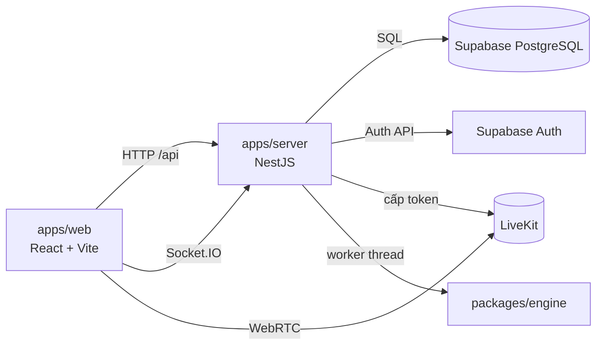

# XIANGQI · Cờ Tướng Online

Ứng dụng web chơi cờ tướng thời gian thực bằng tiếng Việt: đấu với bạn bè, ghép trận ngẫu nhiên, đánh hạng có Elo, luyện tập với máy, có người xem, chat và camera/mic tùy chọn. Giao diện theo phong cách **Kỳ Đài Cổ Phong**.

Dự án là đồ án môn **Quản trị Dự án Công nghệ Thông tin**, được quản lý trên [Jira XIAN](https://xiangqi-web.atlassian.net/jira/software/c/projects/XIAN/boards/38).

> **Trạng thái:** đang phát triển. Phạm vi và tiêu chí nghiệm thu nằm ở [BACKLOG-P1.md](docs/product/BACKLOG-P1.md); quyết định nghiệp vụ nằm ở [BA-SCOPE-DECISIONS.md](docs/product/BA-SCOPE-DECISIONS.md).

## Mục lục

- [Tính năng](#tính-năng)
- [Kiến trúc](#kiến-trúc)
- [Yêu cầu](#yêu-cầu)
- [Bắt đầu nhanh](#bắt-đầu-nhanh)
- [Cấu hình](#cấu-hình)
- [Lệnh thường dùng](#lệnh-thường-dùng)
- [Kiểm thử và CI](#kiểm-thử-và-ci)
- [Cấu trúc thư mục](#cấu-trúc-thư-mục)
- [Tài liệu](#tài-liệu)
- [Đóng góp](#đóng-góp)
- [Bảo mật](#bảo-mật)
- [Giấy phép](#giấy-phép)

## Tính năng

| Nhóm | Mô tả |
|---|---|
| Tài khoản | Đăng ký bằng OTP email, đăng nhập username/email/Google, khôi phục mật khẩu, chế độ Khách |
| Phòng đấu | Tạo phòng, mời bằng mã/link hoặc lời mời bạn bè; 2 người chơi và tối đa 5 người xem |
| Ván đấu | Máy chủ phân xử nước đi và luật kết thúc, đồng hồ, xin hòa, đầu hàng, đi lại, xử lý mất kết nối |
| Ghép trận | Đánh Thường ghép ngẫu nhiên; Đánh Hạng có Elo, bảng xếp hạng và giới hạn cặp đấu |
| Đấu với máy | Ba cấp Dễ / Trung bình / Khó, chọn phe, đi lại |
| Giao lưu | Chat kênh người chơi và kênh chung, sticker, bạn bè, tin nhắn trực tiếp; camera/mic qua LiveKit |
| Lịch sử | Lịch sử ván cá nhân, xem lại ván, xuất FEN/PGN |

## Kiến trúc



- **Máy chủ là nguồn sự thật:** mọi nước đi, đồng hồ và kết quả được kiểm bằng `packages/xiangqi-core`, luật này dùng chung cho cả web và server.
- **Realtime:** Socket.IO đồng bộ phòng, ván và chat. Ghi trạng thái phòng/ván là transaction Postgres có khóa theo thứ tự; tác dụng phụ đi qua bảng outbox sau khi commit.
- **Media tách khỏi ván cờ:** lỗi camera/mic không làm gián đoạn ván đấu.
- **Một runtime cho mỗi database:** server giữ khóa singleton trên Postgres, nên chỉ một instance xử lý phòng/ván tại một thời điểm.

Chi tiết: [kiến trúc server](docs/engineering/server/architecture.md), [realtime](docs/engineering/server/realtime.md), [giao diện web](docs/engineering/web/ui.md).

| Thành phần | Công nghệ |
|---|---|
| Ngôn ngữ, workspace | TypeScript, Node.js 22, pnpm 10 |
| Web | React, Vite, SVG |
| Server | NestJS, Socket.IO, `pg`, chạy bằng `tsx` |
| Dữ liệu, xác thực | Supabase PostgreSQL, Supabase Auth, Google OAuth, SMTP |
| Media | LiveKit (Docker khi chạy local, LiveKit Cloud khi demo Internet) |
| Máy cờ | Negamax, alpha-beta, tìm sâu dần, chạy trong worker thread |
| Kiểm thử | Vitest, PostgreSQL 17 cô lập |

## Yêu cầu

- Node.js **22** (≥ 22.13, < 23), theo `.node-version`
- pnpm **10.34.6**, theo `packageManager` (có thể bật qua `corepack enable`)
- Một project Supabase (PostgreSQL + Auth) cho các tính năng cần database
- Tùy chọn: Docker để chạy LiveKit local, PostgreSQL 17 để chạy test database

## Bắt đầu nhanh

```sh
git clone https://github.com/twotnguyen/XIANGQI.git
cd XIANGQI

umask 077
cp .env.example .env            # điền giá trị theo mục Cấu hình
cp .env apps/web/.env
cp .env apps/server/.env

pnpm install --frozen-lockfile
pnpm dev
```

| Dịch vụ | Địa chỉ |
|---|---|
| Web | <http://localhost:5173> |
| Server | <http://localhost:3000> |
| Kiểm tra sống | `GET /health` |
| Kiểm tra sẵn sàng | `GET /ready` |

Khi chạy dev, các route `/dev/*` hiển thị thư viện thành phần và giao diện mẫu để kiểm tra nhanh.

## Cấu hình

Biến môi trường được mô tả trong [`.env.example`](.env.example). Hướng dẫn tạo và kiểm chứng từng dịch vụ (Supabase, Google OAuth, SMTP, LiveKit) nằm ở [CAU-HINH-MOI-TRUONG.md](docs/setup/CAU-HINH-MOI-TRUONG.md).

- Server đọc `apps/server/.env`; web đọc `apps/web/.env` và chỉ công khai biến có tiền tố `VITE_`.
- Các tính năng bật/tắt bằng cờ `*_ENABLED` (ví dụ `AUTH_REGISTRATION_ENABLED`, `ROOMS_ENABLED`). Chỉ bật sau khi migration và dịch vụ liên quan đã sẵn sàng.
- `DIRECT_URL` phải là kết nối trực tiếp hoặc session pooler, **không** dùng transaction pooler (cổng 6543).
- Migration và rollback nằm trong `supabase/`, xem [supabase/README.md](supabase/README.md).
- LiveKit local: [infra/livekit/README.md](infra/livekit/README.md).
- Triển khai server mẫu: [`render.yaml`](render.yaml).

## Lệnh thường dùng

| Lệnh | Mô tả |
|---|---|
| `pnpm dev` | Chạy web và server ở chế độ phát triển |
| `pnpm lint` | ESLint toàn repo |
| `pnpm format:check` | Kiểm tra định dạng Prettier |
| `pnpm typecheck` | Kiểm tra kiểu mọi package |
| `pnpm build` | Build web và kiểm tra build server |
| `pnpm test` | Chạy toàn bộ test Vitest |
| `pnpm test:unit` | Test web và package, không cần database |
| `pnpm test:db:<miền>` | Test cần database (`account`, `room`, `match`, `realtime`, `chat-media`, `ai`) |
| `pnpm --filter @xiangqi/server start` | Chạy server ở chế độ production |

## Kiểm thử và CI

- Toàn bộ test nằm trong `tests/`, chia theo cấu trúc `apps/` và `packages/`.
- Test database dùng cụm PostgreSQL 17 cô lập do `tests/server/db.sh` dựng. **Không** trỏ các biến `*_TEST_DATABASE_URL` vào Supabase thật, vì fixture sẽ xóa schema.
- GitHub Actions ([`ci.yml`](.github/workflows/ci.yml)):
  - Push hoặc PR vào `develop`: lint, typecheck, build và unit/core khi mã thay đổi.
  - PR `develop` → `main`: chạy đầy đủ, gồm các shard database.

Chi tiết: [tests/README.md](tests/README.md).

## Cấu trúc thư mục

```text
XIANGQI/
├─ apps/
│  ├─ web/          React + Vite: app/ (router, layout), features/ (theo tính năng), shared/ (UI, bàn cờ, điều hướng)
│  └─ server/       NestJS + Socket.IO: account/ (tài khoản), game/ (phòng, ván, chat, AI, media, xếp hạng), core/
├─ packages/
│  ├─ shared/       Hợp đồng dữ liệu, bộ lọc và kiểm tra dùng chung web/server
│  ├─ xiangqi-core/ Luật cờ tướng
│  └─ engine/       Máy cờ
├─ supabase/        Migration, rollback, kiểm thử SQL, mẫu email
├─ tests/           Test, helper và fixture
├─ infra/livekit/   Cấu hình LiveKit local
├─ docs/            Tài liệu sản phẩm, thiết kế, kỹ thuật, kế hoạch, cài đặt
└─ .github/         CI và CODEOWNERS
```

**Quy ước phân tầng:**

- **Server:** Controller → Service → Store; SQL chỉ nằm trong `*.store.ts`.
- **Web:** `features/*` chỉ import `shared/*`; `shared/*` không import `features/*` hay `app/*`.

## Tài liệu

| Nội dung | Tài liệu |
|---|---|
| Ý tưởng và người dùng mục tiêu | [IDEA.md](docs/product/IDEA.md) |
| Tổng quan yêu cầu | [TONG-QUAN-YEU-CAU.md](docs/product/TONG-QUAN-YEU-CAU.md) |
| Quyết định nghiệp vụ và phạm vi | [BA-SCOPE-DECISIONS.md](docs/product/BA-SCOPE-DECISIONS.md) |
| User Story và tiêu chí nghiệm thu | [BACKLOG-P1.md](docs/product/BACKLOG-P1.md), [BACKLOG-P2.md](docs/product/BACKLOG-P2.md) |
| Thiết kế và danh mục màn hình | [DESIGN.md](docs/design/DESIGN.md), [DANH-MUC-MAN-HINH-XIANGQI.md](docs/design/DANH-MUC-MAN-HINH-XIANGQI.md), [mockup](docs/design/mockups/index.html) |
| Ghi chú kỹ thuật | [docs/engineering/](docs/engineering/) |
| Kế hoạch và Jira | [KE-HOACH-JIRA.md](docs/planning/KE-HOACH-JIRA.md), [docs/planning/jira/](docs/planning/jira/README.md) |
| Cấu hình môi trường | [CAU-HINH-MOI-TRUONG.md](docs/setup/CAU-HINH-MOI-TRUONG.md) |
| Hướng dẫn cho coding agent | [AGENTS.md](AGENTS.md) |

## Đóng góp

1. Chọn Task trên Jira; đọc Story và tiêu chí nghiệm thu liên quan.
2. Làm trên `develop` (nhánh mặc định và tích hợp), hoặc nhánh riêng `<type>/XIAN-<số>-<mô-tả>`.
3. Đặt commit theo dạng `<type>(<scope>): XIAN-<số> <mô tả>`, với type là một trong `feat`, `fix`, `docs`, `refactor`, `perf`, `ci`, `chore`, `test`.
4. `main` là nhánh phát hành có branch protection và chỉ nhận PR từ `develop` khi các check bắt buộc đều đạt.

Quy ước đầy đủ: [AGENTS.md › Git và pull request](AGENTS.md#git-và-pull-request).

## Bảo mật

- Không commit `.env`, `.local/` hay bất kỳ khóa, mật khẩu, token nào; chỉ commit file mẫu trống.
- Biến `VITE_*` và `NEXT_PUBLIC_*` sẽ lộ ra trình duyệt. Khóa đặc quyền của Supabase, LiveKit và SMTP chỉ dùng phía server.
- Log vận hành là JSON có danh sách sự kiện cố định, không ghi mật khẩu, OTP, token hay nội dung chat.

Nếu phát hiện lỗ hổng, hãy báo riêng cho nhóm dự án, không mở issue công khai.

## Giấy phép

Dự án chưa chọn giấy phép phân phối. Thư viện, font và tài nguyên bên thứ ba giữ nguyên giấy phép gốc của chúng.
