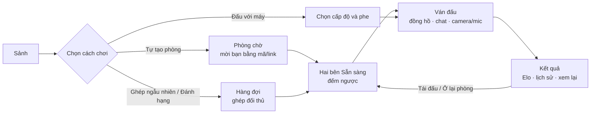
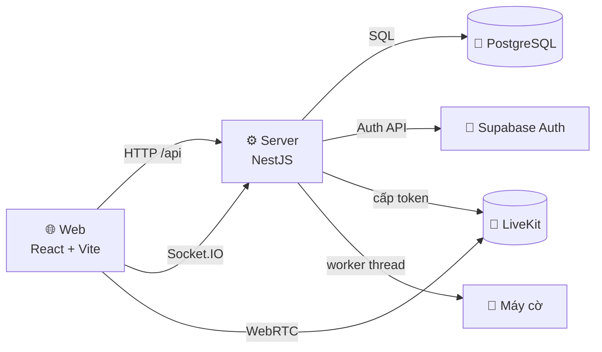

<div align="center">
  

  # Cờ Tướng Online · XIANGQI

  **Chơi cờ tướng trực tuyến cùng bạn bè, người lạ hoặc máy, ngay trên trình duyệt.**

  [](https://github.com/twotnguyen/XIANGQI/actions/workflows/ci.yml)
  
  
  
  
  
  
  

  [Giới thiệu](#-giới-thiệu) · [Tính năng](#-tính-năng) · [Luật chơi](#-luật-chơi) · [Bắt đầu nhanh](#-bắt-đầu-nhanh) · [Kiến trúc](#️-kiến-trúc) · [Đóng góp](#-đóng-góp)

  
</div>

---

## 🏮 Giới thiệu

**Cờ Tướng Online** đưa bàn cờ tướng quen thuộc lên trình duyệt cho người chơi Việt Nam. Bạn bè ở xa có thể vào chung một phòng, vừa đánh cờ vừa trò chuyện, bật camera như ngồi đối diện nhau. Người khác có thể vào xem; người chơi một mình có thể luyện với máy hoặc ghép trận với người lạ. Không cần cài đặt; Khách chỉ cần nhập tên là vào chơi được ngay.

Giao diện tiếng Việt hoàn toàn, theo phong cách **Kỳ Đài Cổ Phong**: tông gỗ và vàng đồng, quân cờ khắc chữ Hán, thư pháp 楚河 · 漢界 giữa bàn.

Dự án là đồ án môn *Quản trị Dự án Công nghệ Thông tin* (HUTECH, 2026), được quản lý trên [Jira](https://xiangqi-web.atlassian.net/jira/software/c/projects/XIAN/boards/38).

> [!NOTE]
> Dự án đang phát triển. Phạm vi và tiêu chí nghiệm thu nằm ở [BACKLOG-P1.md](docs/product/BACKLOG-P1.md).

## ✨ Tính năng

| | Tính năng | Mô tả |
|:--:|---|---|
| 🔐 | **Tài khoản** | Đăng ký với OTP email, đăng nhập bằng username/email/Google, khôi phục mật khẩu, chế độ Khách |
| 🏠 | **Phòng đấu** | Mời bằng mã 8 số, link hoặc lời mời bạn bè; 2 người chơi và tối đa 5 người xem |
| ♟️ | **Ván thời gian thực** | Máy chủ phân xử nước đi; có đồng hồ, xin hòa, đầu hàng, xin đi lại, xử lý mất kết nối |
| 🎲 | **Ghép trận và xếp hạng** | Ghép ngẫu nhiên; Đánh Hạng có Elo và bảng xếp hạng |
| 🤖 | **Đấu với máy** | 3 cấp Dễ / Trung bình / Khó, chọn phe, đi lại |
| 💬 | **Giao lưu** | Chat 2 kênh, sticker, bạn bè, tin nhắn trực tiếp; camera/mic qua LiveKit |
| 📜 | **Lịch sử** | Lịch sử ván, xem lại từng nước, xuất FEN/PGN |

<table>
  <tr>
    <td width="50%"></td>
    <td width="50%"></td>
  </tr>
  <tr>
    <td align="center"><b>Bốn cách bắt đầu một ván</b></td>
    <td align="center"><b>Đăng ký ba bước với OTP email</b></td>
  </tr>
</table>

<p align="center">
  <br />
  <b>Bàn cờ SVG, quân chữ Hán, đổi được góc nhìn</b><br />
  <sub>Ảnh chụp từ các trang xem trước giao diện, dùng dữ liệu minh họa.</sub>
</p>

## 🎮 Một ván cờ diễn ra thế nào



1. **Vào Sảnh.** Đăng nhập bằng tài khoản hoặc vào nhanh dưới tên Khách. Sảnh có bốn lựa chọn, danh sách phòng công khai và ô nhập mã phòng.
2. **Chọn cách chơi.** Tự tạo phòng (5/10/15 phút hoặc không giới hạn, công khai hay khóa), ghép ngẫu nhiên, đánh hạng hoặc đấu với máy.
3. **Phòng chờ.** Chủ phòng mời bạn bằng mã, link hoặc lời mời trong danh sách bạn bè. Người xem có thể xin ngồi khi ghế trống.
4. **Ván đấu.** Bấm hoặc kéo thả quân; ô hợp lệ được gợi ý; nước đi hiện ngay trên máy mình trong khi máy chủ xác nhận. Chat có kênh riêng cho hai người chơi và kênh chung với người xem.
5. **Kết thúc.** Máy chủ tự phát hiện chiếu hết, hết nước, lặp thế hay hết giờ. Ván Đánh Hạng cập nhật Elo; mọi ván được lưu để xem lại hoặc xuất FEN/PGN. Hai người có thể tái đấu và chọn lại phe.

## 📏 Luật chơi

Dùng luật di chuyển chuẩn của cờ tướng và một bộ luật kết thúc rút gọn. Bộ luật này cũng được giải thích trong mục Luật chơi ở Sảnh.

| Tình huống | Kết quả |
|---|---|
| Chiếu hết | Bên bị chiếu hết thua |
| Hết nước đi hợp lệ (không bị chiếu) | Bên hết nước **thua**, không xử hòa |
| Một thế cờ lặp lại lần thứ 3 | Hòa; nếu một bên chiếu ở **mọi** nước của mình trong chu kỳ lặp thì bên đó thua (chiếu liên tục) |
| 120 nửa nước liên tiếp không ăn quân | Hòa |
| Hết giờ | Thua |
| Một bên mất kết nối quá 60 giây | Bên đó thua; quay lại kịp thì ván tiếp tục. Cả hai cùng mất kết nối thì hòa |
| Đuổi quân liên tục | Không xử riêng, áp luật lặp thế |

| Chế độ | Thời gian | Đặc điểm |
|---|---|---|
| Tự tạo phòng | 5 / 10 / 15 phút hoặc không giới hạn | Chủ phòng cấu hình; có người xem |
| Ghép ngẫu nhiên (Đánh Thường) | 15 phút | Khách cũng tham gia được |
| Đánh Hạng | 10 phút | Chỉ thành viên; Elo khởi điểm 1200; lên bảng xếp hạng sau 5 ván; tối đa 3 ván với cùng một đối thủ trong 24 giờ |
| Đấu với máy | Không đồng hồ | Dễ / Trung bình / Khó; tối đa 3 lần đi lại mỗi ván |

## 🚀 Bắt đầu nhanh

### Yêu cầu

- Node.js **22** (≥ 22.13) và pnpm **10**, theo `.node-version` và `packageManager` (`corepack enable` để dùng đúng phiên bản)
- Một project **Supabase** (PostgreSQL + Auth) cho các tính năng cần database
- Tùy chọn: `psql` để dựng database, Docker để chạy LiveKit local

### Cài đặt

```sh
git clone https://github.com/twotnguyen/XIANGQI.git
cd XIANGQI
pnpm install --frozen-lockfile

cp .env.example .env            # điền theo docs/setup/CAU-HINH-MOI-TRUONG.md
cp .env apps/web/.env
cp .env apps/server/.env
```

### Dựng database

Trên project Supabase mới, tạo role ứng dụng một lần trong SQL Editor, rồi dựng toàn bộ schema (baseline và mọi migration):

```sql
CREATE ROLE app_server NOLOGIN NOBYPASSRLS;
```

```sh
REBUILD_DATABASE_URL='<chuỗi kết nối direct hoặc session pooler 5432>' pnpm db:rebuild
# Không dùng Supabase: PostgreSQL thường kèm Auth giả lập
REBUILD_DATABASE_URL='postgresql://localhost:5432/xiangqi_local' pnpm db:rebuild --local-auth
```

Script chỉ chạy trên database trống và không xóa dữ liệu. Chi tiết: [supabase/README.md](supabase/README.md#dựng-lại-database-trống-pnpm-dbrebuild).

### Chạy

```sh
pnpm dev            # web http://localhost:5173 · server http://localhost:3000
```

Không cần backend vẫn xem được giao diện qua `/dev/lobby`, `/dev/board`, `/dev/register`. Các tính năng bật/tắt bằng cờ `*_ENABLED` trong `.env`.

| Lệnh | Mô tả |
|---|---|
| `pnpm dev` | Chạy web và server ở chế độ phát triển |
| `pnpm lint` · `pnpm typecheck` | Kiểm tra mã và kiểu |
| `pnpm test:unit` | Test web và package, không cần database |
| `pnpm test:db:<miền>` | Test server trên PostgreSQL 17 cô lập |
| `pnpm db:rebuild` | Dựng schema trên database trống |
| `pnpm build` | Build web và kiểm tra build server |

## 🏗️ Kiến trúc



- **Máy chủ phân xử nước đi.** Luật cờ nằm trong package [`xiangqi-core`](packages/xiangqi-core/src), dùng chung cho web (gợi ý nước) và server (phân xử).
- **Realtime qua Socket.IO.** Trạng thái phòng/ván được ghi trong transaction PostgreSQL; sự kiện chỉ phát cho client sau khi commit.
- **Máy cờ** dùng negamax, alpha-beta và tìm sâu dần, chạy trong worker thread riêng ([`packages/engine`](packages/engine/src)).
- **Camera/mic** qua LiveKit: server chỉ cấp quyền; lỗi media không làm gián đoạn ván.

Chi tiết: [kiến trúc server](docs/engineering/server/architecture.md) · [realtime](docs/engineering/server/realtime.md) · [giao diện web](docs/engineering/web/ui.md)

<details>
<summary><b>🧰 Công nghệ</b></summary>

| Thành phần | Công nghệ |
|---|---|
| Ngôn ngữ, workspace | TypeScript, Node.js 22, pnpm (monorepo) |
| Web | React, Vite, SVG |
| Server | NestJS, Socket.IO, `pg`, chạy bằng `tsx` |
| Dữ liệu, xác thực | Supabase PostgreSQL, Supabase Auth, Google OAuth, SMTP |
| Media | LiveKit |
| Kiểm thử, CI | Vitest, PostgreSQL 17 cô lập, GitHub Actions |

</details>

<details>
<summary><b>📁 Cấu trúc thư mục</b></summary>

```text
XIANGQI/
├─ apps/
│  ├─ web/          React + Vite: app/ (router, layout), features/ (theo tính năng), shared/ (UI, bàn cờ)
│  └─ server/       NestJS: account/ (tài khoản), game/ (phòng, ván, chat, AI, media, xếp hạng), core/
├─ packages/
│  ├─ shared/       Hợp đồng dữ liệu và kiểm tra dùng chung web/server
│  ├─ xiangqi-core/ Luật cờ tướng
│  └─ engine/       Máy cờ
├─ supabase/        Migration, rollback, script dựng database
├─ tests/           Test, helper và fixture
├─ infra/livekit/   Cấu hình LiveKit local
└─ docs/            Tài liệu sản phẩm, thiết kế, kỹ thuật, kế hoạch
```

</details>

## 🧪 Kiểm thử

Test viết bằng Vitest và nằm trong `tests/`. Test server chạy trên các cụm PostgreSQL 17 cô lập do `tests/server/db.sh` dựng.

- Push hoặc PR vào `develop`: CI chạy lint, typecheck, build và unit.
- PR `develop` → `main`: CI chạy thêm các shard database.

Xem [tests/README.md](tests/README.md).

## 📚 Tài liệu

| Loại | Tài liệu |
|---|---|
| Yêu cầu và phạm vi | [Tổng quan yêu cầu](docs/product/TONG-QUAN-YEU-CAU.md) · [Quyết định nghiệp vụ](docs/product/BA-SCOPE-DECISIONS.md) · [Backlog](docs/product/BACKLOG-P1.md) |
| Thiết kế | [DESIGN.md](docs/design/DESIGN.md) · [Danh mục màn hình](docs/design/DANH-MUC-MAN-HINH-XIANGQI.md) · [Mockup](docs/design/mockups/index.html) |
| Kỹ thuật | [docs/engineering/](docs/engineering/) · [Database](supabase/README.md) |
| Cấu hình | [CAU-HINH-MOI-TRUONG.md](docs/setup/CAU-HINH-MOI-TRUONG.md) · [LiveKit local](infra/livekit/README.md) |
| Quản lý dự án | [Kế hoạch Jira](docs/planning/KE-HOACH-JIRA.md) |

## 🤝 Đóng góp

1. Tạo nhánh từ `develop`, đặt tên `<type>/XIAN-<số>-<mô-tả>`.
2. Commit theo dạng `<type>(<scope>): XIAN-<số> <mô tả>`, với `type` là một trong `feat`, `fix`, `docs`, `refactor`, `perf`, `ci`, `chore`, `test`.
3. Mở PR vào `develop`. `main` là nhánh phát hành, chỉ nhận PR từ `develop` khi các check bắt buộc đều đạt.

Quy ước đầy đủ: [AGENTS.md](AGENTS.md#git-và-pull-request).

## 🛡️ Bảo mật

Không commit `.env` hay bất kỳ khóa, mật khẩu, token nào. Biến `VITE_*` sẽ lộ ra trình duyệt; khóa đặc quyền của Supabase, LiveKit và SMTP chỉ dùng phía server. Nếu phát hiện lỗ hổng, hãy báo riêng cho nhóm dự án, không mở issue công khai.

## 📄 Giấy phép

Dự án chưa chọn giấy phép phân phối. Thư viện, font và tài nguyên bên thứ ba giữ nguyên giấy phép gốc của chúng.

---

<div align="center">
  <sub>楚河 · 漢界 · Nguyễn Ngọc Tình · HUTECH 2026</sub>
</div>
