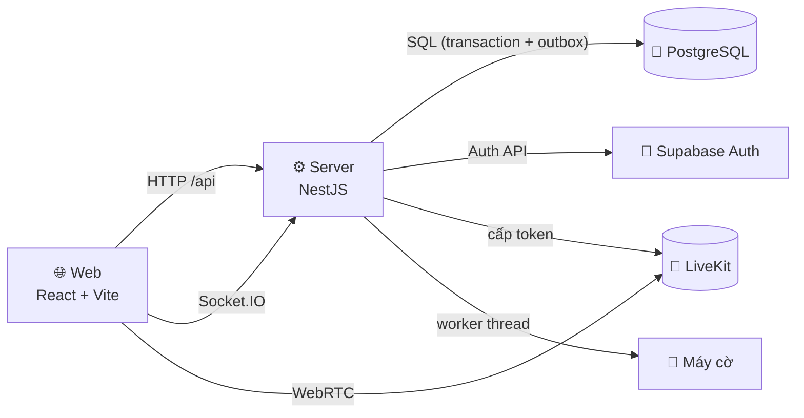

<div align="center">
  

  # Cờ Tướng Online · XIANGQI

  **Nền tảng chơi cờ tướng thời gian thực cho người Việt: phòng đấu, người xem, chat, camera/mic, đánh hạng Elo và máy cờ 3 cấp độ.**

  [](https://github.com/twotnguyen/XIANGQI/actions/workflows/ci.yml)
  
  
  
  
  
  
  
  

  [Tổng quan](#-tổng-quan) · [Điểm nổi bật kỹ thuật](#-điểm-nổi-bật-kỹ-thuật) · [Vai trò của tôi](#-vai-trò-của-tôi) · [Kiến trúc](#️-kiến-trúc) · [Chạy thử](#-chạy-thử)

  
</div>

---

## 🧭 Tổng quan

| | |
|---|---|
| **Sản phẩm** | Web app cờ tướng trực tuyến tiếng Việt, giao diện phong cách *Kỳ Đài Cổ Phong* |
| **Bối cảnh** | Đồ án môn *Quản trị Dự án Công nghệ Thông tin*, HUTECH. Làm trọn vòng đời: phân tích yêu cầu → lập kế hoạch → triển khai → nghiệm thu |
| **Tác giả chính** | **Nguyễn Ngọc Tình**, trưởng nhóm và full-stack developer (~96% commit) |
| **Thời gian** | 09/2026 – 11/2026 |
| **Công nghệ** | TypeScript · React · Vite · NestJS · Socket.IO · PostgreSQL (Supabase) · LiveKit · Vitest · GitHub Actions |

### Quy mô

| Chỉ số | Giá trị |
|---|---|
| Commit / Pull Request đã merge | ~1.190 / 159 |
| Mã nguồn ứng dụng (TS/TSX) | ~59.700 dòng: web 25,8k · server 31,7k · packages 2,2k |
| Mã kiểm thử | ~88.700 dòng, 320 file, **3.563 test đạt** |
| Migration database | 45 migration, mỗi bản có rollback tương ứng |
| Quản lý dự án | Jira: Epic → Story → Task, kế hoạch gốc 880 giờ |

## ✨ Tính năng

| | Tính năng | Mô tả |
|:--:|---|---|
| 🔐 | **Tài khoản** | Đăng ký với OTP email, đăng nhập username/email/Google, khôi phục mật khẩu, chế độ Khách |
| 🏠 | **Phòng đấu** | Mời bằng mã 8 số, link hoặc lời mời bạn bè; 2 người chơi và tối đa 5 người xem |
| ♟️ | **Ván thời gian thực** | Máy chủ phân xử nước đi; đồng hồ, xin hòa, đầu hàng, đi lại, xử lý mất kết nối |
| 🎲 | **Ghép trận và xếp hạng** | Ghép ngẫu nhiên; Đánh Hạng có Elo, bảng xếp hạng, giới hạn số ván cho mỗi cặp |
| 🤖 | **Đấu với máy** | 3 cấp Dễ / Trung bình / Khó, chọn phe, đi lại |
| 💬 | **Giao lưu** | Chat 2 kênh, sticker, bạn bè, tin nhắn trực tiếp; camera/mic qua LiveKit |
| 📜 | **Lịch sử** | Lịch sử ván, xem lại từng nước, xuất FEN/PGN |

<table>
  <tr>
    <td width="50%"></td>
    <td width="50%"></td>
  </tr>
  <tr>
    <td align="center"><b>Bốn cách bắt đầu một ván</b></td>
    <td align="center"><b>Đăng ký ba bước với OTP email</b></td>
  </tr>
</table>

<p align="center">
  <br />
  <b>Bàn cờ SVG, quân chữ Hán, đổi được góc nhìn</b><br />
  <sub>Ảnh chụp từ các trang xem trước giao diện, dùng dữ liệu minh họa.</sub>
</p>

## 🔧 Điểm nổi bật kỹ thuật

**1. Máy chủ là nguồn sự thật, một bộ luật dùng chung hai đầu.**
Luật cờ (nước hợp lệ, chiếu, chiếu hết, hết nước, lặp thế, chiếu liên tục, 120 nửa nước không ăn quân) nằm trong package [`xiangqi-core`](packages/xiangqi-core/src). Web dùng nó để gợi ý nước và hiện nước ngay khi người chơi đi; server dùng chính nó để phân xử, nên client không thể gian lận.

**2. Đồng thời an toàn: không deadlock, không xử lý lệnh hai lần.**
Mọi lệnh ghi trạng thái phòng/ván chạy trong một transaction PostgreSQL ([`room-transactions.ts`](apps/server/src/game/room/room-transactions.ts)). Transaction khóa người chơi rồi khóa phòng theo thứ tự đã sắp xếp, nên hai người cùng thao tác không deadlock. Mỗi lệnh mang `commandId` và được ghi biên lai (receipt), nên client gửi lại vẫn chỉ xử lý một lần. Sự kiện Socket.IO đi qua bảng **outbox** và chỉ phát sau khi commit.

**3. Đảm bảo chỉ một runtime ghi dữ liệu.**
Server giành một advisory lock dạng singleton trên PostgreSQL, kèm barrier và kiểm tra PID của kết nối đang giữ khóa (fencing) ([`runtime-lock.ts`](apps/server/src/core/runtime-lock.ts)). Instance cũ chưa nhả hết kết nối thì instance mới chưa được chạy recovery, nên không có hai tiến trình cùng ghi trạng thái ván.

**4. Máy cờ tự viết, chạy trong worker thread.**
Negamax với alpha-beta và tìm sâu dần (iterative deepening) ([`packages/engine`](packages/engine/src)). Ba cấp độ có ngân sách 300 ms / 1 s / 2 s và độ sâu 2 / 4 / 6. Máy cờ chạy trong worker thread riêng nên không chặn event loop phục vụ các ván online. Nước máy trả về được kiểm lại bằng luật chung trước khi áp dụng.

**5. Bảo mật nhiều lớp.**
- Bật RLS bắt buộc (`FORCE ROW LEVEL SECURITY`) trên các bảng; role `anon`/`authenticated` không truy cập trực tiếp được.
- OTP giới hạn số lần thử; đăng nhập có thời gian phản hồi sàn để không dò được tài khoản qua độ trễ; rate limit theo IP.
- Cookie phiên HttpOnly; log JSON chỉ nhận danh sách mã sự kiện cố định, không ghi token, OTP hay nội dung chat.

**6. Kiểm thử trên database thật.**
3.563 test bằng Vitest. Test server chạy trên các cụm PostgreSQL 17 cô lập ([`tests/server/db.sh`](tests/server/db.sh)), không mock lại SQL. CI chia theo phạm vi: push vào `develop` chạy lint, typecheck, build và unit; PR vào `main` chạy thêm các shard database. `main` có branch protection với 2 check bắt buộc.

## 👤 Vai trò của tôi

Tôi là **trưởng nhóm** và **người phát triển chính** (~96% commit):

- **Quản trị dự án:** phân tích yêu cầu khách hàng thành các quyết định nghiệp vụ (BA) và User Story có tiêu chí nghiệm thu; lập kế hoạch Jira (Epic/Story/Task, ước lượng, phụ thuộc, sprint); quy trình nhánh, commit gắn mã Jira, PR và CI.
- **Backend:** NestJS + Socket.IO: xác thực (OTP, Google, Khách), phòng/ván realtime, đồng hồ, ghép trận, Elo, chat, bạn bè, quyền media LiveKit, lịch sử.
- **Database:** thiết kế schema PostgreSQL, RLS, 45 migration có rollback.
- **Frontend:** React + Vite: Sảnh, phòng đấu, bàn cờ SVG, ván với máy, hồ sơ, lịch sử, xem lại ván, hệ thống giao diện.
- **Máy cờ và luật:** package `xiangqi-core` và `engine`.
- **Chất lượng:** bộ test tự động và pipeline GitHub Actions.

## 🏗️ Kiến trúc



<details>
<summary><b>📁 Cấu trúc monorepo</b></summary>

```text
XIANGQI/
├─ apps/
│  ├─ web/          React + Vite: app/ (router, layout), features/ (theo tính năng), shared/ (UI, bàn cờ)
│  └─ server/       NestJS: account/ (tài khoản), game/ (phòng, ván, chat, AI, media, xếp hạng), core/
├─ packages/
│  ├─ shared/       Hợp đồng dữ liệu và kiểm tra dùng chung web/server
│  ├─ xiangqi-core/ Luật cờ tướng
│  └─ engine/       Máy cờ
├─ supabase/        Migration, rollback, kiểm thử SQL
├─ tests/           Test, helper và fixture
└─ docs/            Tài liệu sản phẩm, thiết kế, kỹ thuật, kế hoạch
```

**Quy ước phân tầng:**
- **Server:** Controller → Service → Store; SQL chỉ nằm trong `*.store.ts`.
- **Web:** `features/*` chỉ import `shared/*`.

</details>

## 🚀 Chạy thử

**Yêu cầu:** Node.js 22 (≥ 22.13), pnpm 10 và một project Supabase cho các tính năng cần database.

```sh
git clone https://github.com/twotnguyen/XIANGQI.git
cd XIANGQI
cp .env.example .env && cp .env apps/web/.env && cp .env apps/server/.env   # điền theo docs/setup
pnpm install --frozen-lockfile
pnpm dev            # web http://localhost:5173 · server http://localhost:3000
```

Không cần backend vẫn xem được giao diện qua `/dev/lobby`, `/dev/board`, `/dev/register`.

**Dựng database:** trên project Supabase mới, tạo role `app_server` một lần trong SQL Editor, rồi chạy script dựng toàn bộ schema (baseline và mọi migration):

```sql
CREATE ROLE app_server NOLOGIN NOBYPASSRLS;
```

```sh
REBUILD_DATABASE_URL='<chuỗi kết nối direct hoặc session pooler 5432>' pnpm db:rebuild
# Không dùng Supabase: PostgreSQL thường + Auth giả lập
REBUILD_DATABASE_URL='postgresql://localhost:5432/xiangqi_local' pnpm db:rebuild --local-auth
```

Script chỉ chạy trên database trống và không xóa dữ liệu. Chi tiết: [supabase/README.md](supabase/README.md#dựng-lại-database-trống-pnpm-dbrebuild).

| Lệnh | Mô tả |
|---|---|
| `pnpm lint` · `pnpm typecheck` | Kiểm tra mã và kiểu |
| `pnpm test:unit` | Test web và package, không cần database |
| `pnpm test:db:<miền>` | Test server với PostgreSQL 17 cô lập |
| `pnpm db:rebuild` | Dựng schema trên database trống |
| `pnpm build` | Build web và kiểm tra build server |

Hướng dẫn cấu hình chi tiết: [CAU-HINH-MOI-TRUONG.md](docs/setup/CAU-HINH-MOI-TRUONG.md) · Kiểm thử: [tests/README.md](tests/README.md) · Database: [supabase/README.md](supabase/README.md)

## 📚 Tài liệu dự án

| Loại | Tài liệu |
|---|---|
| Yêu cầu và phạm vi | [Tổng quan yêu cầu](docs/product/TONG-QUAN-YEU-CAU.md) · [Quyết định nghiệp vụ](docs/product/BA-SCOPE-DECISIONS.md) · [Backlog và tiêu chí nghiệm thu](docs/product/BACKLOG-P1.md) |
| Thiết kế | [DESIGN.md](docs/design/DESIGN.md) · [Danh mục màn hình](docs/design/DANH-MUC-MAN-HINH-XIANGQI.md) · [Mockup](docs/design/mockups/index.html) |
| Kỹ thuật | [Kiến trúc server](docs/engineering/server/architecture.md) · [Realtime](docs/engineering/server/realtime.md) · [Giao diện web](docs/engineering/web/ui.md) |
| Quản lý dự án | [Kế hoạch Jira](docs/planning/KE-HOACH-JIRA.md) · [Dữ liệu và báo cáo Jira](docs/planning/jira/README.md) |
| Quy ước phát triển | [AGENTS.md](AGENTS.md) (nhánh, commit, PR, hàng rào kỹ thuật) |

---

<div align="center">
  <sub>楚河 · 漢界 · Nguyễn Ngọc Tình · HUTECH 2026</sub>
</div>
