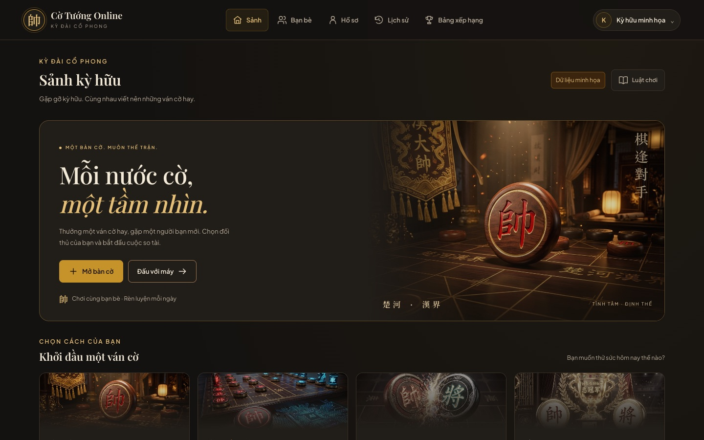
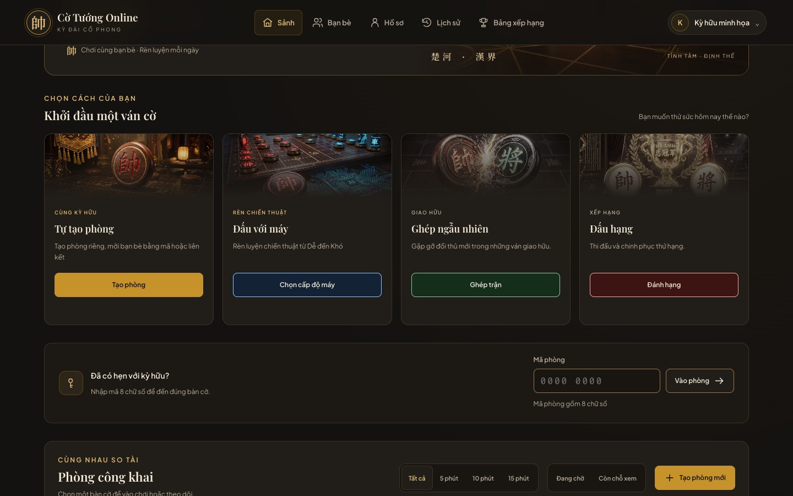
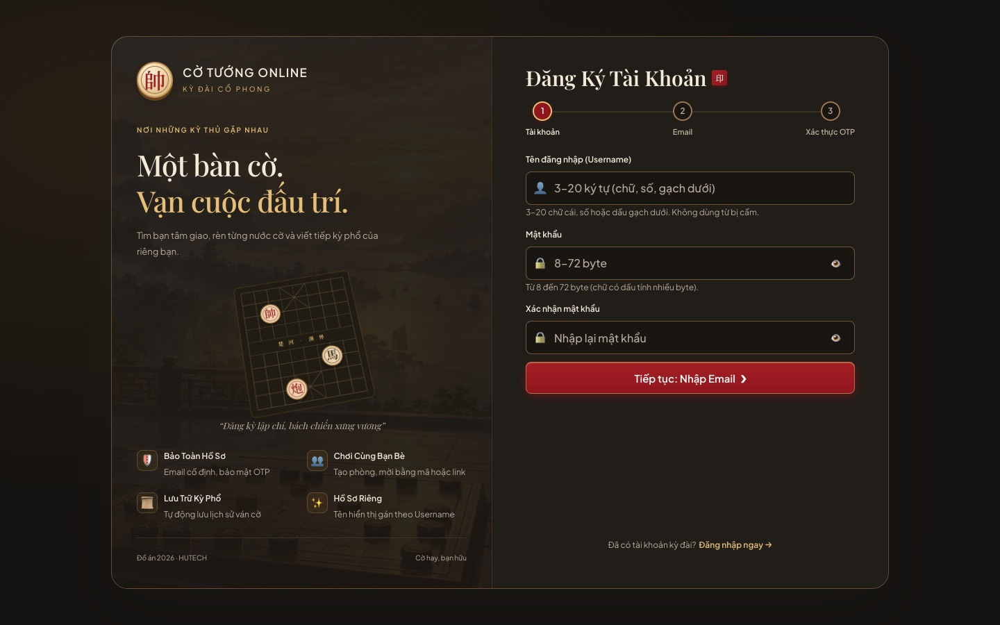
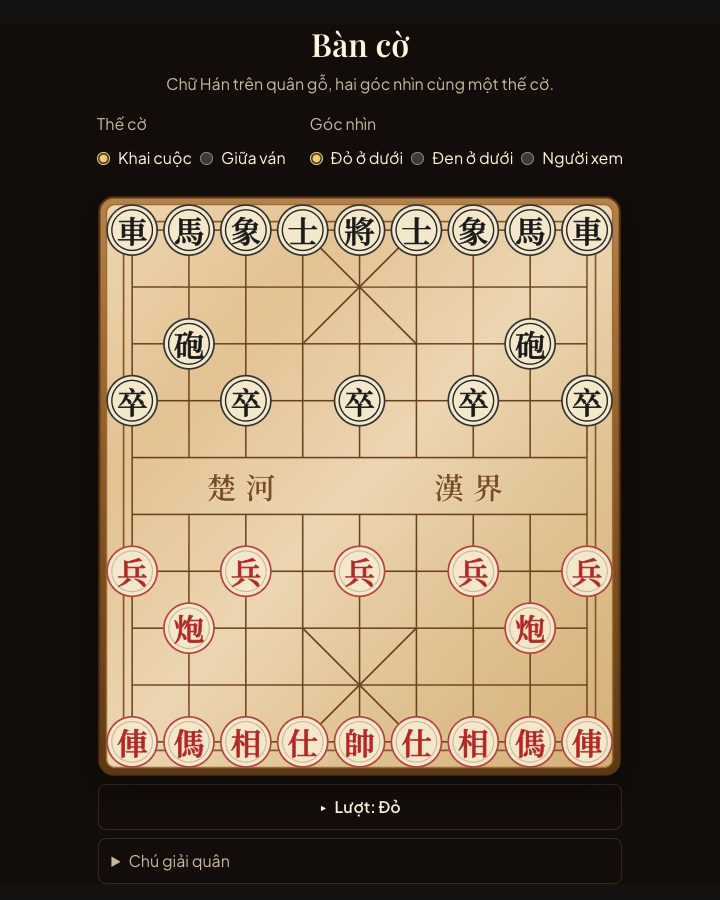
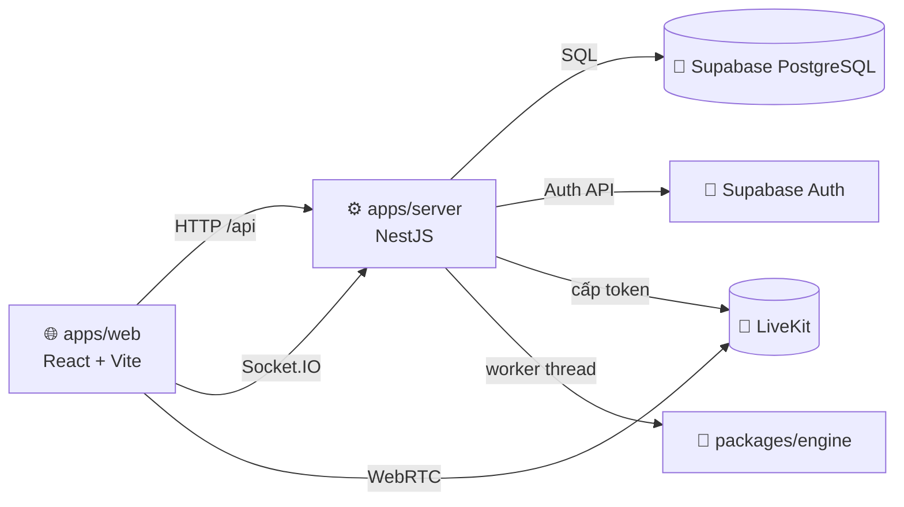

<div align="center">
  

  # Cờ Tướng Online · XIANGQI

  **Kỳ đài cờ tướng trực tuyến cho người Việt**<br />
  Đấu với bạn bè · Ghép trận ngẫu nhiên · Đánh hạng · Luyện tập với máy

  [](https://github.com/twotnguyen/XIANGQI/actions/workflows/ci.yml)
  
  
  
  
  
  
  
  
  

  [Tính năng](#-tính-năng) · [Ảnh chụp](#-ảnh-chụp-màn-hình) · [Bắt đầu nhanh](#-bắt-đầu-nhanh) · [Kiến trúc](#-kiến-trúc) · [Tài liệu](#-tài-liệu) · [Jira](https://xiangqi-web.atlassian.net/jira/software/c/projects/XIAN/boards/38)

  
</div>

---

## 🏮 Giới thiệu

**Cờ Tướng Online** là ứng dụng web chơi cờ tướng thời gian thực, giao diện tiếng Việt theo phong cách **Kỳ Đài Cổ Phong**. Người chơi có thể tạo phòng mời bạn, ghép trận ngẫu nhiên, đánh hạng có Elo hoặc luyện tập với máy. Trong phòng còn có người xem, chat và camera/mic tùy chọn.

Đây là đồ án môn **Quản trị Dự án Công nghệ Thông tin**. Dự án được quản lý từ phân tích yêu cầu, lập kế hoạch đến triển khai và nghiệm thu trên [Jira XIAN](https://xiangqi-web.atlassian.net/jira/software/c/projects/XIAN/boards/38).

> [!NOTE]
> Dự án đang phát triển. Phạm vi và tiêu chí nghiệm thu nằm ở [BACKLOG-P1.md](docs/product/BACKLOG-P1.md); quyết định nghiệp vụ nằm ở [BA-SCOPE-DECISIONS.md](docs/product/BA-SCOPE-DECISIONS.md).

## ✨ Tính năng

| | Tính năng | Mô tả |
|:--:|---|---|
| 🔐 | **Tài khoản** | Đăng ký bằng OTP email, đăng nhập bằng username, email hoặc Google; khôi phục mật khẩu; chế độ Khách |
| 🏠 | **Phòng đấu** | Tạo phòng, mời bằng mã 8 số, link hoặc lời mời bạn bè; 2 người chơi và tối đa 5 người xem |
| ♟️ | **Ván đấu thời gian thực** | Máy chủ phân xử nước đi và luật kết thúc; có đồng hồ, xin hòa, đầu hàng, đi lại và xử lý mất kết nối |
| 🎲 | **Ghép trận** | Đánh Thường ghép ngẫu nhiên; Đánh Hạng có Elo, bảng xếp hạng và giới hạn số ván giữa một cặp |
| 🤖 | **Đấu với máy** | Ba cấp Dễ / Trung bình / Khó, chọn phe, đi lại nước |
| 💬 | **Giao lưu** | Chat kênh người chơi và kênh chung, sticker, bạn bè, tin nhắn trực tiếp |
| 🎥 | **Camera và mic** | Mặc định tắt, chia sẻ theo quyền qua LiveKit; lỗi media không làm gián đoạn ván cờ |
| 📜 | **Lịch sử** | Lịch sử ván cá nhân, xem lại từng nước, xuất FEN/PGN |

## 📸 Ảnh chụp màn hình

<table>
  <tr>
    <td width="50%"></td>
    <td width="50%"></td>
  </tr>
  <tr>
    <td align="center"><b>Bốn cách bắt đầu một ván</b></td>
    <td align="center"><b>Đăng ký ba bước với OTP email</b></td>
  </tr>
</table>

<p align="center">
  <br />
  <b>Bàn cờ SVG với quân chữ Hán, đổi được góc nhìn</b>
</p>

<sub>Ảnh chụp từ các trang xem trước `/dev/*`, dùng dữ liệu minh họa.</sub>

## 🚀 Bắt đầu nhanh

### Yêu cầu

- **Node.js 22** (≥ 22.13, < 23), theo `.node-version`
- **pnpm 10.34.6**, theo `packageManager` (`corepack enable` để dùng đúng phiên bản)
- Một project **Supabase** (PostgreSQL + Auth) cho các tính năng cần database
- Tùy chọn: **Docker** để chạy LiveKit local, **PostgreSQL 17** để chạy test database

### Cài đặt và chạy

```sh
git clone https://github.com/twotnguyen/XIANGQI.git
cd XIANGQI

umask 077
cp .env.example .env            # điền giá trị theo mục Cấu hình
cp .env apps/web/.env
cp .env apps/server/.env

pnpm install --frozen-lockfile
pnpm dev
```

| Dịch vụ | Địa chỉ |
|---|---|
| 🌐 Web | <http://localhost:5173> |
| ⚙️ Server | <http://localhost:3000> |
| 💓 Kiểm tra sống / sẵn sàng | `GET /health` · `GET /ready` |
| 🧩 Trang xem trước giao diện | `/dev/lobby`, `/dev/board`, `/dev/register`, `/dev/ui` |

### ⚙️ Cấu hình

Biến môi trường được mô tả trong [`.env.example`](.env.example). Hướng dẫn tạo và kiểm chứng từng dịch vụ (Supabase, Google OAuth, SMTP, LiveKit) nằm ở [CAU-HINH-MOI-TRUONG.md](docs/setup/CAU-HINH-MOI-TRUONG.md).

- Server đọc `apps/server/.env`; web đọc `apps/web/.env` và chỉ công khai biến có tiền tố `VITE_`.
- Các tính năng bật/tắt bằng cờ `*_ENABLED` (ví dụ `AUTH_REGISTRATION_ENABLED`, `ROOMS_ENABLED`). Chỉ bật khi migration và dịch vụ liên quan đã sẵn sàng.
- Migration và rollback: [supabase/README.md](supabase/README.md) · LiveKit local: [infra/livekit/README.md](infra/livekit/README.md) · Triển khai server mẫu: [`render.yaml`](render.yaml).

> [!IMPORTANT]
> `DIRECT_URL` phải là kết nối trực tiếp hoặc session pooler. **Không** dùng transaction pooler (cổng 6543).

## 🏗️ Kiến trúc



- **Máy chủ là nguồn sự thật:** mọi nước đi, đồng hồ và kết quả được kiểm bằng `packages/xiangqi-core`. Luật này dùng chung cho cả web và server.
- **Realtime nhất quán:** trạng thái phòng/ván được ghi trong transaction Postgres có khóa theo thứ tự. Tác dụng phụ (Socket.IO, thu hồi media) đi qua bảng outbox sau khi commit.
- **Một runtime cho mỗi database:** server giữ khóa singleton trên Postgres, nên chỉ một instance xử lý phòng/ván tại một thời điểm.

<details>
<summary><b>🧰 Công nghệ sử dụng</b></summary>

| Thành phần | Công nghệ |
|---|---|
| Ngôn ngữ, workspace | TypeScript, Node.js 22, pnpm 10 (monorepo) |
| Web | React, Vite, SVG |
| Server | NestJS, Socket.IO, `pg`, chạy bằng `tsx` |
| Dữ liệu, xác thực | Supabase PostgreSQL, Supabase Auth, Google OAuth, SMTP |
| Media | LiveKit (Docker khi chạy local, LiveKit Cloud khi demo Internet) |
| Máy cờ | Negamax, alpha-beta, tìm sâu dần, chạy trong worker thread |
| Kiểm thử | Vitest, PostgreSQL 17 cô lập |

</details>

<details>
<summary><b>📁 Cấu trúc thư mục</b></summary>

```text
XIANGQI/
├─ apps/
│  ├─ web/          React + Vite: app/ (router, layout), features/ (theo tính năng), shared/ (UI, bàn cờ, điều hướng)
│  └─ server/       NestJS + Socket.IO: account/ (tài khoản), game/ (phòng, ván, chat, AI, media, xếp hạng), core/
├─ packages/
│  ├─ shared/       Hợp đồng dữ liệu, bộ lọc và kiểm tra dùng chung web/server
│  ├─ xiangqi-core/ Luật cờ tướng
│  └─ engine/       Máy cờ
├─ supabase/        Migration, rollback, kiểm thử SQL, mẫu email
├─ tests/           Test, helper và fixture
├─ infra/livekit/   Cấu hình LiveKit local
├─ docs/            Tài liệu sản phẩm, thiết kế, kỹ thuật, kế hoạch, cài đặt
└─ .github/         CI và CODEOWNERS
```

**Quy ước phân tầng:**

- **Server:** Controller → Service → Store; SQL chỉ nằm trong `*.store.ts`.
- **Web:** `features/*` chỉ import `shared/*`; `shared/*` không import `features/*` hay `app/*`.

</details>

Chi tiết: [kiến trúc server](docs/engineering/server/architecture.md) · [realtime](docs/engineering/server/realtime.md) · [giao diện web](docs/engineering/web/ui.md)

## 🧪 Lệnh thường dùng và kiểm thử

| Lệnh | Mô tả |
|---|---|
| `pnpm dev` | Chạy web và server ở chế độ phát triển |
| `pnpm lint` · `pnpm format:check` | ESLint và Prettier |
| `pnpm typecheck` | Kiểm tra kiểu mọi package |
| `pnpm build` | Build web và kiểm tra build server |
| `pnpm test` | Chạy toàn bộ test Vitest |
| `pnpm test:unit` | Test web và package, không cần database |
| `pnpm test:db:<miền>` | Test cần database: `account`, `room`, `match`, `realtime`, `chat-media`, `ai` |

- Test database chạy trên cụm PostgreSQL 17 cô lập do `tests/server/db.sh` dựng.
- **CI** ([`ci.yml`](.github/workflows/ci.yml)):
  - Push hoặc PR vào `develop`: lint, typecheck, build và unit/core khi mã thay đổi.
  - PR `develop` → `main`: chạy đầy đủ, gồm cả các shard database.

Chi tiết: [tests/README.md](tests/README.md).

> [!WARNING]
> Không trỏ các biến `*_TEST_DATABASE_URL` vào Supabase thật: fixture test sẽ xóa schema.

## 📚 Tài liệu

| Nội dung | Tài liệu |
|---|---|
| 💡 Ý tưởng và người dùng mục tiêu | [IDEA.md](docs/product/IDEA.md) |
| 📋 Tổng quan yêu cầu | [TONG-QUAN-YEU-CAU.md](docs/product/TONG-QUAN-YEU-CAU.md) |
| ⚖️ Quyết định nghiệp vụ và phạm vi | [BA-SCOPE-DECISIONS.md](docs/product/BA-SCOPE-DECISIONS.md) |
| ✅ User Story và tiêu chí nghiệm thu | [BACKLOG-P1.md](docs/product/BACKLOG-P1.md) · [BACKLOG-P2.md](docs/product/BACKLOG-P2.md) |
| 🎨 Thiết kế và màn hình | [DESIGN.md](docs/design/DESIGN.md) · [Danh mục màn hình](docs/design/DANH-MUC-MAN-HINH-XIANGQI.md) · [Mockup](docs/design/mockups/index.html) |
| 🛠️ Ghi chú kỹ thuật | [docs/engineering/](docs/engineering/) |
| 📅 Kế hoạch và Jira | [KE-HOACH-JIRA.md](docs/planning/KE-HOACH-JIRA.md) · [docs/planning/jira/](docs/planning/jira/README.md) |
| 🔧 Cấu hình môi trường | [CAU-HINH-MOI-TRUONG.md](docs/setup/CAU-HINH-MOI-TRUONG.md) |
| 🤖 Hướng dẫn cho coding agent | [AGENTS.md](AGENTS.md) |

## 🤝 Đóng góp

1. Chọn Task trên Jira; đọc Story và tiêu chí nghiệm thu liên quan.
2. Làm trên `develop` (nhánh mặc định và tích hợp), hoặc trên nhánh riêng `<type>/XIAN-<số>-<mô-tả>`.
3. Đặt commit theo dạng `<type>(<scope>): XIAN-<số> <mô tả>`, với type là một trong `feat`, `fix`, `docs`, `refactor`, `perf`, `ci`, `chore`, `test`.
4. `main` là nhánh phát hành có branch protection và chỉ nhận PR từ `develop` khi các check bắt buộc đều đạt.

Quy ước đầy đủ: [AGENTS.md › Git và pull request](AGENTS.md#git-và-pull-request).

## 🛡️ Bảo mật

- Không commit `.env`, `.local/` hay bất kỳ khóa, mật khẩu, token nào; chỉ commit file mẫu trống.
- Biến `VITE_*` và `NEXT_PUBLIC_*` sẽ lộ ra trình duyệt. Khóa đặc quyền của Supabase, LiveKit và SMTP chỉ dùng phía server.
- Log vận hành là JSON có danh sách sự kiện cố định; không ghi mật khẩu, OTP, token hay nội dung chat.

Nếu phát hiện lỗ hổng, hãy báo riêng cho nhóm dự án, không mở issue công khai.

## 📄 Giấy phép

Dự án chưa chọn giấy phép phân phối. Thư viện, font và tài nguyên bên thứ ba giữ nguyên giấy phép gốc của chúng.

---

<div align="center">
  <sub>楚河 · 漢界 — Đồ án môn Quản trị Dự án Công nghệ Thông tin · HUTECH 2026</sub>
</div>
