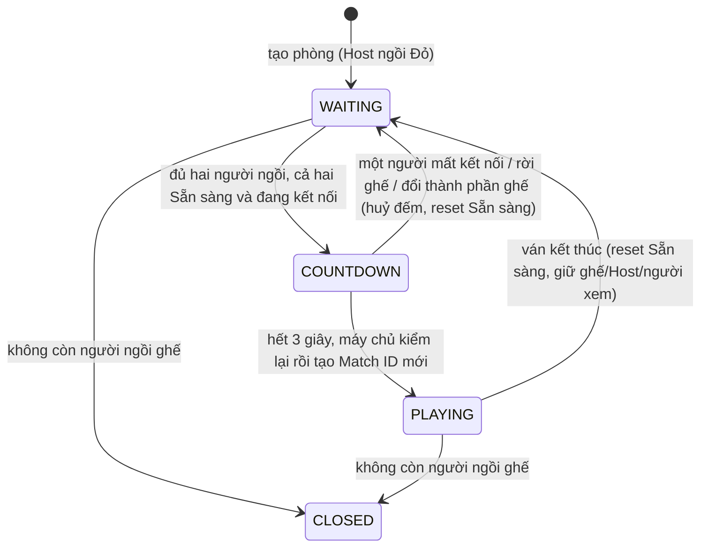

# P1 · YC2 — Tạo phòng, ghế, Sẵn sàng, đổi bên và ở lại phòng

**Ngày lập:** 30/10/2026. **Phạm vi:** YC2 của P1 (EP-02: US-02.1, US-02.2; 27 AC). **Hạn P1:** giữ 04/11/2026.

**Trạng thái:** đặc tả đầy đủ, PO đã chốt Q1–Q7 ngày 30/10/2026 (mục 17). Nội dung phân tích dựa trên BA, Backlog và đối chiếu mã hiện có (mục 15). Chưa sửa mã, chưa chạy test và chưa đóng Task Jira.

## 1. Mục tiêu, nguồn và thứ tự ưu tiên

YC2 cho phép người dùng hoặc Khách tạo một phòng riêng để so tài: chọn mức giờ, số người xem, quyền truy cập; ngồi ghế Đỏ làm Host; chờ người thứ hai; hai bên bấm Sẵn sàng, đếm 3-2-1 và vào ván. Sau ván, phòng về trạng thái chờ để đánh tiếp, đổi bên hoặc rời mà không phải tạo phòng mới.

Nguồn: [BA Phần 0](BA-SCOPE-DECISIONS.md) mục 0.3, 0.5–0.7, 0.10, 0.13 và các Quyết định 2.0, 2.1, 2.3, 2.6–2.8, 8.3; [Backlog P1 — EP-02](BACKLOG-P1.md); [Danh mục màn hình](../design/DANH-MUC-MAN-HINH-XIANGQI.md) §7 và nhóm modal. Khi nguồn mâu thuẫn, **BA Phần 0 thắng**. Tài liệu này chỉ làm rõ để PO/dev/QA dùng chung, không đổi luật.

| Quyết định đã chốt (BA) | Nội dung |
|---|---|
| 19/10 | Không nhập tên phòng; tên hiển thị tự đặt `Phòng <mã>` |
| 28/10 | Quyền truy cập chọn ngay trong form: `CODE_ONLY` (mặc định) hoặc `PUBLIC`; không chọn `LOCKED` khi tạo |
| 05/10 | Người xem: *Không có người xem* hoặc 1–5, mặc định 5; không đổi sau khi tạo |
| 07/10 (0.6) | Xin đổi bên thuộc P1; một người ngồi ghế dùng "Đổi ghế" tự do |
| 07/10 (0.7) | Sau ván phòng về `WAITING` ngay; "Ở lại phòng" / "Rời phòng"; không đóng sau 10 phút |
| 07/10 (0.10) | Host ngồi chờ một mình: không giới hạn thời gian |
| 05/10 (2.3) | Mất mạng khi đang đếm: huỷ đếm, reset Sẵn sàng, giữ ghế 60 giây |

## 2. Phạm vi và ranh giới với các YC khác

### 2.1 Thuộc YC2

1. Tạo phòng (`MODAL-CREATE-ROOM`), mã 8 chữ số, link mời, phòng chờ `/rooms/:id` ở `WAITING` (`SCR-WAITING-ROOM`).
2. Ghế Đỏ/Đen, "Đổi ghế" khi chỉ một người ngồi ghế, "Xin đổi bên" khi đủ hai người.
3. Sẵn sàng/huỷ Sẵn sàng, đếm 3-2-1, kiểm tra lại phía máy chủ rồi tạo ván (Match ID mới).
4. Mất kết nối ở phòng chờ: giữ ghế 60 giây; huỷ đếm; chuyển Host; đóng phòng khi không còn người ngồi ghế.
5. Sau ván: `MODAL-MATCH-RESULT` chỉ "Ở lại phòng"/"Rời phòng"; phòng về `WAITING`; giữ ghế, người xem, chế độ, mức giờ, Host.

### 2.2 Không thuộc YC2 (không làm trong lần này)

| Chủ đề | Thuộc | Ghi chú |
|---|---|---|
| Vào phòng bằng mã/link, mời bạn bè, tự xếp ghế/người xem, chuyển tiếp sau đăng nhập | YC3 | YC2 chỉ sinh mã/link và hiển thị |
| Bàn cờ, luật đi, đồng hồ chạy, kết thúc ván | YC4/YC5 | YC2 chỉ yêu cầu tạo ván đúng và chuyển màn |
| `PUBLIC`/`CODE_ONLY`/`LOCKED` đổi sau tạo, danh sách Sảnh, người xem, kick | YC6 | YC2 chỉ yêu cầu chọn `CODE_ONLY`/`PUBLIC` lúc tạo |
| Chat hai kênh, camera/mic | YC7 | Phòng chờ có chat/media theo BA 0.13 nhưng nghiệm thu ở YC7; YC2 chỉ giữ nguyên kênh khi ở lại phòng (AC-02.2.9) |
| Mã QR, Tái đấu, mức giờ Không giới hạn, Thách đấu | P2 | Ẩn hoàn toàn ở P1, không để nút xám |
| Ghép ngẫu nhiên, Đánh Hạng | P2 | Không có phòng chờ, không có Xin đổi bên |

## 3. Vai trò và quyền

| Chủ thể | Quyền trong YC2 |
|---|---|
| Thành viên hoặc Khách, không ngồi ghế nơi khác, đang ở Sảnh | Tạo phòng (mỗi Khách tối đa 1 phòng đang mở theo BA 0.3) |
| Người đang giữ ghế/ván ở nơi khác | Không tạo được phòng; thấy lý do và đường quay lại vị trí hiện tại (theo YC1, một vị trí chơi) |
| Host | Ngồi ghế; Đổi ghế (khi một mình); Sẵn sàng; Xin đổi bên (khi đủ hai người); Rời phòng |
| Người chơi thứ hai | Sẵn sàng; Xin đổi bên; Rời phòng; không có "Đổi ghế" |
| Người xem | Không có Sẵn sàng, Đổi ghế, Xin đổi bên, nút trong hộp kết quả |
| Máy chủ | Nguồn sự thật duy nhất cho ghế, Sẵn sàng, đếm, Host, trạng thái phòng; không tin client |

## 4. Tham số phòng và quy tắc dữ liệu

| Tham số | Quy tắc |
|---|---|
| Mức giờ | Chỉ 5, 10 hoặc 15 phút mỗi bên (mặc định 10); không cộng giây; cố định sau khi tạo |
| Người xem tối đa | 0–5 (mặc định 5); cố định sau khi tạo |
| Sức chứa | `2 + số người xem tối đa` (tối đa 7) |
| Quyền truy cập khi tạo | `CODE_ONLY` (mặc định) hoặc `PUBLIC`; mọi giá trị khác, kể cả `LOCKED`, bị từ chối |
| Mã phòng | 8 chữ số do máy chủ sinh; hiển thị dạng nhóm 4+4 (ví dụ `7052 1348`); client không gửi mã |
| Tên hiển thị | `Phòng <mã>`; không có trường nhập tên |
| Host | Người tạo; ngồi ghế Đỏ lúc tạo |
| Trạng thái | `WAITING` → (`PLAYING`) → `WAITING` … → `CLOSED` |
| Giá trị lạ | Mức giờ, số người xem hoặc quyền ngoài tập cho phép bị từ chối ở máy chủ, không tạo phòng, không ghi dữ liệu dở dang |

## 5. Trạng thái phòng

`COUNTDOWN` là giai đoạn con của `WAITING` (có hẹn giờ đếm), không phải trạng thái phòng riêng.

## 6. Tạo phòng (US-02.1: AC-02.1.1 – 02.1.5)

1. Ở Sảnh, người dùng chưa ngồi ghế nơi khác bấm **Tạo phòng** → mở form `MODAL-CREATE-ROOM`.
2. Form có: Mức giờ (5/10/15, mặc định 10); Người xem (*Không có người xem*, 1–5, mặc định 5); Quyền truy cập (**Chỉ qua mã/link/lời mời** — mặc định, hoặc **Công khai**). Không có ô tên phòng, không có mức giờ Không giới hạn, không có `LOCKED`.
3. Bấm Tạo → máy chủ kiểm lại mọi trường, sinh ID và mã 8 chữ số, đặt tên `Phòng <mã>`, tạo phòng ở quyền đã chọn, đặt người tạo làm Host ngồi ghế Đỏ, trạng thái `WAITING`. Client vào `/rooms/:id`.
4. Phòng chờ hiển thị mã và link mời (khối chia sẻ chi tiết thuộc YC3). Không có chức năng đổi mức giờ hoặc số người xem sau khi tạo — cả giao diện lẫn API.
5. Lỗi hợp lệ (đang giữ vị trí khác, Khách đã có phòng mở, dịch vụ không sẵn sàng) phải báo bằng tiếng Việt rõ ràng, giữ nguyên lựa chọn trong form, không tạo phòng trùng khi bấm lặp (lệnh có `commandId`).
6. Tạo phòng thành công rồi mất mạng trước khi client nhận phản hồi: thử lại cùng lệnh không tạo phòng thứ hai.

## 7. Phòng chờ: ghế, Sẵn sàng và đếm (AC-02.1.6 – 02.1.10)

### 7.1 Ghế

| Tình huống | Hành vi |
|---|---|
| Chỉ Host ngồi ghế | Nút **Đổi ghế** chuyển Đỏ ↔ Đen tùy thích, không cần duyệt; Sẵn sàng của Host reset |
| Người thứ hai ngồi vào ghế còn lại | "Đổi ghế" biến mất; chỉ còn **Xin đổi bên** (mục 10); Sẵn sàng của cả hai reset |
| Người thứ hai rời ghế, còn một người | "Đổi ghế" xuất hiện lại |
| Thành phần người ngồi ghế thay đổi (vào, rời, mất ghế, xuống/lên ghế) | Sẵn sàng của cả hai reset; đề nghị đổi bên đang chờ bị huỷ |

### 7.2 Sẵn sàng

- Host được bấm Sẵn sàng hoặc huỷ trước khi có người thứ hai; khi người thứ hai ngồi vào, Sẵn sàng của Host reset (theo AC-02.1.10).
- Trạng thái Sẵn sàng của từng người hiển thị realtime cho mọi người trong phòng.
- Chỉ người ngồi ghế được bấm; người xem không có nút.

### 7.3 Đếm 3-2-1

1. Điều kiện bắt đầu đếm: đủ hai người ngồi ghế, cả hai Sẵn sàng. Hiển thị **3… 2… 1…** kèm âm thanh (một tiếng mỗi giây), có thể tắt tiếng theo cài đặt âm thanh hiện có.
2. Trong lúc đếm: không có "Xin đổi bên", "Đổi ghế"; đề nghị đổi bên chờ tự huỷ.
3. Hết đếm, **máy chủ kiểm lại** hai ghế, Sẵn sàng và kết nối rồi mới tạo ván với **Match ID mới**; hai client chuyển `SCR-GAME-ROOM`; đồng hồ Đỏ bắt đầu chạy. Thiếu bất kỳ điều kiện nào: không tạo ván, quay về chờ và reset Sẵn sàng.
4. Không ván nào được tạo hai lần cho cùng một lần đếm, kể cả khi hai máy chủ/worker cùng xử lý.

### 7.4 Mất kết nối ở phòng chờ

| Sự kiện | Hành vi |
|---|---|
| Người chơi mất kết nối khi đang đếm | Huỷ đếm; Sẵn sàng của cả hai về chưa; giữ ghế người mất kết nối **60 giây**; không tạo ván; không xử thua |
| Người chơi mất kết nối ở phòng chờ (không đếm) | Giữ ghế 60 giây; Sẵn sàng của cả hai reset (hành vi hiện có, xem Q4) |
| Nối lại trong 60 giây | Giữ nguyên ghế; cả hai phải Sẵn sàng lại để đếm lại |
| Quá 60 giây | Mất ghế như rời ghế (mục 7.1, 8, 9) |
| Người xem mất kết nối | Thuộc YC6 (giữ chỗ 5 phút), không đổi YC2 |

## 8. Chuyển Host (AC-02.1.11)

- Host rời phòng `WAITING` khi còn người chơi thứ hai → quyền Host chuyển cho người chơi còn lại; phòng tiếp tục chờ.
- Host mất ghế do quá 60 giây khi còn người chơi thứ hai → xử lý như Host rời (Q2).
- Trong ván, Host mất kết nối tạm thời không đổi Host; Host rời hoặc bị xử thua vì quá ân hạn thì quyền chuyển cho người còn lại (BA 2.3 mục 5).
- Host luôn là người đang ngồi ghế; không có thao tác Host tự chuyển mình thành người xem.

## 9. Đóng phòng (AC-02.1.12, AC-02.1.13)

- Phòng `CLOSED` khi **không còn người ngồi ghế**: Host rời khi chỉ một mình, hoặc người cuối cùng mất ghế sau 60 giây.
- Người xem còn lại về Sảnh với thông báo *"Phòng đã đóng"*; chat phòng bị xoá khi phòng đóng.
- **Không tự đóng vì chờ lâu**: Host ngồi một mình hàng giờ vẫn giữ phòng, miễn còn kết nối hoặc còn trong 60 giây ân hạn.
- Không có hạn đóng 10 phút sau ván ở phòng tự tạo (BA 0.7 mục 6).

## 10. Xin đổi bên (US-02.2: AC-02.2.1 – 02.2.7)

| Bước | Hành vi |
|---|---|
| Điều kiện | Phòng `WAITING`, đủ hai người ngồi ghế, không đang đếm; cả hai người chơi có nút **Xin đổi bên**, người xem không có |
| Gửi | A bấm → tối đa **một** đề nghị chờ cho phòng; A thấy trạng thái chờ và nút **Rút đề nghị** |
| Nhận | B thấy `MODAL-SIDE-SWAP-PROMPT` đếm lùi **30 giây** với **Đồng ý / Từ chối** |
| Đồng ý | Hoán đổi Đỏ ↔ Đen; Sẵn sàng của cả hai reset |
| Từ chối hoặc hết 30 giây | A bị khoá gửi lại **60 giây**: nút `DISABLED` kèm tooltip đếm giây còn lại |
| Rút đề nghị | Đề nghị biến mất; có áp dụng khoá 60 giây hay không: xem Q3 |
| Tự huỷ | Khi cả hai Sẵn sàng và bắt đầu đếm; khi một người rời ghế/thành phần ghế đổi |
| Ẩn nút | Khi đang đếm 3-2-1 hoặc đang ván |

Đồng hồ 30 giây và khoá 60 giây tính theo thời gian máy chủ; client chỉ hiển thị. Bấm "Đồng ý" sau khi đề nghị đã hết hạn/bị huỷ được báo rõ và không hoán đổi.

## 11. Sau ván và ở lại phòng (AC-02.2.8 – 02.2.14)

1. Ván kết thúc: **ngay lập tức** phòng về `WAITING`, Sẵn sàng của cả hai = chưa. Hộp kết quả chỉ là lớp hiển thị.
2. `MODAL-MATCH-RESULT` ở P1 chỉ có **Ở lại phòng** và **Rời phòng** cho người chơi; không có Tái đấu, Xem lại; người xem chỉ thấy kết quả, không có nút.
3. **Ở lại phòng**: về phòng chờ; giữ nguyên ghế/phe, người xem, chế độ phòng, mức giờ, Host, Kênh Riêng và Kênh Chung.
4. Cả hai Sẵn sàng → ván mới, Match ID mới, đồng hồ đặt lại đầy đủ theo mức giờ phòng.
5. **Rời phòng**: ghế trống; phòng vẫn `WAITING`; Host chuyển cho người còn lại nếu người rời là Host; phòng `LOCKED` vẫn giữ khoá.
6. Không ai rời: phòng **không** tự đóng sau 10 phút.
7. Muốn đổi phe thì dùng Xin đổi bên (mục 10).
8. Ván gián đoạn do máy chủ khởi động lại: kết quả trung tính; phòng về `WAITING`, reset Sẵn sàng, vẫn có Ở lại/Rời (BA 8.3, 0.17).
9. Hộp kết quả không được tự hiện lại như một ván mới khi phòng đã `WAITING` và người dùng tải lại trang (Q1).

## 12. Giao diện

| Màn / thành phần | Yêu cầu chính |
|---|---|
| `MODAL-CREATE-ROOM` | Hai nhóm lựa chọn có nhãn; mặc định đúng; không có ô tên phòng; lỗi nằm cạnh ô; nút Tạo hiển thị trạng thái `LOADING`, chống bấm hai lần |
| `SCR-WAITING-ROOM` | Hai ghế lớn Đỏ/Đen; cụm nút Sẵn sàng / Đổi ghế / Xin đổi bên / Chia sẻ phòng (người chơi) / Cài đặt phòng (Host); khối chat/media theo YC7 |
| `MODAL-SIDE-SWAP-PROMPT` | Đếm lùi 30 giây; Đồng ý / Từ chối; hành vi khi Esc/đóng: xem Q5 |
| Đếm 3-2-1 | Số lớn, có âm thanh, tôn trọng `prefers-reduced-motion`; thông báo cho trình đọc màn hình |
| `MODAL-MATCH-RESULT` | Chỉ Ở lại phòng / Rời phòng; không hiện chức năng P2 |

Năm trạng thái cho mọi thao tác chính (`SUCCESS`, `LOADING`, `EMPTY`, `ERROR`, `DISABLED` có tooltip) theo DANH-MUC §2; `DISABLED` của Xin đổi bên có tooltip đếm giây. Dùng token và primitives sẵn có, rộng tối thiểu 360 px, vùng bấm tối thiểu 44 px, tiếng Việt có dấu, nút chỉ có biểu tượng phải có tên truy cập.

## 13. Nguyên tắc kỹ thuật bắt buộc

- Mọi thay đổi ghế/Sẵn sàng/Host/đếm là transaction qua `RoomTransactions.withRoom`, khoá actor rồi khoá phòng theo thứ tự đã sắp xếp; lệnh mang `commandId`, idempotent qua biên lai.
- Tác dụng phụ (phát Socket.IO, huỷ media) đi qua outbox sau commit; hẹn giờ (đếm, hết hạn đề nghị, ân hạn 60 giây) do worker máy chủ xử lý, không phụ thuộc client.
- Luật chỉ nằm ở máy chủ: client gửi ý định, không gửi kết quả (ghế, trạng thái, Match ID).
- Tạo phòng, đổi ghế, Sẵn sàng, Xin đổi bên có giới hạn tần suất hợp lý để chống spam; không đổi chu kỳ đọc Sảnh 1 giây.
- Không thêm migration nếu lược đồ hiện có đủ; nếu cần thì kèm `rollback/`, không sửa migration đã áp dụng.

## 14. Trường hợp biên cần xử lý

1. Hai người cùng bấm Sẵn sàng đồng thời: chỉ một lần đếm, một ván.
2. Một người rời đúng giây hết đếm: máy chủ kiểm lại, không tạo ván.
3. Hai đề nghị đổi bên gửi gần như cùng lúc: chỉ một đề nghị được nhận, đề nghị còn lại nhận lỗi rõ ràng.
4. Bấm "Tạo phòng" hai lần, hoặc mở hai tab: không tạo hai phòng; tab thứ hai thấy vị trí hiện tại.
5. Khách hết phiên khi đang chờ trong phòng: theo luật YC1 (không hết khi đang ngồi ghế/trong ván).
6. Host đổi ghế đúng lúc người thứ hai vào: lệnh bị từ chối nếu thành phần ghế đã đổi; client nhận snapshot mới.
7. Máy chủ khởi động lại khi đang đếm: huỷ đếm, về chờ, reset Sẵn sàng; không tạo ván nửa chừng.
8. Tải lại trang khi đang đếm hoặc có modal đề nghị: client khôi phục đúng từ snapshot máy chủ (số giây còn lại tính từ hạn máy chủ).

## 15. Hiện trạng mã (đối chiếu ngày 30/10/2026)

Đã đọc mã và test hiện có, **chưa chạy test mới**. Phần lớn AC đã có triển khai. Bốn điểm cần xử lý hoặc xác nhận:

| Mức | Điểm | Vị trí | Liên quan |
|---|---|---|---|
| Trung bình | Nút Xin đổi bên chưa `DISABLED` + tooltip đếm 60 giây; hiện chỉ báo lỗi dạng toast sau khi bấm | `apps/web/src/features/rooms/RoomSeats.tsx:113-126`, máy chủ đã có `SWAP_COOLDOWN` ở `room-store-swap.ts` | AC-02.2.4 |
| Trung bình | Lời nhắc đổi bên là khung `role="group"` trong trang, không phải modal như `MODAL-SIDE-SWAP-PROMPT` | `RoomSeats.tsx:127-172` | AC-02.2.2, Q5 |
| Thấp–trung bình | `MatchResult` có thể hiện lại sau khi tải trang khi phòng đã `WAITING` (snapshot vẫn trả ván vừa xong; trạng thái "Ở lại" chỉ lưu cục bộ) | `room-store-core.ts:267`, `RoomPage.tsx:641,1066` | AC-02.2.8, Q1 |
| Thấp | Khoảng trống test: reset Sẵn sàng khi đổi ghế/ghế đổi, xoá chat khi đóng phòng, sức chứa 7, Xin đổi bên ở web, người xem không có nút ở hộp kết quả | `tests/**` | AC-02.1.5, 02.1.10, 02.1.12, 02.2.1–2.2.4, 02.2.14 |

Chưa xác minh được từ mã: điều hướng web sau khi tạo (AC-02.1.3), đồng hồ Đỏ bắt đầu chạy ở ván mới (AC-02.1.8), giữ nguyên kênh chat khi ở lại phòng (AC-02.2.9).

Lệch tài liệu (không phải lỗi mã, BA thắng): `DANH-MUC-MAN-HINH-XIANGQI.md` mục `MODAL-CREATE-ROOM` còn mô tả "Nhập tên phòng (1–60 ký tự…)" và "phòng tạo ở `CODE_ONLY`, `PUBLIC` mở qua Cài đặt phòng"; `TRUY-VET-AC.md` còn gắn AC-02.1.1/02.1.2 với bộ lọc tên phòng. Đề xuất sửa sau khi PO duyệt tài liệu này.

## 16. Bảng truy vết AC

Cột "Hiện trạng" lấy từ đối chiếu mã ở mục 15; "ĐỦ" chỉ nghĩa là đã thấy mã triển khai, **không phải đã PASS** — nghiệm thu cần bằng chứng test hoặc chạy thật.

| AC | Nội dung rút gọn | Hiện trạng | Ghi chú |
|---|---|---|---|
| 02.1.1 | Form: 5/10/15, 0–5 xem, CODE_ONLY/PUBLIC, không tên | ĐỦ | |
| 02.1.2 | Máy chủ từ chối giá trị ngoài tập (kể cả LOCKED) | ĐỦ, có test | |
| 02.1.3 | Mã 8 số, `Phòng <mã>`, Host ghế Đỏ, `/rooms/:id` WAITING | ĐỦ server; web chưa xác minh | |
| 02.1.4 | Không đổi mức giờ/số người xem sau tạo | ĐỦ (không có route) | |
| 02.1.5 | Sức chứa = 2 + xem (≤ 7) | ĐỦ (suy ra) | Thiếu test |
| 02.1.6 | Đổi ghế một mình | ĐỦ, có test | |
| 02.1.7 | Sẵn sàng realtime | ĐỦ | |
| 02.1.8 | Đếm 3-2-1, kiểm lại, tạo ván, đồng hồ Đỏ | ĐỦ; đồng hồ Đỏ chưa xác minh | |
| 02.1.9 | Mất kết nối khi đếm: huỷ, reset, giữ ghế 60s | ĐỦ, có test | |
| 02.1.10 | Đổi thành phần ghế → reset Sẵn sàng | ĐỦ (suy ra) | Thiếu test |
| 02.1.11 | Host rời → chuyển Host | ĐỦ, có test | |
| 02.1.12 | Hết người ngồi → CLOSED, "Phòng đã đóng", xoá chat | ĐỦ | Thiếu test xoá chat |
| 02.1.13 | Không tự đóng vì chờ lâu | ĐỦ (theo vắng mặt) | |
| 02.2.1 | Nút Xin đổi bên khi đủ hai người | ĐỦ (mã) | Thiếu test web |
| 02.2.2 | B thấy modal 30s; A thấy Rút | **LỆCH** | Chưa phải modal (Q5) |
| 02.2.3 | Đồng ý → hoán đổi, reset Sẵn sàng | ĐỦ, có test | |
| 02.2.4 | Khoá 60s, nút DISABLED + tooltip | **THIẾU phía web** | Máy chủ có khoá |
| 02.2.5 | Tối đa 1 đề nghị chờ | ĐỦ, có test | |
| 02.2.6 | Tự huỷ khi đếm hoặc rời ghế | ĐỦ | Thiếu test |
| 02.2.7 | Ẩn nút khi đếm/đang ván | ĐỦ (mã) | Thiếu test web |
| 02.2.8 | Hộp kết quả; phòng WAITING; Sẵn sàng = chưa | ĐỦ, có rủi ro tải lại (Q1) | |
| 02.2.9 | Ở lại phòng giữ ghế, người xem, chế độ, giờ, Host, kênh | ĐỦ phần ghế/Host; kênh chưa xác minh | |
| 02.2.10 | Ván mới, Match ID mới, đồng hồ đầy | ĐỦ | Thiếu test riêng |
| 02.2.11 | Rời phòng: ghế trống, WAITING, chuyển Host, giữ LOCKED | ĐỦ | Thiếu test |
| 02.2.12 | Không tự đóng sau 10 phút | ĐỦ (theo vắng mặt) | |
| 02.2.13 | Đổi ghế ẩn khi đủ hai, hiện lại khi một | ĐỦ, có test | |
| 02.2.14 | Hộp kết quả chỉ hai nút; không Tái đấu/Xem lại | ĐỦ | Thiếu test cho người xem |

## 17. Câu hỏi cần PO quyết định

PO trả lời ngày 30/10/2026: chọn đúng cách hiểu đề xuất cho cả bảy câu. Các cách hiểu này là quyết định đã chốt, thay cho "giả định" ở các mục 7–11 và 15; chỉ Q1, Q5 và Q7 yêu cầu sửa mã (mục 15). Q2, Q3, Q4, Q6 phải được xác nhận bằng test khi triển khai.

| # | Câu hỏi | Quyết định của PO |
|---|---|---|
| Q1 | Sau ván, phòng đã về `WAITING`. Tải lại trang (chưa bấm Ở lại/Rời): hộp kết quả có hiện lại không? | **Chốt: không hiện lại.** Hộp kết quả chỉ hiện ngay khi ván kết thúc ở phiên đang mở; tải lại thì vào thẳng phòng chờ |
| Q2 | Host mất ghế quá 60 giây khi người chơi thứ hai còn ngồi | **Chốt: chuyển Host** như khi Host rời; phòng chỉ đóng khi không còn ai ngồi ghế (BA 0.10) |
| Q3 | Người gửi **Rút** đề nghị đổi bên có bị khoá 60 giây không | **Chốt: không khoá**; chỉ khoá khi bị Từ chối/hết hạn |
| Q4 | Mất kết nối ở phòng chờ không trong lúc đếm có reset Sẵn sàng cả hai không | **Chốt: có reset** (giữ hành vi hiện tại) |
| Q5 | `MODAL-SIDE-SWAP-PROMPT` là hộp thoại giữ focus? | **Chốt: hộp thoại giữ focus**; Esc không tự Từ chối — phải bấm Đồng ý/Từ chối hoặc đợi hết 30 giây (hết hạn tính như Từ chối) |
| Q6 | X/Esc ở hộp kết quả có là "Ở lại phòng" không | **Chốt: có**; phòng đã ở `WAITING`, chỉ "Rời phòng" mới rời |
| Q7 | Đóng modal đề nghị đổi bên khi chưa trả lời, có mở lại được trong 30 giây không | **Chốt: có**, qua nút/biểu ngữ trong phòng chờ |

## 18. Kiểm thử đề xuất

Theo AGENTS.md, chưa chạy test trong bước đặc tả này. Khi PO duyệt và giao việc:

- **Máy chủ (PostgreSQL thật qua `tests/server/db.sh`):** tạo phòng đủ tập hợp lệ/không hợp lệ; sức chứa 7; Đổi ghế và reset Sẵn sàng khi thành phần ghế đổi; đếm → ván một lần duy nhất; mất kết nối khi đếm; chuyển Host; đóng phòng và xoá chat; Xin đổi bên (30 giây, 60 giây, 1 đề nghị, tự huỷ); về `WAITING` sau ván và giữ nguyên ghế/Host/người xem; không đóng sau 10 phút.
- **Web:** form mặc định và không có tên phòng; nút Xin đổi bên `DISABLED` + tooltip đếm; modal đề nghị; hộp kết quả (người chơi và người xem); tải lại không hiện lại hộp kết quả (nếu Q1 giữ nguyên).
- **Trình duyệt thật hai người:** vòng D4 → D7 của kịch bản demo cho phần phòng chờ, đo ở 360 px và desktop.
- Kết quả phải được ghi đúng thực tế; điều kiện chưa chạy được ghi `BLOCKED`, không coi là PASS.
