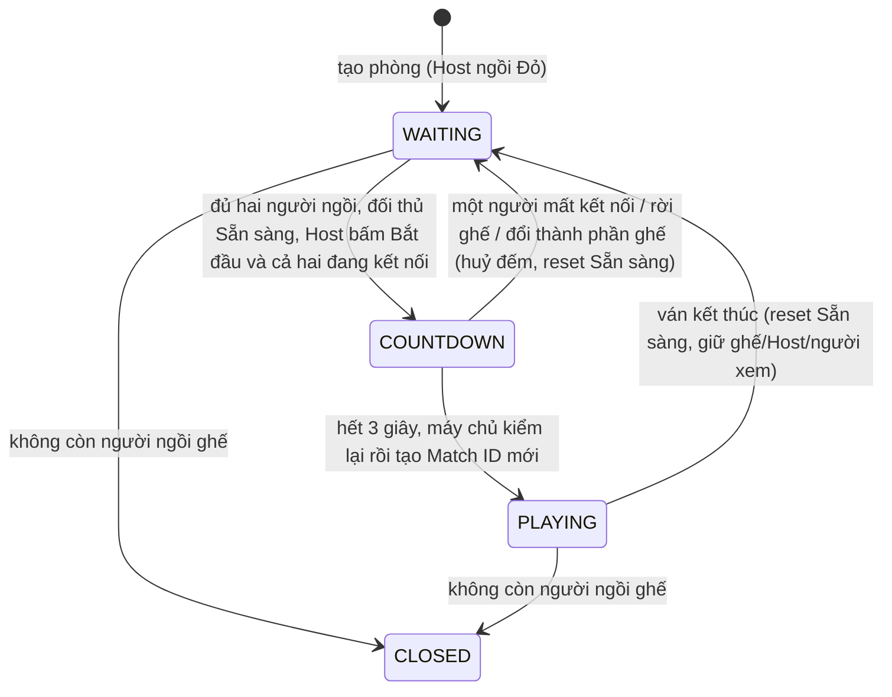

# P1 · YC2 — Tạo phòng, ghế, Sẵn sàng, đổi bên và ở lại phòng

> **BA 0.27 — PO chốt 31/10/2026:** toàn bộ nội dung từng thuộc P2 (Ranked/Elo/bảng xếp hạng, ghép ngẫu nhiên Casual, Xin đi lại/Tái đấu Casual, phần Ranked của lịch sử/thống kê) nay thuộc **P1**. Mọi câu "vẫn P2 / giữ P2 / làm sau / Sắp ra mắt" còn lại trong tài liệu này là lịch sử và bị thay bởi [BA mục 0.27](BA-SCOPE-DECISIONS.md#027-đưa-toàn-bộ-phần-còn-lại-của-p2-lên-p1--po-chốt-31102026); QR vẫn bị loại. Chưa tái ước lượng giờ/Jira; chưa phải bằng chứng triển khai.

**Ngày lập:** 30/10/2026. **Phạm vi:** YC2 của P1 (EP-02: US-02.1, US-02.2; 27 AC). **Hạn P1:** giữ 04/11/2026.

**PO bổ sung phạm vi theo BA 0.20:** P1 có Tái đấu chọn phe **phòng tự tạo**, Không giới hạn/chống treo và giao điểm tạo phòng từ Thách đấu. QR bị bỏ hoàn toàn. Bằng chứng mục 15–18 là **baseline trước bổ sung**, không chứng minh mặc định/mức giờ/Tái đấu mới đã triển khai hoặc đạt; cần kiểm lại AC-02.1.1, AC-02.2.14 và các AC bổ sung ở mục 19.

**Rà soát 31/10/2026:** PO chốt luồng Host Bắt đầu + đối thủ Sẵn sàng, nút Nhường Host, người xem phải thoát phòng mới tạo phòng và không giới hạn tạo phòng (mục 21); **chưa triển khai**.

**Trạng thái:** baseline theo Q1–Q7 (27 AC, mục 16/18); bổ sung BA 0.20 đã triển khai và kiểm chứng local tại mục 20. Cloud: migration của phần bổ sung BA 0.20 đã áp ngày 31/10/2026 (xem YC1 mục 16–17 và BACKLOG-P1 mục 11); chưa xác nhận CI/PO; chưa đóng Task Jira hoặc push phần bổ sung.

## 1. Mục tiêu, nguồn và thứ tự ưu tiên

YC2 cho phép người dùng hoặc Khách tạo một phòng riêng để so tài: chọn mức giờ, số người xem, quyền truy cập; ngồi ghế Đỏ làm Host; chờ người thứ hai; đối thủ bấm Sẵn sàng, Host bấm Bắt đầu, đếm 3-2-1 và vào ván (mục 21). Sau ván, phòng về trạng thái chờ để đánh tiếp, đổi bên hoặc rời mà không phải tạo phòng mới.

Nguồn: [BA Phần 0](BA-SCOPE-DECISIONS.md) mục 0.3, 0.5–0.7, 0.10, 0.13 và các Quyết định 2.0, 2.1, 2.3, 2.6–2.8, 8.3; [Backlog P1 — EP-02](BACKLOG-P1.md); [Danh mục màn hình](../design/DANH-MUC-MAN-HINH-XIANGQI.md) §7 và nhóm modal. Khi nguồn mâu thuẫn, **BA Phần 0 thắng**. Tài liệu này chỉ làm rõ để PO/dev/QA dùng chung, không đổi luật.

| Quyết định đã chốt (BA) | Nội dung |
|---|---|
| 19/10 | Không nhập tên phòng; tên hiển thị tự đặt `Phòng <mã>` |
| 28/10 | Quyền truy cập chọn ngay trong form: `CODE_ONLY` (mặc định) hoặc `PUBLIC`; không chọn `LOCKED` khi tạo |
| 05/10 | Người xem: *Không có người xem* hoặc 1–5, mặc định 5; không đổi sau khi tạo |
| 07/10 (0.6) | Xin đổi bên thuộc P1; một người ngồi ghế dùng "Đổi ghế" tự do |
| 07/10 (0.7) | Sau ván phòng về `WAITING` ngay; "Ở lại phòng" / "Rời phòng"; không đóng sau 10 phút |
| 07/10 (0.10) | Host ngồi chờ một mình: không giới hạn thời gian |
| 05/10 (2.3) | Mất mạng khi đang đếm: huỷ đếm, reset Sẵn sàng, giữ ghế 60 giây |

## 2. Phạm vi và ranh giới với các YC khác

### 2.1 Thuộc YC2

1. Tạo phòng (`MODAL-CREATE-ROOM`), mã 8 chữ số, link mời, phòng chờ `/rooms/:id` ở `WAITING` (`SCR-WAITING-ROOM`).
2. Ghế Đỏ/Đen, "Đổi ghế" khi chỉ một người ngồi ghế, "Xin đổi bên" khi đủ hai người.
3. Sẵn sàng/huỷ Sẵn sàng (người chơi thứ hai), Bắt đầu (Host), Nhường Host, đếm 3-2-1, kiểm tra lại phía máy chủ rồi tạo ván (Match ID mới).
4. Mất kết nối ở phòng chờ: giữ ghế 60 giây; huỷ đếm; chuyển Host; đóng phòng khi không còn người ngồi ghế.
5. Sau ván phòng về WAITING, giữ ghế/người xem/quyền/mức giờ/Host; có Ở lại/Rời và **Tái đấu chọn phe custom** theo BA 0.20/mục 19; Xem lại theo BA 0.22 (thành viên, khi bản lưu sẵn sàng).

### 2.2 Ranh giới với YC khác và phạm vi mới

| Chủ đề | Thuộc | Ghi chú |
|---|---|---|
| Vào phòng bằng mã/link, mời bạn bè, tự xếp ghế/người xem, chuyển tiếp sau đăng nhập | YC3 | YC2 chỉ sinh mã/link và hiển thị |
| Bàn cờ, luật đi, đồng hồ chạy, kết thúc ván | YC4/YC5 | YC2 chỉ yêu cầu tạo ván đúng và chuyển màn |
| `PUBLIC`/`CODE_ONLY`/`LOCKED` đổi sau tạo, danh sách Sảnh, người xem, kick | YC6 | YC2 chỉ yêu cầu chọn `CODE_ONLY`/`PUBLIC` lúc tạo |
| Chat hai kênh, camera/mic | YC7 | Phòng chờ có chat/media theo BA 0.13 nhưng nghiệm thu ở YC7; YC2 chỉ giữ nguyên kênh khi ở lại phòng (AC-02.2.9) |
| Tái đấu custom, Không giới hạn/chống treo, Thách đấu | **P1 bổ sung theo BA 0.20** | Mục 19; Thách đấu chi tiết ở YC3; chống treo giao YC5. QR bị loại khỏi cả P1/P2 |
| Ghép ngẫu nhiên, Đánh Hạng | **P1 theo BA 0.27** | Không có phòng chờ, không có Xin đổi bên |

## 3. Vai trò và quyền

| Chủ thể | Quyền trong YC2 |
|---|---|
| Thành viên hoặc Khách, không ngồi ghế nơi khác, đang ở Sảnh | Tạo phòng (mỗi Khách tối đa 1 phòng đang mở theo BA 0.3) |
| Người đang giữ ghế/ván ở nơi khác | Không tạo được phòng; thấy lý do và đường quay lại vị trí hiện tại (theo YC1, một vị trí chơi) |
| Host | Ngồi ghế; Đổi ghế (khi một mình); **Bắt đầu** (không có Sẵn sàng); Xin đổi bên và **Nhường Host** (khi đủ hai người); Rời phòng |
| Người chơi thứ hai | Sẵn sàng; Xin đổi bên; Rời phòng; không có "Đổi ghế" |
| Người xem | Không có Sẵn sàng, Bắt đầu, Đổi ghế, Xin đổi bên, Nhường Host, nút trong hộp kết quả; muốn tạo phòng phải thoát phòng về Sảnh trước (mục 21.3) |
| Máy chủ | Nguồn sự thật duy nhất cho ghế, Sẵn sàng, đếm, Host, trạng thái phòng; không tin client |

## 4. Tham số phòng và quy tắc dữ liệu

| Tham số | Quy tắc |
|---|---|
| Mức giờ | Thành viên: Không giới hạn/5/10/15 phút; **mặc định Không giới hạn** theo BA 0.20. Khách: 5/10/15, mặc định 10. Thách đấu: mặc định 10. Không cộng giây, không đổi sau khi tạo |
| Người xem tối đa | 0–5 (mặc định 5); cố định sau khi tạo |
| Sức chứa | `2 + số người xem tối đa` (tối đa 7) |
| Quyền truy cập khi tạo | `CODE_ONLY` (mặc định) hoặc `PUBLIC`; mọi giá trị khác, kể cả `LOCKED`, bị từ chối |
| Mã phòng | 8 chữ số do máy chủ sinh; hiển thị dạng nhóm 4+4 (ví dụ `7052 1348`); client không gửi mã |
| Tên hiển thị | `Phòng <mã>`; không có trường nhập tên |
| Host | Người tạo; ngồi ghế Đỏ lúc tạo |
| Trạng thái | `WAITING` → (`PLAYING`) → `WAITING` … → `CLOSED` |
| Giá trị lạ | Mức giờ, số người xem hoặc quyền ngoài tập cho phép bị từ chối ở máy chủ, không tạo phòng, không ghi dữ liệu dở dang |

## 5. Trạng thái phòng

`COUNTDOWN` là giai đoạn con của `WAITING` (có hẹn giờ đếm), không phải trạng thái phòng riêng.

## 6. Tạo phòng (US-02.1: AC-02.1.1 – 02.1.5)

1. Ở Sảnh, người dùng chưa ngồi ghế nơi khác bấm **Tạo phòng** → mở form `MODAL-CREATE-ROOM`.
2. Form thành viên có Không giới hạn/5/10/15 (**mặc định Không giới hạn**); Khách giữ 5/10/15 (**mặc định 10**); Thách đấu mặc định 10. Người xem 0–5 (**mặc định 5**); quyền CODE_ONLY (**mặc định**) hoặc PUBLIC. Không có ô tên, QR hoặc LOCKED khi tạo.
3. Bấm Tạo → máy chủ kiểm lại mọi trường, sinh ID và mã 8 chữ số, đặt tên `Phòng <mã>`, tạo phòng ở quyền đã chọn, đặt người tạo làm Host ngồi ghế Đỏ, trạng thái `WAITING`. Client vào `/rooms/:id`.
4. Phòng chờ hiển thị mã và link mời (khối chia sẻ chi tiết thuộc YC3). Không có chức năng đổi mức giờ hoặc số người xem sau khi tạo — cả giao diện lẫn API.
5. Lỗi hợp lệ (đang giữ vị trí khác, Khách đã có phòng mở, dịch vụ không sẵn sàng) phải báo bằng tiếng Việt rõ ràng, giữ nguyên lựa chọn trong form, không tạo phòng trùng khi bấm lặp (lệnh có `commandId`).
6. Tạo phòng thành công rồi mất mạng trước khi client nhận phản hồi: thử lại cùng lệnh không tạo phòng thứ hai.

## 7. Phòng chờ: ghế, Sẵn sàng và đếm (AC-02.1.6 – 02.1.10)

### 7.1 Ghế

| Tình huống | Hành vi |
|---|---|
| Chỉ Host ngồi ghế | Nút **Đổi ghế** chuyển Đỏ ↔ Đen tùy thích, không cần duyệt (Host không có Sẵn sàng) |
| Người thứ hai ngồi vào ghế còn lại | "Đổi ghế" biến mất; chỉ còn **Xin đổi bên** (mục 10); Sẵn sàng của đối thủ reset |
| Người thứ hai rời ghế, còn một người | "Đổi ghế" xuất hiện lại |
| Thành phần người ngồi ghế thay đổi (vào, rời, mất ghế, xuống/lên ghế) | Sẵn sàng của đối thủ reset; đề nghị đổi bên đang chờ bị huỷ |

### 7.2 Sẵn sàng

- **Từ mục 21.1:** chỉ người chơi thứ hai bấm Sẵn sàng; Host bấm Bắt đầu khi đối thủ đã Sẵn sàng. Khi thành phần ghế thay đổi, Sẵn sàng của đối thủ reset (AC-02.1.10). Mọi câu "cả hai Sẵn sàng" bên dưới đọc theo quy tắc này.
- Trạng thái Sẵn sàng của từng người hiển thị realtime cho mọi người trong phòng.
- Chỉ người ngồi ghế được bấm; người xem không có nút.

### 7.3 Đếm 3-2-1

1. Điều kiện bắt đầu đếm: đủ hai người ngồi ghế, đối thủ đã Sẵn sàng và Host bấm Bắt đầu. Hiển thị **3… 2… 1…** kèm âm thanh (một tiếng mỗi giây), có thể tắt tiếng theo cài đặt âm thanh hiện có.
2. Trong lúc đếm: không có "Xin đổi bên", "Đổi ghế"; đề nghị đổi bên chờ tự huỷ.
3. Hết đếm, **máy chủ kiểm lại** hai ghế, Sẵn sàng và kết nối rồi mới tạo ván với **Match ID mới**; hai client chuyển `SCR-GAME-ROOM`; đồng hồ Đỏ bắt đầu chạy. Thiếu bất kỳ điều kiện nào: không tạo ván, quay về chờ và reset Sẵn sàng.
4. Không ván nào được tạo hai lần cho cùng một lần đếm, kể cả khi hai máy chủ/worker cùng xử lý.

### 7.4 Mất kết nối ở phòng chờ

| Sự kiện | Hành vi |
|---|---|
| Người chơi mất kết nối khi đang đếm | Huỷ đếm; Sẵn sàng của đối thủ về chưa; giữ ghế người mất kết nối **60 giây**; không tạo ván; không xử thua |
| Người chơi mất kết nối ở phòng chờ (không đếm) | Giữ ghế 60 giây; Sẵn sàng của đối thủ reset (xem Q4) |
| Nối lại trong 60 giây | Giữ nguyên ghế; đối thủ phải Sẵn sàng lại và Host bấm Bắt đầu để đếm lại |
| Quá 60 giây | Mất ghế như rời ghế (mục 7.1, 8, 9) |
| Người xem mất kết nối | Thuộc YC6 (giữ chỗ 5 phút), không đổi YC2 |

## 8. Chuyển Host (AC-02.1.11)

- Host rời phòng `WAITING` khi còn người chơi thứ hai → quyền Host chuyển cho người chơi còn lại; phòng tiếp tục chờ.
- Host mất ghế do quá 60 giây khi còn người chơi thứ hai → xử lý như Host rời (Q2).
- Trong ván, Host mất kết nối tạm thời không đổi Host; Host rời hoặc bị xử thua vì quá ân hạn thì quyền chuyển cho người còn lại (BA 2.3 mục 5).
- Host luôn là người đang ngồi ghế; không có thao tác Host tự chuyển mình thành người xem.

## 9. Đóng phòng (AC-02.1.12, AC-02.1.13)

- Phòng `CLOSED` khi **không còn người ngồi ghế**: Host rời khi chỉ một mình, hoặc người cuối cùng mất ghế sau 60 giây.
- Người xem còn lại về Sảnh với thông báo *"Phòng đã đóng"*; chat phòng bị xoá khi phòng đóng.
- **Không tự đóng vì chờ lâu**: Host ngồi một mình hàng giờ vẫn giữ phòng, miễn còn kết nối hoặc còn trong 60 giây ân hạn.
- Không có hạn đóng 10 phút sau ván ở phòng tự tạo (BA 0.7 mục 6).

## 10. Xin đổi bên (US-02.2: AC-02.2.1 – 02.2.7)

| Bước | Hành vi |
|---|---|
| Điều kiện | Phòng `WAITING`, đủ hai người ngồi ghế, không đang đếm; cả hai người chơi có nút **Xin đổi bên**, người xem không có |
| Gửi | A bấm → tối đa **một** đề nghị chờ cho phòng; A thấy trạng thái chờ và nút **Rút đề nghị** |
| Nhận | B thấy `MODAL-SIDE-SWAP-PROMPT` đếm lùi **30 giây** với **Đồng ý / Từ chối** |
| Đồng ý | Hoán đổi Đỏ ↔ Đen; Sẵn sàng của đối thủ reset |
| Từ chối hoặc hết 30 giây | A bị khoá gửi lại **60 giây**: nút `DISABLED` kèm tooltip đếm giây còn lại |
| Rút đề nghị | Đề nghị biến mất; có áp dụng khoá 60 giây hay không: xem Q3 |
| Tự huỷ | Khi đối thủ Sẵn sàng, Host bấm Bắt đầu và bắt đầu đếm; khi một người rời ghế/thành phần ghế đổi |
| Ẩn nút | Khi đang đếm 3-2-1 hoặc đang ván |

Đồng hồ 30 giây và khoá 60 giây tính theo thời gian máy chủ; client chỉ hiển thị. Bấm "Đồng ý" sau khi đề nghị đã hết hạn/bị huỷ được báo rõ và không hoán đổi.

## 11. Sau ván và ở lại phòng (AC-02.2.8 – 02.2.14)

1. Ván kết thúc: **ngay lập tức** phòng về `WAITING`, Sẵn sàng của đối thủ = chưa. Hộp kết quả chỉ là lớp hiển thị.
2. `MODAL-MATCH-RESULT` có **Ở lại phòng / Rời phòng**, thêm **Tái đấu** cho hai thành viên đủ quyền theo mục 19; Xem lại theo BA 0.22 (thành viên, khi bản lưu sẵn sàng). Người xem chỉ thấy kết quả, không có nút người chơi.
3. **Ở lại phòng**: về phòng chờ; giữ nguyên ghế/phe, người xem, chế độ phòng, mức giờ, Host, Kênh Riêng và Kênh Chung.
4. Đối thủ Sẵn sàng, Host Bắt đầu → ván mới, Match ID mới, đồng hồ đặt lại đầy đủ theo mức giờ phòng.
5. **Rời phòng**: ghế trống; phòng vẫn `WAITING`; Host chuyển cho người còn lại nếu người rời là Host; phòng `LOCKED` vẫn giữ khoá.
6. Không ai rời: phòng **không** tự đóng sau 10 phút.
7. Muốn đổi phe thì dùng Xin đổi bên (mục 10).
8. Ván gián đoạn do máy chủ khởi động lại: kết quả trung tính; phòng về `WAITING`, reset Sẵn sàng, vẫn có Ở lại/Rời (BA 8.3, 0.17).
9. Hộp kết quả không được tự hiện lại như một ván mới khi phòng đã `WAITING` và người dùng tải lại trang (Q1).

## 12. Giao diện

| Màn / thành phần | Yêu cầu chính |
|---|---|
| `MODAL-CREATE-ROOM` | Hai nhóm lựa chọn có nhãn; mặc định đúng; không có ô tên phòng; lỗi nằm cạnh ô; nút Tạo hiển thị trạng thái `LOADING`, chống bấm hai lần |
| `SCR-WAITING-ROOM` | Hai ghế lớn Đỏ/Đen; cụm nút Sẵn sàng / Đổi ghế / Xin đổi bên / Chia sẻ phòng (người chơi) / Cài đặt phòng (Host); khối chat/media theo YC7 |
| `MODAL-SIDE-SWAP-PROMPT` | Đếm lùi 30 giây; Đồng ý / Từ chối; hành vi khi Esc/đóng: xem Q5 |
| Đếm 3-2-1 | Số lớn, có âm thanh, tôn trọng `prefers-reduced-motion`; thông báo cho trình đọc màn hình |
| `MODAL-MATCH-RESULT` | Ở lại/Rời; Tái đấu chọn Giữ phe/Đổi phe cho cặp đủ quyền. Xem lại P1 theo BA 0.22 (khi bản lưu sẵn sàng) |

Năm trạng thái cho mọi thao tác chính (`SUCCESS`, `LOADING`, `EMPTY`, `ERROR`, `DISABLED` có tooltip) theo DANH-MUC §2; `DISABLED` của Xin đổi bên có tooltip đếm giây. Dùng token và primitives sẵn có, rộng tối thiểu 360 px, vùng bấm tối thiểu 44 px, tiếng Việt có dấu, nút chỉ có biểu tượng phải có tên truy cập.

## 13. Nguyên tắc kỹ thuật bắt buộc

- Mọi thay đổi ghế/Sẵn sàng/Host/đếm là transaction qua `RoomTransactions.withRoom`, khoá actor rồi khoá phòng theo thứ tự đã sắp xếp; lệnh mang `commandId`, idempotent qua biên lai.
- Tác dụng phụ (phát Socket.IO, huỷ media) đi qua outbox sau commit; hẹn giờ (đếm, hết hạn đề nghị, ân hạn 60 giây) do worker máy chủ xử lý, không phụ thuộc client.
- Luật chỉ nằm ở máy chủ: client gửi ý định, không gửi kết quả (ghế, trạng thái, Match ID).
- Tạo phòng, đổi ghế, Sẵn sàng, Bắt đầu, Xin đổi bên không giới hạn ở mức người dùng, chỉ có trần kỹ thuật 60 lệnh/phút mỗi loại (mục 21.4); không đổi chu kỳ đọc Sảnh 1 giây.
- Không thêm migration nếu lược đồ hiện có đủ; nếu cần thì kèm `rollback/`, không sửa migration đã áp dụng.

## 14. Trường hợp biên cần xử lý

1. Đối thủ hủy Sẵn sàng đúng lúc Host bấm Bắt đầu, hoặc Host bấm Bắt đầu hai lần/hai tab: chỉ một lần đếm, một ván hoặc không ván nào.
2. Một người rời đúng giây hết đếm: máy chủ kiểm lại, không tạo ván.
3. Hai đề nghị đổi bên gửi gần như cùng lúc: chỉ một đề nghị được nhận, đề nghị còn lại nhận lỗi rõ ràng.
4. Bấm "Tạo phòng" hai lần, hoặc mở hai tab: không tạo hai phòng; tab thứ hai thấy vị trí hiện tại.
5. Khách hết phiên khi đang chờ trong phòng: theo luật YC1 (không hết khi đang ngồi ghế/trong ván).
6. Host đổi ghế đúng lúc người thứ hai vào: lệnh bị từ chối nếu thành phần ghế đã đổi; client nhận snapshot mới.
7. Máy chủ khởi động lại khi đang đếm: huỷ đếm, về chờ, reset Sẵn sàng; không tạo ván nửa chừng.
8. Tải lại trang khi đang đếm hoặc có modal đề nghị: client khôi phục đúng từ snapshot máy chủ (số giây còn lại tính từ hạn máy chủ).

## 15. Thay đổi triển khai (30/10/2026)

- Snapshot thêm `room.swapCooldownUntil`: hạn ISO tuyệt đối từ cùng truy vấn hiện có, chỉ người gửi bị từ chối/hết hạn nhận giá trị; người khác nhận `null`. Không thêm migration hoặc timer nghiệp vụ trên client.
- `RoomSeats` hiển thị nút bị khóa và lý do đếm giây theo thời gian server. `SwapPrompt` dùng Dialog giữ focus, đếm thời hạn server; Esc/X/Thu gọn không gửi từ chối, có nút mở lại khi đề nghị còn hiệu lực.
- `RoomPage` chỉ mở kết quả cho ván đã quan sát đang chạy trong phiên đó. Snapshot đầu tiên sau reload không mở lại kết quả cũ. Kết quả chỉ có Ở lại phòng/Rời phòng; Escape = ở lại, nhưng không đóng khi yêu cầu rời đang chờ. Rời lỗi giữ modal, báo lỗi an toàn và cho thử lại.
- Sửa nguyên nhân reset Sẵn sàng ở `room-store-viewers.ts`: cả hai đường người chơi tự xuống xem và Host chuyển người chơi xuống xem đều gọi cleanup countdown/readiness và đóng đề nghị đổi ghế trước snapshot cuối.
- Cập nhật danh mục màn hình và nguồn `AC-TASK-MAP.json`/báo cáo truy vết theo BA 19/10, 28/10: không nhập/lọc tên phòng, chọn CODE_ONLY/PUBLIC ngay trong form. Không sửa lịch, giờ, người nhận hoặc trạng thái Jira.

## 16. Bảng truy vết AC → bằng chứng local

Đường dẫn rút gọn: `room/` = `tests/server/game/room/`; `runtime` = `tests/server/game/game.runtime.yc2.test.ts`; `web/` = `tests/web/features/rooms/`. Kết quả chạy và giới hạn ở mục 18; không dùng sự hiện diện của mã làm chứng cứ PASS.

| AC | Nội dung | Test hoặc quan sát |
|---|---|---|
| 02.1.1 | Form đúng lựa chọn và mặc định | `web/RoomForms.test.ts`; trình duyệt form 10 phút/5 xem/CODE_ONLY, không tên |
| 02.1.2 | Từ chối tham số ngoài tập | `room/room.test.ts`, `room/room-http.test.ts`: validation trước ghi |
| 02.1.3 | Mã 8 số, Host Đỏ, vào phòng chờ | `room/room.test.ts`; trình duyệt tạo và vào `/rooms/:id` |
| 02.1.4 | Thời gian/trần xem bất biến | `web/RoomSettings.test.ts`; không có API đổi hai tham số sau tạo |
| 02.1.5 | Tối đa 2 + 5 | `room/room-yc2-lifecycle.test.ts`: người xem thứ sáu nhận ROOM_FULL |
| 02.1.6 | Đổi ghế một mình | `room/room.test.ts`; `web/RoomSeats.test.ts` |
| 02.1.7 | Sẵn sàng realtime | `tests/server/game/game.runtime.test.ts`; hai trình duyệt Sẵn sàng cùng ván |
| 02.1.8 | Đếm, tạo ván, đồng hồ Đỏ | `runtime`: countdown thật, đồng hồ đỏ chạy/đen đầy; `web/RoomCountdown.test.ts` |
| 02.1.9 | Mất kết nối khi đếm | `room/room.test.ts`: huỷ đếm/reset/giữ ghế; runtime hiện có |
| 02.1.10 | Đổi thành phần ghế reset cả hai | `room/room-yc2-lifecycle.test.ts`: rời ghế, tự xuống xem, Host chuyển xuống xem, disconnect |
| 02.1.11 | Chuyển Host khi rời | `tests/server/game/game.runtime.test.ts`; lifecycle: quá 60 giây chuyển Host không xử thua |
| 02.1.12 | Đóng phòng và xoá chat | `runtime`: rời ghế cuối, xoá chat SQL, gửi room.closed tới người xem |
| 02.1.13 | Host chờ lâu không tự đóng | `room/room-yc2-lifecycle.test.ts`: connected Host với last_seen_at cũ hai giờ, chạy xử lý hạn |
| 02.2.1 | Quyền Xin đổi bên | `web/RoomSeats.test.ts`, `web/RoomPage.swap.test.ts`: hai ghế/người xem/solo |
| 02.2.2 | Modal 30 giây, người gửi có Rút | `web/RoomPage.swap.test.ts`; trình duyệt modal và focus |
| 02.2.3 | Đồng ý đổi bên/reset | `room/room-side-swap.test.ts`; hai trình duyệt đổi Đỏ ↔ Đen |
| 02.2.4 | Cooldown 60 giây và tooltip | `room/room-side-swap.test.ts`: hạn/riêng người gửi/qua reseat; `web/RoomPage.swap.test.ts`; trình duyệt reload vẫn khóa |
| 02.2.5 | Chỉ một đề nghị | `room/room-side-swap.test.ts`; web không gửi lặp khi đang chờ |
| 02.2.6 | Đếm/rời ghế tự huỷ | `room/room-yc2-lifecycle.test.ts`: kiểm CLOSED và không tạo cooldown |
| 02.2.7 | Ẩn đổi bên khi đếm/đang đấu | `web/RoomPage.swap.test.ts`; trình duyệt ván thật |
| 02.2.8 | Kết quả → WAITING/reset | `runtime`; `web/RoomPage.result.test.ts`: live/reload/reconnect |
| 02.2.9 | Giữ ghế/Host/xem/quyền/chat | `runtime`: kiểm cả ROOM_PUBLIC và PLAYERS_PRIVATE sau RESIGN |
| 02.2.10 | Ván mới ID mới/đồng hồ đầy | `runtime`: hai lượt countdown thật, Match ID khác và clock reset |
| 02.2.11 | Rời phòng giữ LOCKED/chuyển Host | `runtime`: hai ca rời peer/Host |
| 02.2.12 | Không đóng sau mười phút | Phép đo runtime và hai socket thật, xem kết quả mục 18 |
| 02.2.13 | Chuyển nút solo/hai ghế | `web/RoomSeats.test.ts`, `web/RoomPage.swap.test.ts` |
| 02.2.14 | Chỉ hai nút đúng vai trò | `web/match/MatchResult.test.ts`, `web/RoomPage.result.test.ts`; trình duyệt thắng/thua |

## 17. Câu hỏi cần PO quyết định

PO trả lời ngày 30/10/2026: chọn đúng cách hiểu đề xuất cho cả bảy câu. Các cách hiểu này là quyết định đã chốt, thay cho "giả định" ở các mục 7–11 và 15; chỉ Q1, Q5 và Q7 yêu cầu sửa mã (mục 15). Q2, Q3, Q4, Q6 phải được xác nhận bằng test khi triển khai.

| # | Câu hỏi | Quyết định của PO |
|---|---|---|
| Q1 | Sau ván, phòng đã về `WAITING`. Tải lại trang (chưa bấm Ở lại/Rời): hộp kết quả có hiện lại không? | **Chốt: không hiện lại.** Hộp kết quả chỉ hiện ngay khi ván kết thúc ở phiên đang mở; tải lại thì vào thẳng phòng chờ |
| Q2 | Host mất ghế quá 60 giây khi người chơi thứ hai còn ngồi | **Chốt: chuyển Host** như khi Host rời; phòng chỉ đóng khi không còn ai ngồi ghế (BA 0.10) |
| Q3 | Người gửi **Rút** đề nghị đổi bên có bị khoá 60 giây không | **Chốt: không khoá**; chỉ khoá khi bị Từ chối/hết hạn |
| Q4 | Mất kết nối ở phòng chờ không trong lúc đếm có reset Sẵn sàng cả hai không | **Chốt: có reset** (giữ hành vi hiện tại) |
| Q5 | `MODAL-SIDE-SWAP-PROMPT` là hộp thoại giữ focus? | **Chốt: hộp thoại giữ focus**; Esc không tự Từ chối — phải bấm Đồng ý/Từ chối hoặc đợi hết 30 giây (hết hạn tính như Từ chối) |
| Q6 | X/Esc ở hộp kết quả có là "Ở lại phòng" không | **Chốt: có**; phòng đã ở `WAITING`, chỉ "Rời phòng" mới rời |
| Q7 | Đóng modal đề nghị đổi bên khi chưa trả lời, có mở lại được trong 30 giây không | **Chốt: có**, qua nút/biểu ngữ trong phòng chờ |

## 18. Kiểm chứng đã chạy

Theo yêu cầu triển khai, commit và test đầy đủ của PO; Node 22.22.3, PostgreSQL 17 cô lập.

| Kiểm tra | Kết quả quan sát |
|---|---|
| `fnm exec --using 22 bash tests/server/db.sh test` | **227/227 file, 2.728/2.728 test đạt**; lượt cuối không dùng chung database với smoke |
| Web phòng/router + realtime projection | **32 file, 408 test đạt** |
| `fnm exec --using 22 pnpm -r typecheck` | Đạt cả workspace |
| `fnm exec --using 22 pnpm build` | Đạt; cảnh báo chunk LiveKit >500 kB còn nguyên |
| ESLint các file TypeScript thay đổi | Đạt |
| Prettier các file TypeScript thay đổi | Đạt; sửa định dạng `RoomPage.result.test.ts` sau lượt check đầu |
| Nguồn truy vết → `TRUY-VET-AC.md` | Khớp kết quả `traceability_md()`; cả 27 Given/When/Then/mức kiểm trong mapping khớp Backlog P1, không sinh lại lịch/tài liệu khác |
| Hai trình duyệt độc lập | Guest → tạo phòng → vào bằng mã → đổi bên → Sẵn sàng/đếm → ván → đầu hàng → thắng/thua → ở lại và reload không mở kết quả cũ |
| Modal và cooldown | Focus nằm trong modal; Escape thu gọn, nút mở lại giữ hạn 30 giây; hoán đổi đúng hai đầu; từ chối khóa đúng người gửi và reload vẫn thấy khóa |
| Giao diện thật | Đã xem ảnh 1366×768 và 360×800, hộp kết quả hai nút và modal đổi bên; không tràn ngang |
| Chờ sau ván >10 phút | **611 giây thực**: WAITING, hai ghế/hai kết nối, Host và Match ID giữ nguyên; `/ready` 200, `/auth/refresh` không cookie 401; hai trình duyệt reload vẫn ở phòng chờ, không mở lại kết quả |

Smoke chạy Vite `127.0.0.1:5182` → Nest `127.0.0.1:3182`, cụm PostgreSQL riêng tại `55462/xiangqi_yc2_smoke`. Hai danh tính Khách và Socket.IO thật; provider Auth không khả dụng và không được gọi trong đường Guest. Không dùng tài khoản, fixture hoặc migration trên Cloud.

Hai test reset Sẵn sàng khi xuống xem đã được quan sát **fail trước sửa / pass sau sửa**: cờ người còn lại trước đó vẫn `true`. Lượt full chạy cùng smoke trên DB test đã thất bại do khóa runtime; chuyển smoke sang DB riêng rồi lượt cuối đạt, không đổi mã để bỏ khóa. Phép đo mười phút đầu thấy SQL còn phòng ở giây 611 nhưng runtime mất quyền phục vụ, nên không dùng kết quả đó nghiệm thu; đo lại trên cụm PostgreSQL riêng với kiểm tra readiness và bootstrap Auth ở cuối.

Giới hạn: không nghiệm thu YC3/YC6/YC7, Google/OAuth, LiveKit cam/mic hoặc tải nhiều người trong lần này. Smoke báo lỗi media chưa cấu hình nhưng không chặn ván. Chưa nghe âm thanh trên loa và chưa chạy screen reader; test đếm/âm thanh không thay thế hai kiểm tra thiết bị này. Lượt full vẫn có log `realtime_disconnect_failed`, `realtime_maintenance_failed`, `registration_maintenance_failed` và cảnh báo navigation của jsdom; không che log, không coi suite xanh là bằng chứng production không lỗi.

Không thêm migration/dependency. Tự kiểm server: SQL thay đổi chỉ trong store; controller không chạm DB; ghi ghế vẫn qua `withRoom`/biên lai/outbox sau commit; không thêm tầng abstraction mới.

## 19. Bổ sung P1 — Tái đấu và Không giới hạn/chống treo (BA 0.20)

**Trạng thái:** đã triển khai, bằng chứng local tại mục 20; không kế thừa PASS từ baseline. AC chi tiết giữ mã cũ tại [BACKLOG-P2.md](BACKLOG-P2.md), được đưa vào phạm vi [Backlog P1](BACKLOG-P1.md).

### 19.1 Tái đấu chọn phe — phần custom US-P2-09 / XIAN-123

- Sau ván trong cùng phòng tự tạo, hai thành viên vẫn giữ ghế: người đề nghị chọn **Giữ phe / Đổi phe**, mặc định Đổi. Đối thủ thấy rõ lựa chọn và có 30 giây Đồng ý/Từ chối.
- Đồng ý → server kiểm lại cặp/ghế/phòng/kết quả và trạng thái chưa bắt đầu ván khác; đếm 3 giây → Match ID mới **không cần Ready lại**. Dùng cơ chế kiểm kết nối/hủy đếm của phòng hiện có, không vượt ràng buộc một vị trí.
- Giữ mức giờ (kể cả Không giới hạn), quyền phòng, Host, blocks, spectators và chat cùng cặp. Không đổi tên/mã hoặc tạo phòng khác chỉ vì tái đấu.
- Hai đề nghị đồng thời giữ đề nghị tới trước, bên gửi sau thấy đề nghị đối thủ. Thay ghế/đã có ván mới làm đề nghị cũ vô hiệu; retry không tạo hai ván.
- Không dùng/không đồng ý Tái đấu vẫn giữ đường **Ở lại → Xin đổi bên nếu muốn → Ready**; không tự tạo ván mới. Khách không gửi/nhận Tái đấu theo quyền nguồn; không tự đồng ý thay họ.
- Nghiệm thu **AC-P2-09.1–3 phần custom**: Giữ/Đổi, chấp nhận/hết hạn, đồng thời, thay ghế/Ready/rời/mất mạng sát accept/countdown, ván mới duy nhất và giữ chat/quyền. Tái đấu Casual: xem YC9; Ranked không có Tái đấu.

### 19.2 Không giới hạn và chống treo — US-P2-10 / XIAN-124

- Form thành viên có bốn mức, mặc định Không giới hạn; Thách đấu mặc định 10. Khách không tự tạo mức Không giới hạn, nhưng **được chơi/xem phòng mức này do thành viên tạo** theo ghế/chỗ trống, phiên/khóa/chặn; khi chơi chịu cùng chống treo/INACTIVITY (PO chốt BA 0.21).
- Trong ván online Không giới hạn, chỉ bên tới lượt không đi **3 phút** nhận banner đếm **30 giây**. Banner không modal, không trap focus, không che bàn cờ hoặc Đầu hàng. Không áp AI hay xử phạt Host ngồi chờ một mình.
- Hết cảnh báo không phản hồi → server kết thúc `INACTIVITY`, bên không hoạt động thua. “Tôi còn đây” reset 3 phút tối đa hai lần liên tiếp khi chưa có nước mới; lần nhắc thứ ba không có nút. Đi nước mới reset chuỗi.
- Timer/hạn/kết quả do server quyết định, reconnect/retry không tự reset hoặc xử thua hai lần. Các chế độ 5/10/15 vẫn giữ đồng hồ và TIMEOUT hiện hành.
- Nghiệm thu **AC-P2-10.1–3**: mặc định/validation/quyền, mốc 3 phút +30 giây, lần xác nhận 1/2/3, reset theo nước đi, đúng người tới lượt, kết thúc/mất mạng/reconnect đồng thời, UI banner thực trên 360px.

### 19.3 Giao điểm Thách đấu và chia sẻ

Thách đấu từ trang Bạn bè dùng cùng form tạo phòng không tên, mặc định 10 phút/CODE_ONLY/5 người xem; chỉ xác nhận mới tạo rồi gửi lời mời cho bạn đã chọn. Chi tiết **AC-P2-19.1–3** ở YC3. Chia sẻ chỉ có Sao chép link/Sao chép mã; không QR ở bất kỳ phân kỳ nào, vẫn giữ tab mời bạn bè.

## 20. Bằng chứng local cho tái đấu và Không giới hạn

- Suite PostgreSQL 17/Node 22: 247 file/2.873 test PASS, gồm race tái đấu, hết hạn, quyền Khách, clock invariant ONLINE/AI, idempotency “Tôi còn đây”, reset chuỗi khi đi nước, hòa và ưu tiên disconnect.
- Hai trình duyệt production: Giữ phe và Đổi phe đều được đối thủ chấp nhận, đếm rồi vào ván mới không Ready lại; cùng phòng/mã/mức giờ.
- Ván online Không giới hạn có clock anchor lưu DB nhưng snapshot `clocks: null`; web không tạo đồng hồ giả. Regression parser phủ ACTIVE/FINISHED và từ chối thiếu deadline chống treo.
- UI banner 30 giây và “Tôi còn đây” chạy với worker thật; xác nhận ghi lại anchor và `inactivity_extensions=1` trên DB smoke. Một ván im lặng thực tế kết thúc “Không phản hồi quá lâu”.
- Form thành viên mặc định Không giới hạn; Thách đấu mặc định 10 phút; Khách chỉ tạo 5/10/15 nhưng được tham gia phòng 0 theo quyền. Chia sẻ chỉ copy link/mã, không ảnh QR.
- Bố cục desktop giới hạn viewport, vùng phụ cuộn nội bộ. Migration có rollback, kiểm trên DB local riêng; Cloud/CI và nghiệm thu PO chưa xác nhận.

## 21. Quyết định PO khi rà soát YC2 — 31/10/2026

Các quyết định dưới đây sửa mục 1, 3, 5, 7, 8, 11, 13, 14. **Đã có mã local 31/10 (Host Bắt đầu, Nhường Host, trần 60 lệnh/phút), chưa nghiệm thu**; mockup `SCR-WAITING-ROOM.html` còn theo luồng cũ (cả hai bấm Sẵn sàng).

### 21.1 Bắt đầu ván bằng nút của Host (phòng tự tạo)

- **Người chơi thứ hai** có nút **Sẵn sàng / Hủy Sẵn sàng**. **Host không có Sẵn sàng**; Host có nút **Bắt đầu**.
- **Bắt đầu** chỉ sáng và có hiệu lực khi: đủ hai người ngồi ghế, đối thủ đã Sẵn sàng, cả hai đang kết nối, phòng ở `WAITING` và không đang đếm. Chưa đủ điều kiện thì `DISABLED` kèm tooltip (*"Chờ người chơi thứ hai"* hoặc *"Chờ đối thủ sẵn sàng"*). Host đang ngồi một mình vẫn thấy nút, ở trạng thái `DISABLED`.
- **Đồng bộ nhanh:** ngay khi đối thủ bấm Sẵn sàng/Hủy, nút Bắt đầu của Host sáng/tắt theo, không cần tải lại. Mục tiêu độ trễ dùng ngưỡng NFR-01 (p95 < 100 ms trong môi trường demo, đo thật; không đạt ghi BLOCKED) — PO xác nhận 31/10.
- Host bấm Bắt đầu → **đếm 3-2-1** (giữ nguyên, có âm thanh) → máy chủ kiểm lại hai ghế, Sẵn sàng của đối thủ và kết nối → tạo ván, Match ID mới. Thiếu điều kiện nào: không tạo ván, quay về chờ.
- Trong lúc đếm, đối thủ hủy Sẵn sàng, mất kết nối, rời ghế hoặc thành phần ghế đổi → hủy đếm, về chờ, Sẵn sàng của đối thủ reset, giữ ghế 60 giây cho người mất kết nối (AC-02.1.9).
- **Reset Sẵn sàng của đối thủ** khi: thành phần ghế đổi, Xin đổi bên được đồng ý, Nhường Host, đối thủ mất kết nối ở phòng chờ, ván kết thúc.
- Sau ván: phòng về `WAITING`; đối thủ phải Sẵn sàng lại, Host bấm Bắt đầu. Tái đấu (mục 19.1) vẫn vào ván không cần Sẵn sàng/Bắt đầu.
- **Chỉ áp cho phòng tự tạo (kể cả Thách đấu).** Đánh Thường ghép ngẫu nhiên và Ranked dùng hộp Xác nhận 30 giây rồi đếm 3-2-1 (YC9 mục 16), không có Sẵn sàng/Bắt đầu của Host.
- Mọi câu "cả hai Sẵn sàng", "Sẵn sàng của cả hai" ở mục 5–14 của tài liệu này, ở BA 0.6/0.7/2.3/2.8 và BACKLOG-P1 AC-02.1.7–02.1.10 được hiểu theo quy tắc này.

### 21.2 Nhường Host

- Chỉ **Host** thấy nút **Nhường Host**, chỉ khi phòng `WAITING`, đủ hai người ngồi ghế và không đang đếm. Không nhường khi đang ván hoặc khi chỉ có một người ngồi ghế.
- Bấm → hộp xác nhận → **chuyển ngay**, người nhận không phải đồng ý. Người nhận thành Host (có Bắt đầu, Cài đặt phòng, quyền Host khác); Host cũ thành người chơi thứ hai (có Sẵn sàng). Ghế/phe không đổi; Sẵn sàng của người chơi thứ hai reset.
- Chuyển nguyên tử, idempotent theo `commandId`; trạng thái do máy chủ quyết định; thông báo cho cả phòng. Người xem không có nút.
- Chuyển Host tự động khi Host rời/mất ghế (mục 8) giữ nguyên.

### 21.3 Người xem phải thoát phòng mới tạo phòng

- Người xem chỉ xem khi đang ở trong phòng. **Về Sảnh = rời hẳn phòng xem**, giải phóng chỗ xem ngay.
- Sảnh **không** có thông báo hay nút để quay lại phòng đang xem (khác người chơi: ván dở vẫn có banner "Quay lại").
- Người đang xem muốn tạo phòng phải thoát phòng về Sảnh rồi mới tạo. Nút Tạo phòng ở phòng xem không có; ở Sảnh luôn dùng được nếu không ngồi ghế nơi khác.
- Không đổi: người xem mất kết nối (đóng tab, mất mạng) giữ chỗ 5 phút và vào lại bằng link/mã (YC6); chuyển thẳng từ phòng xem A sang phòng B bằng link/lời mời vẫn nguyên tử theo BA 0.19 Q5.

### 21.4 Không giới hạn tạo phòng

- Người dùng không bị giới hạn số lần tạo phòng và có thể tạo, rời/hủy phòng rồi tạo phòng khác ngay. Phòng chỉ có Host một mình: Host rời thì phòng đóng ngay (mục 9).
- **Trần kỹ thuật rất cao** để bảo vệ hệ thống, không tác động người dùng bình thường: mỗi tài khoản (Khách tính theo phiên) tối đa **60 lệnh/phút cho mỗi loại lệnh phòng** (tạo phòng, đổi ghế, Sẵn sàng, Bắt đầu, Xin đổi bên). Vượt trần: *"Thao tác quá nhanh, vui lòng thử lại sau"*, không ghi dữ liệu. Giá trị do dev chỉnh được; PO xác nhận 31/10.
- Giữ: Khách tối đa 1 phòng đang mở; chu kỳ đọc Sảnh 1 giây không đổi; khóa 60 giây của Xin đổi bên (mục 10) không đổi.
- Rủi ro đã nêu và PO chấp nhận: có thể tạo và hủy phòng liên tục làm danh sách PUBLIC nháy và tăng ghi dữ liệu; chỉ giảm bằng trần kỹ thuật ở trên.

### 21.5 Tiêu chí bổ sung

| Mã | Given / When | Then bắt buộc |
|---|---|---|
| AC-YC2-RV-01 | Phòng tự tạo, Host ngồi một mình | Nút Bắt đầu hiện nhưng `DISABLED` kèm tooltip; Host không có nút Sẵn sàng |
| AC-YC2-RV-02 | Đủ hai người, đối thủ bấm Sẵn sàng | Nút Bắt đầu của Host sáng ngay không cần tải lại; đối thủ Hủy Sẵn sàng thì tắt ngay |
| AC-YC2-RV-03 | Host bấm Bắt đầu khi đủ điều kiện | Đếm 3-2-1 rồi máy chủ kiểm lại và tạo đúng một ván, Match ID mới; bấm lặp hoặc hai tab không tạo hai ván |
| AC-YC2-RV-04 | Đang đếm, đối thủ hủy Sẵn sàng / mất kết nối / rời ghế | Hủy đếm, không tạo ván, Sẵn sàng của đối thủ reset, giữ ghế 60 giây với người mất kết nối |
| AC-YC2-RV-05 | Host bấm Bắt đầu bằng API khi đối thủ chưa Sẵn sàng hoặc người khác (không phải Host) gọi lệnh | Máy chủ từ chối, không tạo ván |
| AC-YC2-RV-06 | Host bấm Nhường Host trong phòng chờ đủ hai người, xác nhận | Quyền Host chuyển ngay, nút Bắt đầu/Cài đặt phòng đổi chủ, Sẵn sàng của người chơi thứ hai reset, ghế/phe giữ nguyên |
| AC-YC2-RV-07 | Nhường Host khi đang đếm, đang ván, một mình, hoặc người xem/người chơi thứ hai gọi | Nút ẩn hoặc `DISABLED`; gọi trực tiếp bị từ chối |
| AC-YC2-RV-08 | Người đang xem phòng A về Sảnh | Chỗ xem được giải phóng; Sảnh không có banner hay nút quay lại phòng A; bấm Tạo phòng dùng được |
| AC-YC2-RV-09 | Người dùng tạo phòng rồi rời/hủy rồi tạo tiếp liên tục dưới trần | Mọi lần tạo thành công, không khóa chờ; Khách vẫn tối đa 1 phòng mở |
| AC-YC2-RV-10 | Một tài khoản gửi trên 60 lệnh phòng cùng loại trong một phút | Lệnh vượt trần bị từ chối với thông báo quá nhanh, dữ liệu không đổi |

### 21.6 Tác động triển khai (đã có mã local, chưa nghiệm thu)

- Đã làm: lệnh `room.start` (socket) và `transfer-host` (HTTP); `ready` từ chối Host; hộp xác nhận Nhường Host ở `RoomPage`; trần `CommandLimiter`; test server/web cập nhật theo luồng mới. Người xem: Sảnh vốn không có banner quay lại phòng xem, "Rời phòng" giải phóng chỗ xem ngay, người xem tạo phòng không bị chặn; **chưa tự rời khi trình duyệt quay lại/đóng tab (giữ chỗ 5 phút theo YC6)**. Chưa sửa mockup. **Đã xem giao diện thật 31/10/2026** (Vite + Nest + Socket.IO + PostgreSQL cô lập; Khách làm Host trên trình duyệt, đối thủ Khách qua API/Socket, không dùng Cloud): Host một mình thấy Bắt đầu bị khóa kèm lý do; đối thủ Sẵn sàng làm Bắt đầu sáng ngay không tải lại, Hủy thì tắt ngay; bấm Bắt đầu → đếm 3-2-1 (ẩn Xin đổi bên/Nhường Host) → ván mới đồng hồ chạy; sau ván Sẵn sàng reset; Nhường Host qua hộp xác nhận chuyển quyền ngay, ghế giữ nguyên; 360 px không tràn ngang, nút cao 44 px. Chưa đo độ trễ p95, chưa thử hai trình duyệt người thật, chưa thử trần 60 lệnh/phút trên UI. Ghi chú các mục dưới là phân tích ban đầu:

- Đổi mô hình Sẵn sàng: hiện lưu Sẵn sàng cả hai ghế; cần Sẵn sàng chỉ cho người không phải Host và lệnh Bắt đầu mới. Ảnh hưởng `RoomStore` (lớp và hợp đồng `realtime.ts`), `RoomSeats`/`RoomPage`, test phòng, mockup `SCR-WAITING-ROOM.html`, AC-02.1.7–02.1.10, D5, D7.
- Nhường Host: lệnh mới trong `RoomStore`, nút ở `RoomSeats`, AC mới; thêm vào danh sách lệnh trong `docs/engineering/server/room.md` khi triển khai.
- Người xem: bỏ mọi banner "quay lại phòng đang xem" nếu đã có; kiểm đường Về Sảnh giải phóng chỗ xem.
- Trần 60 lệnh/phút: dùng cơ chế giới hạn sẵn có nếu có; không thêm hạ tầng mới.
- Bằng chứng ở mục 15–20 là trước các thay đổi này; không kế thừa PASS.
