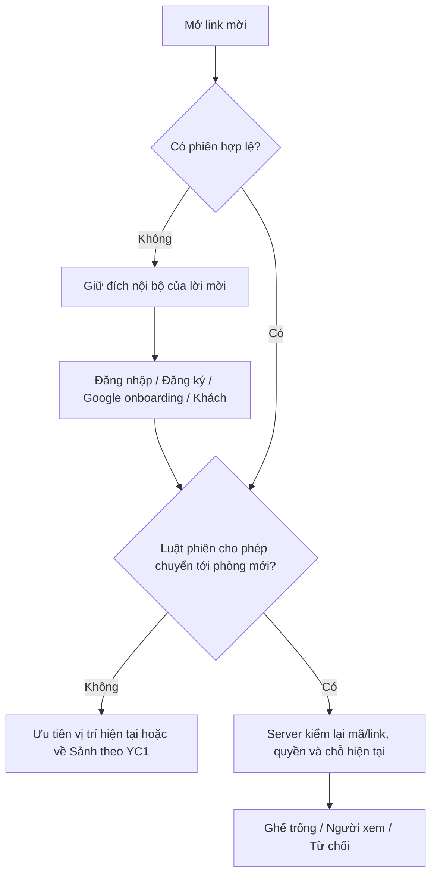

# P1 · YC3 — Mời vào phòng bằng link/mã và bạn bè online

**Ngày lập:** 30/10/2026. **Phạm vi:** EP-03, US-03.1 và US-03.2, tổng **28 AC** (7 + 21). Giữ hạn P1 theo BA, không tái ước lượng hay đổi kế hoạch Jira trong tài liệu này.

**Trạng thái:** PO đã chốt Q1–Q8 và tên người gửi ngày 30/10/2026; đã triển khai server/web và kiểm chứng local theo mục 13. Bằng chứng local không phải xác nhận CI/Cloud hoặc nghiệm thu PO; không đổi trạng thái Jira.

**PO mở rộng P1 theo BA 0.20:** Thách đấu (`US-P2-19`/XIAN-133) và DM/unread (`US-P2-18`/XIAN-132) thuộc P1; **QR bỏ hẳn**, chỉ Sao chép link/Sao chép mã. Mục 15 bổ sung sáu AC mang mã cũ; AC-03.2.14 đổi từ disabled sang hoạt động có kiểm quyền. Bằng chứng mục 13 là **trước mở rộng**, không nghiệm thu thay phần mới hoặc AC-03.2.14 đã đổi.

## 1. Mục tiêu và nguồn có thẩm quyền

Người dùng rủ người khác vào đúng phòng tự tạo theo hai đường độc lập:

1. Chia sẻ link hoặc mã phòng cho bất kỳ ai, không cần kết bạn; người chưa có phiên đăng nhập/đăng ký/chọn Khách rồi tự về đúng phòng.
2. Tài khoản thành viên kết bạn hai chiều, xem trạng thái bạn, gửi lời mời 30 giây ngay trong phòng đang ngồi ghế.

Nguồn: [BA-SCOPE-DECISIONS.md](BA-SCOPE-DECISIONS.md) Phần 0 (đặc biệt **0.19 — PO chốt YC3 30/10/2026**, 0.2, 0.3, 0.5–0.7), Quyết định 1.8, 2.4–2.8, 4.2–4.3, 5.5 và Phần 11; [BACKLOG-P1.md](BACKLOG-P1.md) EP-03 và NFR; [DANH-MUC-MAN-HINH-XIANGQI.md](../design/DANH-MUC-MAN-HINH-XIANGQI.md) §11, §14, nhóm modal và thanh điều hướng. [YC1](P1-YC1-TAI-KHOAN-VA-XAC-THUC.md) và [YC2](P1-YC2-TAO-PHONG.md) là các phạm vi đã tách riêng.

Thứ tự ưu tiên: **BA Phần 0 → phần BA còn lại → Backlog P1 → Danh mục màn hình → Design → mockup**. Các lựa chọn PO ở mục 12 đã được đưa vào BA 0.19; không còn là đề xuất đang chờ duyệt.

### 1.1 Cách đọc những chỗ khác nhau giữa nguồn

| Nội dung                                                    | Cách áp dụng trong P1                                                                                                  |
| ----------------------------------------------------------- | ---------------------------------------------------------------------------------------------------------------------- |
| Một số AC ghi “mã 8 ký tự”                                  | BA 2.7 quy định cụ thể **8 chữ số**, máy chủ cấp; giữ cả số 0 đầu nếu có. Không suy thành mã chữ/số tùy ý              |
| Nguồn cũ có QR | BA 0.20 **loại QR khỏi cả P1/P2**, chỉ chia sẻ link/mã; không tạo ảnh/nút QR |
| Mẫu popup từng ghi `[Tên Host]`                             | PO đã chốt dùng **tên người thực sự gửi**, cả Host và người chơi còn lại đủ quyền đều được mời; BA 2.5/0.19 đã đồng bộ |
| BA 5.5 nhắc DM/unread | **P1 theo 0.20**; badge DM tách số đếm/đích chuông lời mời kết bạn; Elo/thẻ Ranked vẫn P2 |
| Mô tả Thách đấu cũ có câu “nhập tên phòng” | P1 dùng form YC2 hiện hành **không nhập tên**; mặc định Thách đấu 10 phút/CODE_ONLY/5 người xem |

BA, Backlog, Danh mục và tổng quan yêu cầu đã được đồng bộ theo lựa chọn PO. Không tự đổi lịch, ước lượng hoặc trạng thái Task Jira.

## 2. Phạm vi và ranh giới

| Trong YC3 P1                                                         | Không gộp vào YC3                                                                                    |
| -------------------------------------------------------------------- | ---------------------------------------------------------------------------------------------------- |
| Chia sẻ/sao chép link và mã; nhập mã tại Sảnh                        | Tạo phòng, mức giờ, Ready, đếm ngược, đổi bên, Host transfer: YC2                                    |
| Giữ đích qua login/register/onboarding Google/Khách theo quyền YC1   | Tự rời ván/đầu hàng hoặc bỏ ưu tiên phiên để nhận lời mời mới                                        |
| Xếp ghế trống hoặc người xem khi vào; xử lý đầy/đóng/khóa/bị chặn    | Toàn bộ danh sách phòng PUBLIC, đổi quyền phòng, quản lý ghế/kick: YC6; YC3 kiểm giao điểm vào phòng |
| Tìm/kết bạn, thu hồi/chấp nhận/từ chối/hết hạn/hủy kết bạn; DM/unread và Thách đấu theo mục 15 | Ranked, ghép ngẫu nhiên, lịch sử/replay: P2; QR bị loại hẳn |
| Online/Đang đấu/Offline, chuông kết bạn, badge DM tách biệt | Không tự tạo phòng khi mở Friends; chỉ xác nhận form Thách đấu mới tạo rồi mời |
| Mời bạn online trong phòng, popup 30 giây và xử lý Tham gia/Từ chối  | Email/push notification ngoài ứng dụng hoặc lời mời phòng lưu trong chuông                           |

Không viết lại chức năng đã có chỉ vì đổi tên yêu cầu. Phần code hiện hữu cần được kiểm chứng lại theo AC và quyết định PO, không được đánh dấu PASS chỉ vì tìm thấy file/test.

## 3. Vai trò và quyền

| Chủ thể                                    | Quyền và giới hạn                                                                                                                      |
| ------------------------------------------ | -------------------------------------------------------------------------------------------------------------------------------------- |
| Chưa có phiên                              | Được mở link; chọn đăng nhập, đăng ký hoặc Khách trước khi server cho vào phòng                                                        |
| Thành viên, kể cả chưa xác minh email      | Dùng link/mã, trang Bạn bè và lời mời theo quyền phòng; không lấy email tùy chọn làm cổng khóa YC3                                     |
| Khách                                      | Vào bằng link/mã; khi ngồi ghế được chia sẻ link/mã. Không tìm/kết bạn, không gửi/nhận lời mời bạn bè; tab bạn bè trong modal ẩn       |
| Host hoặc người chơi còn lại đang ngồi ghế | Mở Chia sẻ phòng; thành viên được gửi lời mời bạn online. Không chỉ Host mới có quyền này                                              |
| Người xem                                  | Không có nút Chia sẻ phòng; không được gọi API giả làm người ngồi ghế để gửi lời mời phòng                                             |
| Người đang giữ ghế hoặc ván AI khác        | Không được chiếm vị trí chơi thứ hai; luật phiên/vị trí được kiểm trước auto-redirect và lúc chấp nhận lời mời                         |
| Máy chủ                                    | Quyết định quan hệ bạn bè, trạng thái có thể mời, deadline, quyền vào, ghế và sức chứa. Client không tự quyết bằng dữ liệu hiển thị cũ |

## 4. Dữ liệu và các mốc thời gian đã chốt

| Đối tượng           | Quy tắc                                                                                                                                                                                         |
| ------------------- | ----------------------------------------------------------------------------------------------------------------------------------------------------------------------------------------------- |
| Mã phòng            | Chuỗi 8 chữ số, không chuyển thành số nguyên làm mất số 0 đầu; có thể trình bày nhóm `7052 1348`                                                                                                |
| Tên phòng           | `Phòng <mã>` theo YC2, không nhập tên tùy ý                                                                                                                                                     |
| Link phòng          | Trỏ về cùng phòng/quyền với mã; không có link riêng “chơi” và “xem”. URL cụ thể là hợp đồng kỹ thuật, không phải một quyết định BA mới                                                          |
| Lời mời kết bạn     | Hết hạn sau **30 ngày**, người gửi được thu hồi                                                                                                                                                 |
| Số bạn              | Tối đa **200** trên mỗi tài khoản                                                                                                                                                               |
| Lời mời kết bạn chờ | Tối đa **50**, tính **gửi + nhận**, không phải mỗi chiều 50                                                                                                                                     |
| Từ chối kết bạn     | Chặn đúng chiều sau 2 lần từ chối; khi hai người kết bạn thành công reset bộ đếm cặp về 0, hủy kết bạn không khôi phục lịch sử chặn cũ                                                          |
| Lời mời vào phòng   | Hạn **30 giây**, mỗi popup độc lập, hiển thị đồng thời. Từ chối/X/Esc kết thúc invite và phản hồi người gửi; không lưu chuông                                                                   |
| Cooldown mời phòng  | **10 giây theo toàn tài khoản người gửi**, dùng chung người nhận/phòng/tab; bắt đầu sau gửi thành công, từ chối kéo ít nhất đến `thời điểm từ chối +10 giây`. Không reset khi invite tự hết hạn |
| Cập nhật Online     | Bạn có kết nối hoạt động được hiển thị Online trong **≤ 5 giây** theo AC-03.2.10                                                                                                                |
| Mất kết nối         | Thời gian nhận biết Offline chưa có số cụ thể trong AC-03.2.12; không đánh đồng với giữ ghế **60 giây** hay giữ chỗ xem **5 phút**                                                              |
| Sức chứa            | 2 ghế + 0–5 người xem; tối đa 7. Chỗ đang được giữ theo ân hạn không phải chỗ trống để cấp lần hai                                                                                              |

Hạn là thời gian máy chủ; reload, đóng/mở popup hoặc nhiều tab không được làm mới hạn. Giữ tính chống trùng của các lệnh và quyền hiện có; không đưa token lời mời/phiên vào log, không cho redirect ra URL ngoài ứng dụng.

## 5. Chia sẻ và vào phòng bằng link/mã — US-03.1

### 5.1 Chia sẻ phòng

1. Một trong hai người đang ngồi ghế bấm **Chia sẻ phòng** ở phòng tự tạo, cả lúc chờ và đang ván.
2. `MODAL-INVITE` có link, mã monospace/tabular cùng hai nút **Sao chép link / Sao chép mã**; không ảnh/khối/nút QR ở cả P1/P2. Tab mời bạn bè giữ nguyên.
3. Thành viên có phần mời bạn bè; Khách chỉ có link/mã. Người xem không có nút mở chức năng.
4. Chỉ báo “Đã sao chép” khi clipboard thật sự thành công. Nếu trình duyệt từ chối, giữ link/mã có thể chọn để sao chép thủ công, không báo thành công giả.
5. Khi phòng bị khóa, mã/link/lời mời cũ không thể cấp quyền cho người mới. Mở lại phải dùng bản mới; không suy “đã copy trước” thành quyền vượt khóa.

### 5.2 Nhập mã và mở link khi đã có phiên

1. Ở Sảnh, nhập mã hợp lệ hoặc mở link mời.
2. Kiểm phiên và vị trí chơi trước; không tự đầu hàng/rời ghế nơi khác để cố vào phòng mới.
3. Server kiểm hiệu lực mã/link, phòng còn mở, quyền truy cập, danh sách chặn, trạng thái ghế và sức chứa trong cùng xử lý an toàn đồng thời.
4. Còn ghế có thể cấp: vào đúng ghế trống; Host ở Đỏ thì người mới vào Đen, và ngược lại.
5. Đủ hai ghế: còn chỗ xem thì vào Người xem kèm thông báo ở mục 10; hết chỗ thì từ chối. Nếu đang xem A muốn chuyển B, giữ A và báo lỗi tại chỗ theo Q5; không có phòng xem nguồn mới dùng SCR-ACCESS-DENIED.
6. Vào thành công cập nhật snapshot/role/phòng thật; không chỉ đổi URL rồi coi là đã nhận ghế.

Link/mã không cho chọn phe hay giữ ghế trước. Hai người tranh ghế/chỗ xem cuối phải do server phân xử; không vượt sức chứa và không gán hai người vào một ghế. Người đã có chỗ trong chính phòng đi theo luồng đồng bộ/nối lại, không tạo thành viên thứ hai.

### 5.3 Chưa đăng nhập

- Đăng ký bỏ qua email/OTP vẫn là hoàn tất tài khoản hợp lệ theo YC1; không bắt xác minh email để quay về link.
- Google có thể cần onboarding trước khi đủ tư cách vào phòng; hoàn tất rồi mới join, không bỏ qua bước bắt buộc.
- Khách nhập tên hợp lệ rồi vào đúng phòng, không cần mở link lần hai.
- Đăng nhập lại cùng thiết bị trong ân hạn phải ưu tiên ván cũ; đăng nhập thiết bị khác theo YC1 có thể xử lý vị trí cũ và đưa thiết bị mới về Sảnh. Không để pending invite vượt quyết định đó.
- Phòng đã đầy/khóa/đóng trong thời gian xác thực phải báo trạng thái hiện tại, không bảo đảm chỗ theo thời điểm người dùng mở link.
- Đích chuyển tiếp chỉ là đường dẫn nội bộ hợp lệ; không phản chiếu tùy ý `returnTo`/URL ngoài vào redirect.

### 5.4 Khóa, thu hồi, chặn và nối lại

| Tình huống                                           | Kết quả baseline                                                                                                                  |
| ---------------------------------------------------- | --------------------------------------------------------------------------------------------------------------------------------- |
| PUBLIC/CODE_ONLY, link/mã hiện hành, đủ quyền và chỗ | Vào theo ghế/người xem, không cần là bạn Host                                                                                     |
| LOCKED, người mới                                    | Chặn mọi đường vào, kể cả lời mời gửi trước lúc khóa                                                                              |
| Khóa rồi mở lại                                      | Sinh mã/link mới; bản cũ và lời mời chưa dùng đã thu hồi không sống lại                                                           |
| Bị kick/chặn trong vòng đời phòng                    | Không vào lại bằng mã/link/lời mời mới của cùng danh tính cho đến khi phòng đóng                                                  |
| Ghế đang mất mạng nhưng còn 60 giây                  | Giữ ghế cho chủ cũ, không xem là ghế trống                                                                                        |
| Người xem nối lại trong 5 phút                       | Luồng nối lại giữ chỗ theo YC6, kể cả phòng đã khóa; quá hạn coi là người mới                                                     |
| Sau ván tự tạo                                       | Phòng về WAITING theo YC2; lời mời/join phải đọc trạng thái hiện tại, không áp dụng quy tắc FINISHED của phòng ghép ngẫu nhiên P2 |

Việc có thêm token/link không làm bỏ qua kiểm tra vị trí chơi, danh sách chặn hoặc sức chứa.

## 6. Bạn bè tối thiểu — US-03.2

### 6.1 Tìm và gửi lời mời kết bạn

- `/friends` chỉ dành cho thành viên; tìm **tiền tố username**, không phân biệt hoa thường, không đổi thành tìm theo Display Name/email.
- Kết quả theo AC: avatar, Display Name, `@username`, nút Kết bạn; không trả Khách hoặc dữ liệu riêng như email/phiên.
- Quan hệ đang là bạn/đã gửi/có yêu cầu nhận phải hiển thị đúng trạng thái, không tạo lời mời trùng khi bấm lặp.
- Gửi thành công tạo một lời mời chờ; người nhận nhìn thấy trong danh sách chờ và chuông.
- Hai yêu cầu A→B và B→A đồng thời chỉ giữ một lời mời, không tự chấp nhận. Bên nhận của lời mời được giữ phải chủ động Chấp nhận.
- Các giới hạn 200 bạn, 50 tổng pending áp dụng mỗi tài khoản; không cho dùng cuộc đua giữa nhiều request để vượt trần. Khi chấp nhận cần kiểm lại sức chứa danh sách bạn của hai phía, không chỉ lúc gửi.

### 6.2 Vòng đời quan hệ

| Trạng thái/biến cố                  | Kết quả                                                                                                              |
| ----------------------------------- | -------------------------------------------------------------------------------------------------------------------- |
| Chưa có quan hệ → gửi hợp lệ        | Một lời mời chờ, hạn 30 ngày                                                                                         |
| Người nhận Chấp nhận khi còn hợp lệ | Hai bên có cùng quan hệ bạn bè; hết pending; reset bộ đếm từ chối của cặp về 0                                       |
| Người nhận Từ chối                  | Pending mất ở hai phía; ghi nhận lần từ chối đúng chiều                                                              |
| Người gửi Thu hồi                   | Pending mất ở hai phía; không phải hành vi người nhận Từ chối                                                        |
| Quá 30 ngày                         | Pending hết hiệu lực; không thể chấp nhận bằng UI/API cũ                                                             |
| Chấp nhận/thu hồi/từ chối đồng thời | Chỉ một kết quả cuối hợp lệ; không vừa là bạn vừa còn pending                                                        |
| Hủy kết bạn                         | Hai bên không còn trong danh sách nhau; không xóa tài khoản hay dữ liệu phòng/ván                                    |
| A bị B từ chối hai lần              | Chặn A→B, B vẫn được gửi A; khi đã kết bạn thành công reset bộ đếm cặp, hủy kết bạn sau đó không khôi phục số đếm cũ |

Việc hết hạn/thu hồi không tự tính thành một lần từ chối. DM/lịch sử bền và unread thuộc P1 mở rộng theo BA 0.20, nghiệm thu riêng theo mục 15, không suy từ kết quả kết bạn.

### 6.3 Trang Bạn bè và chuông

- Có danh sách bạn và danh sách lời mời đang chờ; người nhận Chấp nhận/Từ chối, người gửi có đường Thu hồi.
- Hủy kết bạn không được chỉ ẩn ở client của người bấm; phía kia phải cập nhật đúng.
- Chuông có số đếm **lời mời kết bạn đang chờ**; bấm chuyển `/friends` và tự mở tab **Lời mời kết bạn đang chờ**, dùng chung danh sách/hành động. Xử lý ở một nơi phải đồng bộ danh sách/số đếm ở nơi khác, không thêm dropdown riêng.
- **Nhắn tin** mở DM với accepted friend; **Thách đấu** mở form tạo phòng và mời người đã chọn sau xác nhận, theo mục 15. Không thêm nút “mời vào phòng đang có” từ Friends ngoài cơ chế Thách đấu này.
- Badge tin nhắn chưa đọc thuộc P1, mở hội thoại; không dùng chung số đếm/đích của chuông pending friend request hoặc lời mời vào phòng.

## 7. Trạng thái bạn và điều kiện nhận mời

| Trạng thái | Ý nghĩa đã chốt                                                | Nút Mời trong phòng                                   |
| ---------- | -------------------------------------------------------------- | ----------------------------------------------------- |
| Online     | Có kết nối hoạt động, không bận vị trí chơi                    | Bấm được khi hết cooldown và các quyền còn lại hợp lệ |
| Đang đấu   | Có ghế WAITING/PLAYING hoặc vị trí AI và còn kết nối hoạt động | DISABLED, “Bạn bè đang trong ván khác”                |
| Offline    | Không còn kết nối hoạt động sau thời gian nhận biết            | DISABLED, nhãn “Ngoại tuyến”                          |

- Online không chỉ là ở Sảnh; người đang xem không chiếm ghế chơi. Nhận lời mời sang B khi đang xem A đi theo chuyển phòng ở Q5: chỉ rời A sau khi nhận chỗ B thành công.
- Không coi reload hoặc đóng một trong nhiều tab là Offline nếu vẫn có kết nối hợp lệ khác.
- Server phải kiểm lại lúc gửi và lúc Tham gia; trạng thái xanh cũ trên UI không cấp quyền.
- AC-03.2.10 yêu cầu Online trong ≤5 giây; không lấy số đó làm lời hứa rằng mọi trường hợp phát hiện đóng tab/mất mạng cũng ≤5 giây.
- Khi server đã nhận biết mất mọi kết nối thì **Offline ưu tiên hiển thị**, kể cả còn ghế/vị trí đang được giữ; vẫn không nhận mời để chiếm thêm ghế. Giữ nguyên hạn ghế 60 giây và chỗ xem 5 phút; chưa bổ sung số giây nhận biết mất mạng mới.

## 8. Mời bạn online vào phòng

### 8.1 Người gửi

1. Thành viên đang ngồi ghế trong phòng tự tạo mở Chia sẻ phòng → phần bạn bè.
2. Xem đúng các trạng thái Online/Đang đấu/Offline, lý do vô hiệu như mục 7.
3. Bấm Mời một bạn Online; server kiểm quan hệ bạn bè, quyền người gửi, phòng, danh tính người nhận, vị trí chơi và hiệu lực truy cập hiện tại.
4. Tạo lời mời có deadline 30 giây và gửi tới đúng người nhận; không gửi cho Khách, không coi link chia sẻ công khai là friend invite.
5. Giao diện chỉ báo đã gửi khi server xác nhận. Lỗi dịch vụ/bạn vừa bận/offline phải báo thật, không giả thành công.

Cooldown **10 giây theo toàn người gửi**, dùng chung các phòng/người nhận/tab. Trong cooldown, nút Mời bị vô hiệu kèm thời gian còn lại; máy chủ vẫn từ chối yêu cầu vượt hạn dù client bị sửa. Gửi thành công bắt đầu hạn, gửi thất bại không giả thành công. Gửi lặp khi invite còn chờ không tạo bản sao/gia hạn; sau Từ chối hạn mới theo Q6. Không dùng cooldown 60 giây của đổi bên YC2.

### 8.2 Người nhận

- Popup góc màn hình: **“Người chơi [Tên người thực sự gửi] mời bạn tham gia phòng cờ [Tên phòng]”**, Tham gia/Từ chối, hạn gốc 30 giây. Hiển thị **nhiều popup đồng thời**, không hàng chờ ẩn/không thay cũ bằng mới.
- Tham gia: server kiểm lại deadline, phiên/vị trí, khóa/chặn, phòng và sức chứa; sau đó theo luật link/mã. Người đang xem A chỉ rời A khi chuyển nguyên tử/nhận chỗ B thành công; B đầy/khóa/lỗi giữ A và báo lỗi tại chỗ, không điều hướng sang màn khác để bỏ A.
- Từ chối, X hoặc Esc của popup đang tương tác: kết thúc đúng invite đó, không từ chối các popup khác, không thu gọn/mở lại. Người gửi thấy thông báo **“[Tên người nhận] đã từ chối lời mời tham gia phòng.”** và thời gian cooldown gửi lại; không lưu phản hồi thành lời mời trong chuông.
- Khi server ghi nhận Từ chối, hạn gửi lại của toàn người gửi được kéo ít nhất đến `thời điểm từ chối +10 giây`, không rút ngắn hạn đang muộn hơn. Retry/nhiều tab chỉ ghi nhận/phát phản hồi một lần.
- Hết hạn tự nhiên: popup biến mất và invite vô hiệu, không báo giả là người nhận chủ động từ chối và không khởi động lại cooldown.
- Không dừng đồng hồ/ván hiện tại để hiển thị hoặc xử lý popup. Người đã bận không được dùng lời mời nhận từ trước để chiếm thêm ghế.
- Mất mạng, reload hay đổi tab không tạo lại 30 giây. Hai tab cùng Tham gia không tạo hai thành viên/ghế.
- Người gửi rời ghế/rời phòng/xuống xem hoặc hủy kết bạn không tự thu hồi invite đã cấp; giữ đến hạn gốc. Không kiểm lại tư cách bạn bè/ghế của người gửi như điều kiện thu hồi; vẫn kiểm toàn bộ quyền vào hiện tại của người nhận. Khóa/đóng phòng vẫn vô hiệu invite.

Lời mời **không bảo đảm chỗ**: ghế/chỗ xem được xác định khi server nhận lệnh Tham gia. Không dùng thao tác gửi lời mời để giữ trước nhiều ghế/chỗ xem.

## 9. Màn hình và trạng thái giao diện

| Bề mặt                    | Trạng thái phải mô tả/kiểm chứng                                                                        |
| ------------------------- | ------------------------------------------------------------------------------------------------------- |
| Ô mã tại Sảnh             | Trống, đang nhập, dữ liệu không hợp lệ, đang gửi, lỗi mã/đóng phòng; không mất số 0 đầu                 |
| Chia sẻ phòng             | Link/mã hiện hành; sao chép thành công/thất bại; Guest không có tab bạn; người xem không có nút chia sẻ |
| Danh sách bạn             | Loading, lỗi có thể thử lại, rỗng, có bạn và presence cập nhật; không lộ người lạ trong danh sách riêng |
| Kết quả tìm kiếm          | Loading, rỗng, lỗi, quan hệ hiện tại và hành động đúng; không để phản hồi truy vấn cũ đè truy vấn mới   |
| Pending kết bạn           | Đến/đã gửi, hành động đang xử lý, lỗi, thu hồi/hết hạn ở phía kia; chuông và số đếm nhất quán           |
| Danh sách mời trong phòng | Online mời được; Offline/BUSY có lý do; không bấm lặp gây trạng thái thành công giả                     |
| Popup nhận mời            | Hạn hiện tại, Tham gia/Từ chối đang xử lý, hết hạn/thu hồi, lỗi thực; nhiều lời mời theo Q2             |
| Từ chối truy cập          | Lý do rõ bằng tiếng Việt, đường về Sảnh; không vào phòng một phần hay hiện dữ liệu riêng khi bị chặn    |

Yêu cầu chung: thao tác bàn phím, nhãn điều khiển, lý do disabled truy cập được; modal chia sẻ quản lý focus đúng, popup mời không làm mất thao tác bàn cờ; responsive từ 360px, không cuộn ngang do link dài; tên người/phòng hiển thị như văn bản thuần. Đây là yêu cầu kiểm chứng NFR, không phải báo đã xem UI thật.

## 10. Thông báo chuẩn và xử lý lỗi

| Trường hợp                                     | Nội dung/hành vi theo nguồn                                                                                                                                                                        |
| ---------------------------------------------- | -------------------------------------------------------------------------------------------------------------------------------------------------------------------------------------------------- |
| Hết ghế, chuyển sang xem                       | “Ghế đấu đã đủ 2 người, bạn đang tham gia phòng với vai trò Người xem.”                                                                                                                            |
| Đầy sức chứa                                   | “Phòng thi đấu đã đầy người, vui lòng chọn phòng khác!”; không có phòng xem nguồn thì SCR-ACCESS-DENIED + “Quay về Sảnh chính”; đang xem A chuyển B thì giữ A, báo lỗi tại chỗ theo Q5             |
| Mã không tồn tại/phòng đóng                    | “Mã phòng không tồn tại hoặc phòng đã đóng”                                                                                                                                                        |
| Đang giữ vị trí chơi khác                      | “Bạn đang ở trong một ván/phòng khác”; giữ vị trí cũ, không tự đầu hàng                                                                                                                            |
| Chủ động từ chối lời mời phòng                 | “[Tên người nhận] đã từ chối lời mời tham gia phòng.” trên màn hình người gửi; cooldown gửi lại ít nhất 10 giây tính từ lúc server ghi nhận Từ chối; không dùng thông báo này cho hết hạn tự nhiên |
| Đang cooldown mời phòng                        | Nút Mời vô hiệu kèm số giây còn lại theo hạn server, dùng chung toàn người gửi; không báo nhầm bạn Offline/BUSY nếu chỉ bị cooldown                                                                |
| Bạn Offline                                    | “Ngoại tuyến”                                                                                                                                                                                      |
| Bạn bận                                        | “Bạn bè đang trong ván khác”                                                                                                                                                                       |
| Khách mở Bạn bè                                | DISABLED, “Đăng ký tài khoản để kết bạn”; tab mời bạn bè ẩn                                                                                                                                        |
| Nhắn tin/Thách đấu P1 | Nhắn tin chỉ accepted friend; Thách đấu chỉ đủ quyền/Online/hết cooldown và người gửi không giữ vị trí khác; lý do disabled cụ thể, không “Sắp ra mắt” |
| Bị chặn vào phòng                              | “Bạn đã bị đuổi và chặn tham gia phòng cờ này!”; không lộ chat/media phòng                                                                                                                         |
| Phòng khóa, link/mã cũ, invite hết hạn/thu hồi | Nêu đúng lý do bằng tiếng Việt, không giả thành mã còn hiệu lực hay join thành công; câu chữ chi tiết chưa có AC cố định                                                                           |
| Backend/clipboard/network lỗi                  | Báo thất bại thật, không xóa dữ liệu nhập hay ghi nhận hành động thành công chưa xác nhận                                                                                                          |

## 11. Truy vết đủ 28 AC và bằng chứng cần thu

Bảng dưới giữ **Given/When/Then gốc và mức kiểm bắt buộc theo Backlog P1**. Cột cuối là Task kế hoạch, không phải trạng thái Done. Bằng chứng triển khai và kiểm chứng local hiện tại ở mục 13; integration test không tự thay thế nghiệm thu E2E trên môi trường phát hành.

| AC         | Kết quả phải chứng minh                                                                                   | Mức gốc | Nghiệm thu kế hoạch                  |
| ---------- | --------------------------------------------------------------------------------------------------------- | ------- | ------------------------------------ |
| AC-03.1.1  | Người chơi chia sẻ thấy link/mã 8 số và Sao chép; không QR                                                | E2E     | T29                                  |
| AC-03.1.2  | Đã có phiên, link/mã vào được mà không cần kết bạn Host                                                   | E2E     | T29                                  |
| AC-03.1.3  | Login/register hoàn tất tự về đúng phòng, không mở link lần hai                                           | E2E     | T29; đường Guest AC-01.3.15 tại T48  |
| AC-03.1.4  | Ghế trống được cấp đúng phe còn lại                                                                       | E2E     | T29                                  |
| AC-03.1.5  | Hết ghế, còn chỗ xem → Người xem và đúng thông báo                                                        | E2E     | T29                                  |
| AC-03.1.6  | Hết chỗ: Access Denied nếu không có phòng xem nguồn; đang xem A chuyển B thì giữ A và báo lỗi tại chỗ     | E2E     | T29                                  |
| AC-03.1.7  | Mã sai/phòng đóng trả đúng lỗi, không join                                                                | E2E     | T29                                  |
| AC-03.2.1  | Tìm tiền tố username không phân biệt hoa thường, đúng trường, không Guest                                 | E2E     | T49                                  |
| AC-03.2.2  | Gửi kết bạn → bên kia có pending và chuông                                                                | E2E     | T49                                  |
| AC-03.2.3  | Chấp nhận tạo bạn hai phía và reset bộ đếm từ chối cặp; Từ chối xóa pending                               | E2E     | T49                                  |
| AC-03.2.4  | Thu hồi xóa pending ở hai phía                                                                            | I       | T49                                  |
| AC-03.2.5  | Sau 30 ngày pending tự hết hiệu lực                                                                       | I       | T49                                  |
| AC-03.2.6  | Chạm trần 200 bạn hoặc 50 tổng pending → chặn kèm lý do                                                   | I       | T49                                  |
| AC-03.2.7  | Chặn gửi đúng chiều sau 2 lần từ chối; reset sau kết bạn thành công, hủy kết bạn không phục hồi đếm cũ    | I       | T49                                  |
| AC-03.2.8  | Gửi chéo đồng thời chỉ một pending, không tự thành bạn                                                    | I       | T49                                  |
| AC-03.2.9  | Hủy kết bạn biến mất ở cả hai danh sách                                                                   | E2E     | T49                                  |
| AC-03.2.10 | Mở ứng dụng có kết nối → Online trong ≤5 giây, không reload                                               | E2E     | T49                                  |
| AC-03.2.11 | Ngồi ghế còn kết nối → Đang đấu; mất mọi kết nối thì theo AC-03.2.12                                      | E2E     | T49; kiểm thêm ràng buộc AI theo YC1 |
| AC-03.2.12 | Server nhận biết mất mọi kết nối → Offline kể cả giữ ghế; không mất ràng buộc vị trí                      | E2E     | T49                                  |
| AC-03.2.13 | Chuông có số đếm, bấm chuyển `/friends` và tự mở tab Lời mời dùng chung                                   | E2E     | T49                                  |
| AC-03.2.14 | Nhắn tin/Thách đấu hoạt động có kiểm quyền theo AC-P2-18.1–3 và AC-P2-19.1–3; không QR | E2E | T49 và Task mở rộng giữ mã cũ |
| AC-03.2.15 | Thành viên ngồi ghế có phần mời bạn trong Chia sẻ; người xem không nút Chia sẻ                            | E2E     | T49                                  |
| AC-03.2.16 | Online và hết cooldown10giây toàn người gửi mới mời được; Offline/BUSY/cooldown có lý do                  | E2E     | T49                                  |
| AC-03.2.17 | Nhiều popup đồng thời, tên người thực sự gửi, hạn gốc30giây; người gửi rời ghế/hủy bạn không tự thu hồi   | E2E     | T49                                  |
| AC-03.2.18 | Tham gia kiểm lại chỗ; đang xem A thì nhận B thành công mới rời A, B lỗi vẫn giữ A                        | E2E     | T49                                  |
| AC-03.2.19 | Từ chối/X/Esc phản hồi đúng người gửi và cooldown10giây; hết hạn không giả Từ chối; popup khác giữ nguyên | E2E     | T49                                  |
| AC-03.2.20 | Khóa phòng sau khi gửi → lời mời chưa dùng bị thu hồi, không join                                         | I       | T49                                  |
| AC-03.2.21 | Người nhận đang ngồi ghế khác không được chiếm ghế thứ hai                                                | I       | T49                                  |

T22/T26 cung cấp luồng join; T31/T40 cung cấp bạn bè và mời; T53 cung cấp khóa/thu hồi; T56 cung cấp ràng buộc vị trí. Đây là **nhãn Task kế hoạch**, không suy T22 = XIAN-22. Nguồn đầy đủ: [TRUY-VET-AC.md](../planning/jira/reports/TRUY-VET-AC.md), US-03.1–03.2. Hồi quy tích hợp tại T51; không chuyển trạng thái Jira bằng tài liệu này.

### 11.1 Ca biên cần có khi triển khai/nghiệm thu

1. Hai người tranh ghế/chỗ xem cuối; nhiều request/command trùng không tạo quá chỗ.
2. Join đồng thời với khóa, kick, đóng phòng hoặc xoay mã/link; snapshot cũ không vượt quyền mới.
3. Login/register/Guest mất thời gian làm phòng đầy; link cũ không hồi sinh sau khóa/mở.
4. Một tài khoản có AI hoặc ghế WAITING nơi khác; gửi/chấp nhận từ tab khác không vượt một vị trí.
5. Tìm username sai hoa/thường, Guest, chính mình, đã là bạn, pending ngược chiều; không lộ email.
6. Mốc 199→200 bạn, 49→50 tổng pending, và hai bên đồng thời chấp nhận/gửi; không vượt trần.
7. Thu hồi/từ chối/chấp nhận/hết hạn cùng lúc; retry không làm tăng số lần từ chối hai lần.
8. Reload/reconnect/nhiều tab trong hạn30giây; không reset hạn, không join hai lần, không phát popup đã xử lý.
9. Người nhận vừa bận/offline, người gửi rời ghế/hủy kết bạn; invite vẫn hạn gốc nhưng không vượt quyền khóa/chặn/vị trí/chỗ hiện tại theo Q4/Q7.
10. Clipboard thất bại, mạng lỗi, màn 360px, bàn phím; popup không ngắt ván/chat/media.
11. Kết bạn thành công reset bộ đếm cả cặp; hủy rồi kết bạn lại không bị đếm cũ chặn. Request accept thất bại không tự reset.
12. Cooldown dùng chung giữa nhiều người nhận/phòng/tab: tại 9,999 giây chưa được gửi, đủ 10 giây mới được; retry không gia hạn invite. Từ chối ở giây thứ 2 đặt hạn gửi lại ít nhất đến giây 12; một Từ chối đến muộn không rút ngắn hạn mới hơn.
13. Từ chối/X/Esc chỉ xử lý popup đang tương tác, thông báo đúng người gửi một lần; tự hết hạn không phát thông báo Từ chối. Người gửi đã rời ghế vẫn nhận phản hồi khi còn phiên ứng dụng hợp lệ.
14. Nhiều popup độc lập cùng lúc trên 360px, dùng bàn phím được, không che mất đường thao tác và không bẫy focus giữa nhiều dialog.
15. Đang xem A chuyển B: B vừa đầy/khóa sau precheck hoặc ghi B lỗi thì rollback giữ A; thành công chỉ còn chỗ hợp lệ ở B, không hai chỗ do retry/multi-tab. Tác dụng phụ chuyển phòng/media chỉ sau commit.
16. Chuông mở thẳng tab Lời mời từ Sảnh/phòng/hồ sơ, số đếm và hành động dùng chung; không thêm dropdown riêng.

Bằng chứng nghiệm thu cần ghi commit, môi trường, dữ liệu/định danh kịch bản an toàn, kết quả, số đo presence/deadline, ảnh hoặc ghi nhận UI khi cần; không lưu token thật/OTP/email riêng trong báo cáo.

## 12. Quyết định PO đã chốt — 30/10/2026

Nguồn có thẩm quyền: **BA 0.19**. Q1–Q8 và tên người thực sự gửi đã được PO trả lời; phần này không phải danh sách đề xuất hoặc câu hỏi còn mở.

### Q1. Reset sau khi kết bạn thành công

- Chặn đúng chiều A→B sau khi A bị B từ chối hai lần; B vẫn có thể chủ động gửi A.
- Khi hai người kết bạn thành công, reset bộ đếm từ chối của cặp về 0. Nếu sau đó hủy kết bạn, không phục hồi số đếm cũ.
- Thu hồi/hết hạn không tính là Từ chối; chấp nhận thất bại không phải kết bạn thành công để reset.

### Q2. Nhiều popup đồng thời

- Hiển thị nhiều lời mời phòng **cùng lúc**; mỗi popup nhận diện người gửi/phòng, có Tham gia/Từ chối và deadline gốc riêng.
- Không xếp hàng làm ẩn lời mời, không giữ mỗi lời mời mới nhất; deadline không reset khi bố cục thay đổi.
- Bố cục từ 360px cho phép tiếp cận từng popup bằng bàn phím, không bẫy focus giữa nhiều modal.

### Q3. Cooldown 10 giây theo người gửi

- Phạm vi **toàn tài khoản người gửi**, không mỗi người nhận hay mỗi phòng; chia sẻ cùng hạn giữa các tab.
- Gửi thành công bắt đầu 10 giây chờ; trong hạn cả UI/API chặn, trả/hiển thị thời gian còn lại theo server. Gửi thất bại không báo đã gửi.
- Một invite đang chờ không bị nhân bản hay gia hạn bởi gửi lặp. Hết hạn tự nhiên không tự kéo dài cooldown; phản hồi Từ chối áp dụng Q6.

### Q4. Giữ invite khi người gửi rời ghế hoặc hủy kết bạn

- Invite đã cấp **vẫn giữ đến hết30giây gốc** nếu người gửi rời ghế/rời phòng/xuống xem hoặc hai bên hủy kết bạn.
- Chấp nhận không yêu cầu người gửi còn giữ ghế hoặc còn là bạn, nhưng vẫn kiểm phiên/vị trí người nhận, phòng còn mở, khóa/chặn và sức chứa.
- Không vượt khóa/đóng phòng; thu hồi do khóa không sống lại khi mở lại.

### Q5. Nhận chỗ B thành công mới rời chỗ xem A

- B đầy/khóa/lỗi thì **giữ A**, hiện lỗi tại chỗ; không điều hướng người xem ra Access Denied rồi bỏ chỗ A.
- Kiểm chỗ và ghi chuyển phải **nguyên tử**: kiểm lại trong xử lý chuyển, xác nhận/cấp chỗ B rồi mới hoàn tất rời A; lỗi ghi rollback. Không dùng precheck slot làm bảo đảm.
- Gửi lời mời không giữ trước slot. Chuyển thành công tuân thủ ghế trống→ghế, hết ghế→người xem; không tự đầu hàng/rời ghế ở ván khác.
- Không mở rộng thành xem nhiều phòng đồng thời từ thao tác này; chuyển phòng/media chỉ phát tác dụng phụ sau commit.

### Q6. X/Esc = Từ chối, phản hồi người gửi và chờ10giây

- Từ chối, X hoặc Esc trên popup đang tương tác đều kết thúc **đúng lời mời đó**, không thu gọn/mở lại hoặc đóng tất cả popup.
- Người gửi thấy thông báo **“[Tên người nhận] đã từ chối lời mời tham gia phòng.”** khi còn phiên hợp lệ, kể cả đã rời ghế; không lưu thành room invite trong chuông.
- Khi server ghi nhận Từ chối, cooldown của toàn người gửi kéo ít nhất đến `thời điểm từ chối +10 giây`, không rút ngắn hạn đang muộn hơn; đồng bộ toàn tab. Đây là cách tính rõ mốc gửi lại sau10giây, không chờ người nhận mở thông báo mới bắt đầu tính.
- Retry/nhiều tab chỉ xử lý/phát phản hồi một lần. Hết hạn tự nhiên không báo giả Từ chối và không kéo lại cooldown.

### Q7. Offline khi mất mọi kết nối, vẫn giữ vị trí

- Khi server nhận biết không còn bất kỳ kết nối hợp lệ nào, hiện **Offline** dù còn ghế hoặc vị trí AI đang được giữ.
- Không giải phóng vị trí hoặc cho nhận mời để chiếm thêm ghế vì đổi nhãn; còn tab kết nối hợp lệ thì không Offline.
- Giữ hạn ghế60giây/chỗ xem5phút. PO chưa thêm một ngưỡng thời gian nhận biết mất kết nối mới.

### Q8. Chuông chuyển đến tab Lời mời

- Bấm chuông chuyển `/friends` và tự chọn **Lời mời kết bạn đang chờ**.
- Dùng chung danh sách, số đếm và Chấp nhận/Từ chối/Thu hồi; không dựng dropdown khác. Badge DM P1 theo 0.20 là hành vi riêng, không đổi Q8.

### Tên người gửi — đã chốt

Popup dùng **tên người thực sự gửi**, không luôn ghi Host. Quyền mời của cả hai người ngồi ghế giữ nguyên.

## 13. Triển khai và bằng chứng local baseline — 30/10/2026, trước BA 0.20

### 13.1 Phạm vi mã

- `FriendStore`/`FriendService`: khóa cặp actor có thứ tự; trần 200 bạn/50 tổng pending ở cả hai đầu; reset bộ đếm sau accept; prefix username literal không phân biệt hoa thường; thu hồi/từ chối/hết hạn không tạo bạn hoặc cộng sai số đếm.
- Presence toàn ứng dụng qua lease DB từng tab (heartbeat 2 giây, hạn 8 giây), không phụ thuộc phải mở phòng. Một truy vấn chiếu danh sách bạn + trạng thái, Offline ưu tiên; mọi reservation phòng/AI vẫn bận.
- Lời mời phòng: dedupe/deadline gốc 30 giây; cooldown toàn sender 10 giây, Từ chối kéo ít nhất đến lúc xử lý +10; phản hồi bền/ack đúng người gửi. Trigger khóa/đóng phòng thu hồi pending; người gửi rời ghế/hủy bạn không thu hồi.
- `RoomFriendInvites` nối accept thật vào `withRoom`: reauthorize phiên, khóa actor/phòng theo thứ tự, kiểm invite, cấp B, rời chỗ xem A, ghi command/response và outbox cùng commit. Không còn accept trả mã rồi frontend join lần hai. B lỗi rollback giữ A; replay kiểm quyền phòng hiện tại.
- Web: modal mã/link + Bạn bè cho thành viên ngồi ghế; Khách chỉ mã/link, người xem không có nút chia sẻ. Nhiều popup không modal với deadline riêng, X/Esc xử lý đúng popup; chuông mở tab pending dùng chung. Trang Bạn bè tự cập nhật, bỏ kết quả tìm kiếm cũ và giữ danh sách khi lỗi mạng.
- Giữ cơ chế auth destination hiện có, không tạo cơ chế redirect thứ hai. Lỗi đầy/mã sai/chặn/phòng khác có tiếng Việt và đường về Sảnh; lỗi nhận B ngay trong popup không điều hướng bỏ A.

### 13.2 Ma trận bằng chứng 28 AC

**UI thật** dưới đây chạy React/Vite + Nest/Socket.IO + PostgreSQL 17 riêng tại loopback. Chỉ biên Supabase Auth là provider synthetic; không dùng dữ liệu/tài khoản Cloud. **DB** là test PostgreSQL cô lập qua `tests/server/db.sh`, không thay bằng mock hành vi miền.

| AC         | Bằng chứng đã quan sát                                                                                                                                     |
| ---------- | ---------------------------------------------------------------------------------------------------------------------------------------------------------- |
| AC-03.1.1  | UI thành viên/Khách mở modal, mã 8 số gồm `09749748`, sao chép thật vào clipboard; Escape đóng và trả focus                                                |
| AC-03.1.2  | UI/HTTP vào link bằng tài khoản độc lập không là bạn Host; server join thật                                                                                |
| AC-03.1.3  | UI login hiện hữu, đăng ký mới bỏ email và Khách từ link đều tự đến đúng room; test AppRouter giữ đích Google/onboarding/remount                           |
| AC-03.1.4  | UI người mới vào `Bạn · Đen` khi Host Đỏ; DB room/admission kiểm cấp ghế và tranh chỗ                                                                      |
| AC-03.1.5  | UI đăng ký xong vào Người xem khi hai ghế đủ, thông báo chuẩn; DB auto spectator regression                                                                |
| AC-03.1.6  | UI phòng đủ hai ghế/0viewer báo đầy + Quay về Sảnh; UI A→B đầy giữ URL A, A còn HTTP 200                                                                   |
| AC-03.1.7  | UI mã không tồn tại trả đúng thông báo, không join; room modes/InviteEntry kiểm khóa/đóng/mã cũ                                                            |
| AC-03.2.1  | UI tìm `YC3MATE` thấy `yc3mate`; DB tiền tố/Guest loại khỏi kết quả; không DTO email                                                                       |
| AC-03.2.2  | UI gửi kết bạn → bên nhận chuông 1, tab incoming có người gửi                                                                                              |
| AC-03.2.3  | UI accept tạo danh sách hai phía; UI decline xóa pending; DB reset cả cặp sau accept/hủy bạn                                                               |
| AC-03.2.4  | UI Thu hồi xóa pending hai phía; hồi quy actual web client → Nest → DB bắt lỗi HTTP method GET/POST                                                        |
| AC-03.2.5  | DB đẩy thời gian qua 30 ngày, pending chuyển EXPIRED; gửi mới tạo request ID khác                                                                          |
| AC-03.2.6  | DB receiver 49→50 pending với hai sender đồng thời chỉ một thành công; receiver 199→200 bạn với hai accept đồng thời chỉ một thành công, gửi tiếp bị chặn  |
| AC-03.2.7  | DB hai decline chặn đúng chiều, reverse request vẫn được; accept reset, unfriend không phục hồi đếm cũ                                                     |
| AC-03.2.8  | DB `Promise.all` gửi chéo giữ cùng một ID pending, không tự thành bạn                                                                                      |
| AC-03.2.9  | UI hủy kết bạn biến mất cả hai phía không reload; DB xác nhận hai list rỗng                                                                                |
| AC-03.2.10 | UI friend online tại Sảnh/Bạn bè; reconnect được bên kia thấy sau 1.940 ms trong mẫu local (<5 giây)                                                       |
| AC-03.2.11 | UI có ghế → Đang đấu và nút Mời không dùng được; server xét toàn bộ `active_players`, không riêng room_id                                                  |
| AC-03.2.12 | UI ngắt mọi heartbeat → Offline sau 7.980 ms trong mẫu local, nối lại vẫn giữ ghế; DB hai lease giữ online tới khi cả hai hết hạn và không xóa reservation |
| AC-03.2.13 | UI chuông từ Sảnh mở `/friends?tab=requests`, đúng incoming/actions, không dropdown riêng                                                                  |
| AC-03.2.14 | **Bằng chứng cũ, không đạt yêu cầu mở rộng:** UI Nhắn tin/Thách đấu còn disabled. Cần triển khai mục 15 và nghiệm thu lại AC này |
| AC-03.2.15 | UI Host và người chơi Đen có modal/tab bạn; Khách không có tab; Người xem không có nút chia sẻ                                                             |
| AC-03.2.16 | UI các trạng thái/lý do disabled và cooldown; HTTP thật trước hạn trả 429, sau hạn gửi thành công; decline trả còn 9.996 ms                                |
| AC-03.2.17 | UI hai sender độc lập tạo hai popup cùng lúc trên 360px, mẫu giao 1.070 ms; HTTP deadline đúng 30.000 ms; runtime DB sender rời ghế/hủy bạn không revoke   |
| AC-03.2.18 | UI B đầy giữ A (200); giải phóng B rồi retry nhận ghế, URL B và A trả 403; DB rollback sau write, replay và tranh slot cuối                                |
| AC-03.2.19 | UI Escape một popup chỉ bỏ popup đó và sender có thông báo; test X/decline, deadline không giả decline; DB replay chỉ một thông báo/ack/cooldown           |
| AC-03.2.20 | Runtime thật khóa B → invite REVOKED, list rỗng, không accept; trạng thái thu hồi được lưu bền vững trong DB                                               |
| AC-03.2.21 | UI người đang giữ ghế mở link khác bị chặn và không mất ghế cũ; DB active reservation và các hồi quy phiên/AI toàn suite                                   |

### 13.3 Kiểm tra tự động và giới hạn

- Node 22, PostgreSQL 17 cô lập. Nhóm admission được chứng minh failing-before/passing-after; commit đầu `e8f98d6` (`XIAN-58`) có 9/9 admission/concurrency test đạt.
- Hồi quy social gồm reset, hai lease, race giới hạn, dedupe, expiry, revoke, reply/ack, rollback trước/sau ghi. Runtime HTTP dùng room store thật, không port mock làm bằng chứng cấp ghế.
- Typecheck toàn workspace, eslint file sửa và build đã chạy; số test toàn suite và trạng thái cuối ghi tại mục 13.4 khi bàn giao. Build giữ cảnh báo chunk LiveKit >500kB hiện có, không nới ngưỡng để giấu cảnh báo.
- Desktop 1366×768 và mobile 360×800: Friends/room share modal có `scrollWidth == innerWidth`; Friends và phòng chờ mobile mẫu cuối có `scrollHeight == innerHeight`. Nội dung dài cuộn trong danh sách/modal; không cam kết mọi trang cũ trong dự án hết cuộn.
- Chưa nghiệm thu Google OAuth/SMTP/LiveKit thật, mạng production, screen reader phần cứng, tải lớn hoặc PO. Không sửa cấu hình Cloud, không áp migration live, không push hoặc cập nhật Jira trong đợt này.

### 13.4 Chốt kiểm chứng

- Toàn suite dưới Node 22/PostgreSQL 17: **231 file, 2.759 test đạt**. Không có test fail; log lỗi realtime/maintenance là các kịch bản lỗi có chủ đích trong suite.
- Sau thay đổi cuối ở web client và account-boundary: **76 file web, 955 test đạt**; nhóm HTTP/Nest/DB thật + friends/popup/router: **4 file, 72 test đạt**. Bổ sung X trên popup chạy riêng **3/3 đạt**.
- Typecheck toàn workspace, eslint file đã sửa và build đều đạt. Cảnh báo LiveKit >500kB giữ nguyên; jsdom có cảnh báo điều hướng tài liệu không hỗ trợ, không thay cho bằng chứng browser thật.
- Đã kiểm `git diff --check` và quét mẫu bí mật trên staged theo từng commit. Không coi kết quả local là trạng thái CI/Cloud; không push, không áp migration live.
- Đã dừng các dịch vụ smoke riêng và xóa script/config/auth fixture tạm. Không dừng dev server có sẵn của người dùng.

## 14. Điều kiện chốt đặc tả và triển khai

1. Q1–Q8 và tên người gửi đã chốt; BA 0.19, Backlog, Danh mục và tổng quan đã đồng bộ. Không còn câu hỏi PO mở trong nhóm này.
2. Giữ 28 mã AC baseline, bổ sung điều kiện theo quyết định PO vào AC tương ứng; không coi số AC không đổi là công việc/ước lượng không đổi.
3. Đối chiếu code/test hiện có để lập phần sửa còn thiếu; không viết lại toàn bộ YC3. Thách đấu/DM đã thuộc P1 theo 0.20, không chờ P2.
4. Nghiệm thu lại baseline bị đổi cùng sáu AC bổ sung mục 15; các ca quyền/race cần server/DB thật và UI thật. Bằng chứng baseline không thay kết quả mới.
5. Kết quả local, CI, Cloud và nghiệm thu PO ghi riêng; chưa có bằng chứng thì để chưa kiểm chứng, không tự đóng Task Jira.

**Giới hạn:** mục 13 chỉ kiểm chứng baseline trước BA 0.20; bằng chứng mới của DM/Thách đấu và AC-03.2.14 nằm tại mục 16. Cloud/CI và nghiệm thu PO chưa xác nhận; không tự Jira Done.

## 15. Bổ sung P1 — Thách đấu và DM/unread (BA 0.20)

**Trạng thái:** đã triển khai và kiểm chứng local theo mục 16. Giữ mã `US-P2-*`, `AC-P2-*` và Jira để truy vết; không còn là “Sắp ra mắt P2”. AC/TC gốc ở [BACKLOG-P2.md](BACKLOG-P2.md), phạm vi ở [Backlog P1](BACKLOG-P1.md).

### 15.1 Thách đấu bạn bè — US-P2-19 / XIAN-133

1. Từ bạn accepted đang Online, người gửi không giữ vị trí chơi khác và hết cooldown → Thách đấu mở lại form YC2, giữ rõ bạn đích. Không tạo/gửi chỉ vì mở form.
2. Không nhập tên; server sinh tên/mã. Mặc định **10 phút/CODE_ONLY/5 người xem**, chỉnh hợp lệ kể cả Không giới hạn với thành viên. Hủy không ghi phòng/lời mời.
3. Chỉ xác nhận mới tạo phòng rồi gửi đúng bạn đích. Server recheck friendship/Online/BUSY, vị trí và cooldown **10 giây toàn người gửi**; retry/đa tab không tạo trùng.
4. Dùng lại popup **30 giây**, nhiều popup độc lập, X/Esc = Từ chối/phản hồi/cooldown, giữ invite khi rời/hủy bạn và chuyển A→B nguyên tử theo BA 0.19; không thêm một loại lời mời khác.
5. Phòng đã tạo nhưng gửi thất bại/bạn bận/từ chối/hết hạn → giữ phòng cho Host quản lý; không tự đóng/chuyển AI/báo giả thành công.
6. Kiểm **AC-P2-19.1–3**: hủy/xác nhận, đúng đích, quan hệ/presence/cooldown đổi khi form mở, tạo/gửi thất bại, lệnh lặp và một vị trí.

### 15.2 Nhắn tin trực tiếp và tin chưa đọc — US-P2-18 / XIAN-132

- Chỉ hai thành viên accepted friends đọc/gửi; kiểm độc lập API/socket/RLS. Người lạ/bên thứ ba/Khách bị từ chối. Giữ filter/rate limit hiện hành; **sticker vẫn P2**.
- Lịch sử **lưu bền**, không xóa khi đóng phòng/hủy bạn. Hủy bạn thu hồi đọc/gửi ngay và ẩn hội thoại/history, kể cả hội thoại mở/request/socket đang chạy; kết bạn lại hiện lại.
- Badge là tổng **incoming chưa đọc từ bạn hiện tại**, không tính tin mình. Tách khỏi chuông kết bạn và phản hồi lời mời phòng.
- Chỉ read khi tin thực sự hiện trong **viewport của hội thoại ở tab hoạt động**; tải ngầm/tab nền/tin ngoài vùng nhìn không đủ. Server lưu/đồng bộ read state giữa thiết bị.
- Hủy bạn loại hội thoại khỏi badge nhưng giữ read state; refriend tính lại tin vẫn chưa đọc, không tự read hoặc biến tin đã đọc thành unread.
- Khung DM có lịch sử cuộn nội bộ, không làm trang Friends dài vô hạn; mobile có người nhận, trạng thái gửi/lỗi/thử lại và trạng thái bị thu hồi quyền.
- Kiểm **AC-P2-18.1–3**: lịch sử/reload, giả ID/third-party/RLS, unfriend thu hồi tức thì, refriend/read state, incoming/outgoing, viewport/active/background/multi-device và race quyền khi gửi.

### 15.3 Ranh giới và nghiệm thu

Tái đấu custom và Không giới hạn/chống treo thuộc P1 ở [YC2 mục 19](P1-YC2-TAO-PHONG.md#19-bổ-sung-p1--tái-đấu-và-không-giới-hạnchống-treo-ba-020), giao YC5. QR bị loại, không test/tạo ảnh. Test/commit mục 13 chỉ phủ baseline trước mở rộng; không tự cập nhật Jira Done hoặc dùng làm bằng chứng phần mới.

## 16. Bằng chứng local cho Thách đấu và DM

- Suite Node 22/PostgreSQL 17: 247 file/2.873 test PASS, gồm DM HTTP/DB/RLS, thu hồi quyền khi hủy bạn, lịch sử khi kết bạn lại, read watermark đơn điệu và form Thách đấu.
- UI production hai thành viên: kết bạn qua tìm kiếm/chuông; Thách đấu mở form 10 phút/CODE_ONLY/5; Hủy giữ số phòng bằng 0 trên DB; xác nhận tạo phòng rồi bạn nhận popup và vào cùng phòng thành công.
- DM gửi hai chiều, badge incoming riêng với chuông kết bạn, đọc hội thoại cập nhật badge; reload vẫn giữ lịch sử trên DB. Dialog giới hạn chiều cao và cuộn lịch sử riêng.
- Thách đấu lỗi gửi mời vẫn giữ phòng đã tạo; retry tạo dùng cùng commandId/input, không tự tạo phòng thứ hai sau phản hồi không rõ. Backend tiếp tục kiểm friend/presence/cooldown và lời mời cũ 30 giây.
- Không còn QR. Chưa áp migration lên Cloud, chưa kiểm CI/PO hoặc push; bằng chứng local không thay nghiệm thu môi trường phát hành.
