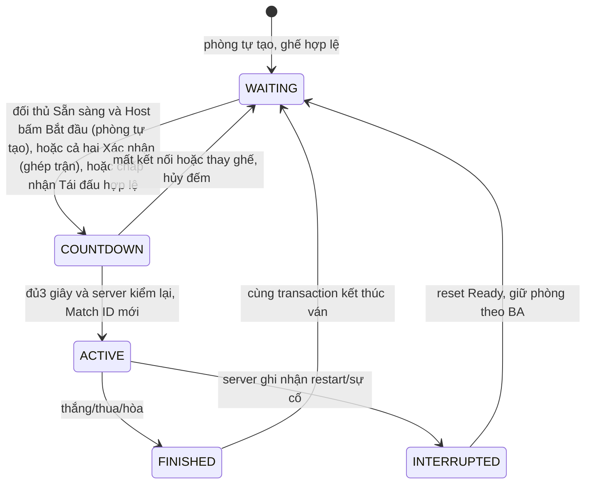

# P1 · YC5 — Ván online, đồng hồ, đề nghị và xử lý sự cố

> **BA 0.27 — PO chốt 31/10/2026:** toàn bộ nội dung từng thuộc P2 (Ranked/Elo/bảng xếp hạng, ghép ngẫu nhiên Casual, Xin đi lại/Tái đấu Casual, phần Ranked của lịch sử/thống kê) nay thuộc **P1**. Mọi câu "vẫn P2 / giữ P2 / làm sau / Sắp ra mắt" còn lại trong tài liệu này là lịch sử và bị thay bởi [BA mục 0.27](BA-SCOPE-DECISIONS.md#027-đưa-toàn-bộ-phần-còn-lại-của-p2-lên-p1--po-chốt-31102026); QR vẫn bị loại. Chưa tái ước lượng giờ/Jira; chưa phải bằng chứng triển khai.

**Triển khai 31/10/2026:** đã bổ sung Hủy ván, Xin đi lại online, phân xử deadline/mất mạng đồng thời và demo mạng. Bằng chứng và giới hạn nghiệm thu mới nằm ở mục 18; các bảng đối chiếu trước triển khai ở mục 13 không phải trạng thái runtime mới.

**Ngày lập/chốt bổ sung:** 31/10/2026. **Phạm vi:** EP-05, US-05.1–05.3 và giao điểm P1 theo BA 0.20–0.23, gồm demo mạng chỉ môi trường demo. Bốn quyết định PO tại mục 15 đã được ghi vào BA 0.23; Casual/Ranked P1 theo BA 0.27 và vòng đời ghép thuộc YC9. Phân biệt triển khai local với nghiệm thu Cloud/thiết bị/PO tại mục 18.

## 1. Mục tiêu, nguồn và cách đọc

Hai người chơi cùng một ván trực tuyến, mọi nước/đồng hồ/kết quả do server quyết định. Người chơi và người xem nhận trạng thái nhất quán; lệnh trùng, mất mạng, đổi tab và worker chạy muộn không tạo hai nước hoặc hai kết quả.

Nguồn ưu tiên:

1. [BA-SCOPE-DECISIONS.md](BA-SCOPE-DECISIONS.md), **Phần 0 thắng**, đặc biệt 0.3, 0.7–0.8, 0.12, 0.14, 0.17, 0.20–0.23; tiếp đến 1.8, 2.1, 2.3, 3.3, 3.5–3.6, 8.3.
2. [BACKLOG-P1.md](BACKLOG-P1.md), EP-05; AC-P2 nguồn của phần đã chuyển tại [BACKLOG-P2.md](BACKLOG-P2.md).
3. [YC2](P1-YC2-TAO-PHONG.md) cho bắt đầu/giữ phòng; [YC4](P1-YC4-BAN-CO-VA-LUAT.md) cho luật/nhánh nước và các lựa chọn PO đã chốt.
4. Hợp đồng kỹ thuật hiện hành: [realtime](../engineering/server/realtime.md), [match](../engineering/server/match.md), [clock](../engineering/server/clock.md), [architecture](../engineering/server/architecture.md). Nội dung kỹ thuật lịch sử không tự đổi luật BA.
5. [DESIGN](../design/DESIGN.md) §7–8 cho trạng thái, bàn cờ, thông báo, responsive và trợ năng.

**Số AC:** EP-05 chi tiết có **28 AC**, gồm13 ở US-05.1,9 ở US-05.2 và6 ở US-05.3; bảng tổng hợp Epic đang ghi22. Tài liệu dùng28 ID chi tiết, không tự sửa tổng baseline/giờ/Jira sinh báo cáo.

Phân biệt ba khái niệm: **đã được PO duyệt**, **đã có code**, **đã kiểm chứng đạt**. Các bảng code ở mục13 chỉ chứng minh sự tồn tại/hành vi đọc được, không phải PASS local/Cloud.

## 2. Phạm vi và quyền

### 2.1 Thuộc YC5 P1

- Bắt đầu ván được YC2 bàn giao: đủ hai người đúng ghế, Match ID mới, khai cuộc chuẩn, Đỏ đi trước.
- Nhận/kiểm/lưu nước, phát snapshot, kiểm phiên bản và chống áp dụng lệnh trùng.
- Đồng hồ5/10/15 phút không cộng giây; Không giới hạn/chống treo theo BA0.20–0.21.
- Kết thúc do luật YC4, hết giờ, đầu hàng/rời, hòa thỏa thuận, mất kết nối, không hoạt động hoặc gián đoạn hạ tầng.
- Xin hòa, Xin đi lại custom theo BA0.22; sau ván về phòng chờ, Tái đấu custom theo BA0.20.
- Khôi phục kết nối trong hạn, đồng bộ đúng bàn/lượt/đồng hồ/quyền; xử restart theo BA0.17, **không khôi phục ván ACTIVE giả**.

### 2.2 Quyền và giao điểm

| Chủ thể | Quyền / giới hạn |
|---|---|
| Thành viên hoặc Khách đang ngồi ghế | Đi khi đúng lượt/quyền tab; Đầu hàng/Rời có xác nhận; Xin hòa và gửi/trả lời/rút Xin đi lại custom theo luật |
| Khách ở phòng Không giới hạn do thành viên tạo | Chơi/xem theo chỗ trống, chịu cùng chống treo; không tự tạo mức Không giới hạn |
| Người xem | Nhận bàn/đồng hồ/kết quả; không đi, xin hòa/Undo/đầu hàng hoặc trả lời thay người chơi |
| Tab chỉ đọc hoặc chưa đồng bộ | Không phát lệnh điều khiển; reconnect không tự giành quyền |
| Server/worker | Kiểm quyền, deadline, luật; ghi và công bố kết quả đúng một lần |

Tái đấu chọn phe chỉ cho cặp thành viên đủ quyền, **không tự mở quyền Khách** vì Khách được Undo online. Ván có Khách vẫn chơi tiếp bằng Ready/Xin đổi bên theo YC2. History/Replay/export chỉ thành viên sở hữu ván theo BA0.22; người xem và Khách không được truy cập lịch sử riêng.

AI thuộc YC8: không đồng hồ người, không xin hòa, không chống treo online, grace30phút; không áp nhầm60giây/INACTIVITY của YC5.

## 3. Vòng đời phòng và ván

Sơ đồ ghép giai đoạn phòng/ván để mô tả luồng; `COUNTDOWN` không phải enum phòng riêng. **Match FINISHED/INTERRUPTED không đổi lại ACTIVE**; phòng đã về WAITING ngay khi kết thúc. Đóng hộp kết quả không thực hiện chuyển trạng thái server và không tạo ván mới.

Giữ ghế/Host/người xem/quyền truy cập/mức giờ và chat cùng cặp theo YC2/YC7; Ready reset. Không có hạn đóng10phút cho phòng tự tạo. Phòng hết người ngồi ghế đóng, người xem về Sảnh. Quy tắc FINISHED10phút chỉ của Casual/Ranked P2, không áp vào custom.

## 4. Hợp đồng lệnh, snapshot và dữ liệu bền

### 4.1 Lệnh từ client

Envelope hiện hành gồm `commandId`, `roomId`, `expectedVersion`, action. Lệnh ván mang `matchId`, `matchVersion`; nước đi dùng from/to nguyên0..89 theo tọa độ gốc, không đảo tọa độ khi cầm Đen.

Server kiểm: phiên thật → quyền phòng/tab/ghế → biên lai/fingerprint → phiên bản phòng/ván → ván hiện tại → nguyên nhân kết thúc đã đến hạn → đúng lượt và luật tương ứng. Chi tiết thứ tự nội bộ theo contract; không bỏ kiểm quyền chỉ vì có receipt hoặc worker biết Match ID.

Client không được truyền thời gian còn lại, winner, role hoặc thế cờ mới để server tin. Mất quyền/phiên phải chặn cả API/socket/receipt replay, không chỉ ẩn nút.

### 4.2 Chống trùng và phiên bản

| Trường hợp | Kết quả bắt buộc |
|---|---|
| Mất ack, chưa biết lệnh thành công hay không | Thử lại **cùng envelope/commandId**; không tự tạo ID mới để áp cùng nước |
| Cùng commandId, cùng fingerprint, còn quyền | Replay kết quả đã lưu, không trừ giờ/áp nước/tạo kết quả lần hai |
| Cùng commandId nhưng đổi payload/expectedVersion | Từ chối `COMMAND_ID_REUSED`, không ghi đè receipt |
| Ý định dựa trên phiên bản cũ | Trả lỗi và snapshot chính thức; không tự sửa đích hoặc lén áp vào thế mới |
| Ack cũ tới sau snapshot mới | Không ghi đè version/generation mới bằng dữ liệu thấp hơn |
| Đổi Match ID do Tái đấu | Lệnh ván cũ không tác động ván mới |

Receipt bền24giờ theo hợp đồng realtime. Đó không phải bảo đảm cho phép replay vô hạn; luật/phiên bản/ván hiện tại vẫn ngăn thao tác cũ phá ván sau khi receipt hết hạn.

### 4.3 Ghi bền và phát realtime

- Ghi trạng thái, event, nhánh nước hiệu lực, kết quả, biên lai và outbox trong cùng transaction Postgres qua `withRoom`; khóa actor rồi phòng theo thứ tự đã sắp xếp.
- Nước hợp lệ tạo một MOVE hiệu lực. Nước kết thúc có thể tạo MOVE rồi RESULT, không buộc matchVersion chỉ tăng1 cho mọi lệnh.
- Không phát snapshot/media side effect như đã thành công trước commit. Commit xong nhưng publish lỗi không được làm mất nước hoặc rollback bằng trạng thái client.
- Kết quả chỉ một lần, bất biến; lỗi tạm rollback dữ liệu chưa commit, không trả thành công giả.
- Có trường hợp lệnh bị từ chối vì hết giờ nhưng server vừa ghi kết quả terminal: caller vẫn phải **commit kết quả và receipt**, không throw làm mất kết quả.
- Giữ nhánh đã bỏ để truy vết nếu mô hình hiện hành cần; lặp/Replay/export chỉ theo nhánh hiệu lực. Không sửa migration đã áp dụng; thay đổi schema mới có rollback chống mất dữ liệu.

## 5. Đồng hồ có giờ — US-05.1

| Mức phòng | Mỗi bên lúc bắt đầu | Tăng giờ sau nước |
|---|---|---|
|5phút|300.000ms|Không|
|10phút|600.000ms|Không|
|15phút|900.000ms|Không|
|Không giới hạn|Không đồng hồ đếm lùi|Chống treo theo mục6|

Chỉ bên tới lượt tiêu hao thời gian. Server lấy thời gian tin cậy, tính sau khi có khóa cần thiết; timestamp do client hoặc thời điểm người dùng click không quyết định nước còn hạn. Nước tới sau khi hết giờ bị từ chối, kể cả chiếu hết.

- Không hoàn/cộng giờ khi gửi sai luật, lệnh cũ/trùng, reconnect, mở tab hoặc Undo.
- Hết giờ tự xử `TIMEOUT` bằng worker, không đợi đối thủ đi/refresh.
- Client nội suy để hiển thị; tại0 chỉ báo “Đang chờ máy chủ xác nhận hết giờ”, không tự kết luận thắng/thua.
- Quay lại tab ẩn/reconnect phải đồng bộ theo server; AC yêu cầu sai số≤1giây. Không dùng `Date.now()` máy người chơi làm nguồn phân xử.
- Mất mạng, mở đề nghị hòa/Undo hoặc modal xác nhận không dừng đồng hồ. Không thêm pause/tạm dừng hoặc cộng giây ngoài phạm vi BA.
- Tái đấu có Match ID mới, giờ đầy theo mức phòng; không dùng số dư ván cũ.

**Biên:** kiểm deadline−1ms/đúng deadline/+1ms; worker muộn vẫn dựa deadline thật, không theo thứ tự tick. BA 0.23 chốt TIMEOUT thắng DISCONNECT khi deadline bằng nhau; quan hệ với INACTIVITY theo mục 10.3/15.

## 6. Không giới hạn và chống treo — phần P1 đã duyệt

Nguồn: US-P2-10/XIAN-124, AC-P2-10.1–3, BA0.20–0.22; không phải đề xuất chuyển mới.

1. Bắt đầu lượt/nước mới mở cửa sổ3phút cho **bên tới lượt**.
2. Đủ180giây chưa đi → banner không modal đếm30giây; không che bàn, đồng hồ/nhãn mức giờ hoặc Đầu hàng; không trap focus.
3. Trong hạn, đi nước hợp lệ thì tiếp tục, reset chuỗi xác nhận; “Tôi còn đây” mở lại3phút nhưng tối đa2lần liên tiếp chưa có nước mới.
4. Lần nhắc tiếp theo khi hết quota không còn nút xác nhận; vẫn có thể đi nước hợp lệ trước hạn. Im lặng đến210giây từ mốc gần nhất → `INACTIVITY`, bên tới lượt thua.
5. Chỉ đúng người tới lượt, còn quyền tab, ván hiện tại và đúng thời điểm được xác nhận. Người xem/đối thủ/tab cũ không kéo dài thay; double-click/retry cùng lệnh không tăng số lần hai lần.
6. Không giới hạn gửi `clocks=null`, có promptAt/expiresAt/confirmsLeft; không dùng redMs=blackMs=0 ở DB để vẽ “hết giờ”.
7. Undo custom thành công: **3phút mới cho bên được trả lượt**, giữ số lần xác nhận đã dùng trong chuỗi chưa có nước mới; không phục hồi quota Undo (PO chốt tại BA0.22). Không lấy deadline cũ của đối thủ áp lên người xin.
8. Mất kết nối không miễn chống treo. Theo BA 0.23, deadline INACTIVITY đến trước grace thì xử INACTIVITY; grace đến trước thì DISCONNECT, bằng nhau ưu tiên DISCONNECT. Nếu nhóm DISCONNECT có hai mốc mất mạng bằng nhau tuyệt đối thì áp hòa đồng thời, không chọn UUID. Kết quả không phụ thuộc thứ tự worker.

Lỗi camera/mic không tính là mất kết nối ván, không dừng bộ đếm hoặc xử thua. “Tôi còn đây” không là nước đi và không giảm cooldown đề nghị tính theo nước mình.

## 7. Đầu hàng, rời phòng và đăng xuất — US-05.2

| Thao tác | Trước xác nhận | Sau xác nhận hợp lệ |
|---|---|---|
|Đầu hàng|Modal nói rõ sẽ thua, focus mặc định ở Hủy|`RESIGN`, đối thủ thắng; không phụ thuộc đang tới lượt ai|
|Rời khi ván đang chạy|Cảnh báo rời=đầu hàng, có Ở lại|Kết thúc `RESIGN` rồi rời; chuyển Host theo YC2 nếu cần|
|Hủy/Esc ở xác nhận|Đóng xác nhận, giữ nguyên ván|Không gửi resign/rời như thể đồng ý|
|Hủy ván (chưa có nước nào)|Xác nhận, focus mặc định ở Giữ ván|`ABORTED`, không cần đối thủ đồng ý; chỉ custom và ghép ngẫu nhiên (mục 17.2)|
|Đóng tab/mất mạng|Không thể tin sự kiện unload là xác nhận|Áp ân hạn mất kết nối; không tự RESIGN|
|Rời sau ván|Không biến thành đầu hàng ván đã kết thúc|Giữ nguyên kết quả cũ, thực hiện quyền rời phòng|

Đăng xuất chủ động trong ván phải đi theo cảnh báo/quy tắc phiên YC1, không cho logout trở thành đường lách bỏ ghế mà không xử lý ván. Không coi thu hồi phiên kỹ thuật hoặc tab bị tiếp quản là hành động tự nguyện đã xác nhận đầu hàng.

Server luôn kiểm kết quả/deadline trước hiệu lực resign: nếu ván đã kết thúc/hết giờ hợp lệ, không thay bằng RESIGN đến muộn. Nút xác nhận không thể gửi lặp; response cũ không đóng nhầm modal của Match ID mới. Toast không che Đầu hàng.

## 8. Xin hòa và đề nghị trong ván

### 8.1 Xin hòa baseline P1

- Cả hai người chơi, gồm Khách, được xin hòa trong custom ACTIVE khi đủ quyền; **không áp ngưỡng20nước/bên của Ranked P2**.
- Mỗi người chỉ một đề nghị đang chờ theo BA3.6; hạn30giây từ server, không kéo lại hạn bằng collapse/reconnect.
- Đối thủ Đồng ý trước hạn → `DRAW_AGREEMENT`; chỉ người nhận trả lời, người gửi được Rút.
- Từ chối hoặc hết hạn → người gửi chờ **5nước tiếp theo của chính mình**, không phải5ply hoặc5nước của đối thủ. Hiển thị còn bao nhiêu, không dùng cooldown10giây của lời mời phòng.
- X/Esc chỉ thu gọn, có Mở lại; không từ chối/đồng ý thay người dùng. Bàn và đồng hồ tiếp tục; đề nghị không trap focus.
- Người nhận đi một nước cờ khi đề nghị còn chờ thì đề nghị tự kết thúc như Từ chối (PO 31/10, mục 17). Xin hòa không có ngưỡng nước tối thiểu.
- Hết ván đóng mọi đề nghị, accept muộn không đổi kết quả. Hai người có đề nghị riêng không được khiến hai transaction tạo hai RESULT.

### 8.2 Xin đi lại custom đã lên P1 — BA0.22

US-P2-08/XIAN-122, AC-P2-08.1–3: thành viên/Khách được gửi/trả lời, không người xem. Đã đi ít nhất một nước mình; đối thủ đồng ý trong30giây mới lùi về trước nước gần nhất của người xin:1ply nếu đối thủ chưa đi,2plies nếu đã đi. Người xin không đi tiếp khi pending; đối thủ vẫn theo luật lượt.

Quota tối đa3lần thành công/bên/ván, từ chối/hết hạn không trừ; chờ3nước mình trước xin lại. Đồng hồ có giờ không hoàn; Không giới hạn xử theo mục6. Các metadata quota không được quay lui như quân cờ để có Undo vô hạn. Rút/thu gọn/đề nghị khác theo BA3.6; không sao chép ngữ nghĩa X/Esc của popup mời phòng YC3.

Nhánh bị Undo không tính lặp/chiếu liên tục/120nửa nước, Replay hoặc PGN. Giữ một Match ID và tăng phiên bản để reject nước/worker/response cũ; Undo không phải Tái đấu, không tạo khai cuộc mới.

## 9. Mất kết nối, nhiều tab và trở lại — US-05.3

### 9.1 Phân biệt mất tab và mất người chơi

Server nhận biết hết kết nối phòng hợp lệ của người chơi mới bắt đầu disconnectedAt/grace. Một tab/socket cũ đóng nhưng còn kết nối hợp lệ khác không được xử người đó như mất toàn bộ kết nối. Presence bạn bè và quyền giữ ghế là hai miền khác nhau; nhãn Offline không tự giải phóng vị trí.

- Người chơi ACTIVE: giữ cơ hội nối lại60giây, đồng hồ/bộ đếm ván vẫn chạy.
- WAITING/FINISHED: giữ ghế60giây, hết hạn mất ghế chứ không tạo kết quả thua.
- Người xem: giữ chỗ5phút, không có xử thua.
- Người đang giữ ghế mất mạng không nhận lời mời để chiếm ghế khác.

Mốc60giây là server ghi nhận, không hứa tính từ lúc người dùng rút dây mạng. Kết nối lại đúng trước/ở/sau hạn phải kiểm dưới khóa; client hiện0 không tự thắng. Quy tắc equality của deadline cần kiểm nhất quán API/worker/reconnect.

### 9.2 Bề mặt người chơi

Người tự mất mạng thấy lớp “Đang kết nối lại…” không đóng bằng Esc; nếu chưa nhận deadline server thì ghi rõ **ước tính**, không giả là còn chắc chắn60giây. Socket nối lại chưa đủ: cần snapshot mới và quyền hiện tại mới mở thao tác.

Đối thủ thấy panel không modal, thời gian chờ từ deadline server; không dừng bàn. Người xem mất mạng thấy trạng thái xem, không bị đe dọa thua60giây. Reconnect phục hồi cùng Match ID/nhánh/lượt/đồng hồ/đề nghị/role nếu còn hợp lệ; không reset giờ, quota hoặc deadline gốc.

Tab cũ reconnect chỉ có quyền cũ; takeover phải theo luồng chủ động hiện có. Không lấy socket mới để lách readonly hoặc tự bật media; lỗi media không khiến reconnect ván thất bại.

### 9.3 Xử hết hạn

- Một người quá hạn: `DISCONNECT`, đối thủ thắng, trừ khi một nguyên nhân kết thúc hợp lệ trước đó đã quyết định ván.
- Cả hai quá hạn và server vẫn hoạt động: timestamp khác nhau thì bên mất kết nối trước thua, **không tự INTERRUPTED**.
- Hai disconnectedAt bằng nhau tuyệt đối theo timestamp server lưu: **hòa do mất kết nối đồng thời**, reason đặc tả `DRAW_SIMULTANEOUS_DISCONNECT`, winner=null (BA 0.23). Không làm tròn về cùng giây/tick; không dùng UUID. Chỉ xét nếu cả hai vẫn mất kết nối, đã quá grace và không có nguyên nhân ưu tiên trước.
- Không cho reconnect đến muộn hồi sinh ván hoặc thu hồi kết quả đã lưu.

## 10. Hạ tầng, restart và ưu tiên kết quả

### 10.1 Restart không giống hai client mất mạng

Server ghi nhận restart/sự cố của chính nó → ván online `INTERRUPTED`, winner=null, không phải hòa và không W/D/L/Elo. Code lưu cause `SERVER_RESTART`, UI hiển thị “Ván bị gián đoạn”. Phòng custom về WAITING, reset Ready, không tự vào lại ACTIVE và không hẹn đóng10phút.

Dữ liệu nước/kết quả online vẫn bền phục vụ lịch sử; “không tiếp tục ACTIVE qua restart” không có nghĩa xóa ván. Chỉ một instance game hoạt động trên DB theo kiến trúc hiện hành; không tuyên bố HA hoặc rolling deploy không gián đoạn. Khi DB không ghi được, không phát kết quả giả để che lỗi.

### 10.2 Bảng nguyên nhân và kết quả

| Nguyên nhân | Hiển thị / kết quả | Điều phải giữ |
|---|---|---|
|CHECKMATE / STALEMATE|Bên không còn nước thua|STALEMATE không hòa|
|PERPETUAL_CHECK|Bên chiếu liên tục thua; cả hai cùng chiếu liên tục hòa|Đọc cả winner, không đoán chỉ theo reason|
|DRAW_REPETITION / DRAW_NO_CAPTURE|Hòa theo luật YC4|Chỉ nhánh hiệu lực|
|DRAW_AGREEMENT|Hòa do đồng ý hợp lệ|Đúng người nhận/hạn, không đảo kết quả cũ|
|RESIGN|Đối thủ thắng|Có xác nhận chủ động, sau kiểm deadline|
|TIMEOUT|Bên hết giờ thua|Chỉ ván có giờ; client không quyết|
|DISCONNECT|Bên quá grace thua|Mốc server, bên rớt trước nếu cả hai|
|DRAW_SIMULTANEOUS_DISCONNECT|Hòa do cả hai mất kết nối đồng thời|BA 0.23; timestamp bằng nhau tuyệt đối, cả hai quá grace; không INTERRUPTED; reason mới cần triển khai|
|INACTIVITY|Bên tới lượt không phản hồi thua|Chỉ online Không giới hạn|
|INTERRUPTED / cause SERVER_RESTART|Trung tính|Không W/D/L/hòa; không giả khôi phục|
|ABORTED (Hủy ván, PO 31/10)|Trung tính, “Ván bị hủy”|Chỉ khi chưa có nước; không W/D/L/Elo; vào Lịch sử, không Replay; không áp Ranked/AI|

### 10.3 Ưu tiên kết quả đã được PO chốt — BA 0.23

- Kết quả terminal đã commit giữ nguyên; mọi action/worker sau chỉ thấy kết quả đó.
- Hết giờ trước khi nước tới thì không nhận nước, kể cả chiếu hết. Sau nước hợp lệ, ưu tiên luật theo BA0.17/YC4.
- TIMEOUT trước grace → TIMEOUT; grace trước TIMEOUT → DISCONNECT. Tick muộn không đảo mốc nguyên nhân thật.
- Camera/mic lỗi hoặc hai client cùng rớt không chứng minh sự cố server.
- Mọi đường worker/action chọn **deadline hợp lệ đến trước**. Nếu bằng nhau tuyệt đối: **TIMEOUT → DISCONNECT → INACTIVITY**. Hòa đồng thời thuộc nhóm DISCONNECT trong so sánh này; không trộn hai loại TIMEOUT/INACTIVITY trong cùng mức giờ. Không dùng thứ tự commit tình cờ để bỏ qua nguyên nhân đã đến hạn trước.
- Ví dụ: INACTIVITY lúc 03:30, grace lúc 03:40, worker chạy 04:00 → giữ INACTIVITY. Nếu hai deadline cùng 03:30 → nhóm DISCONNECT thắng; kiểm hai người rớt cùng mốc để chọn hòa hoặc một bên thua theo luật.
- Hòa đồng thời là hòa thật: lưu kết quả/lý do/thời điểm, UI hai người/người xem, History/Replay và PGN `1/2-1/2`. Không tái sử dụng `BOTH_OFFLINE`/`SERVER_RESTART` trung tính hoặc PGN `*` để né bổ sung reason.

## 11. Giao diện gọn, đồng bộ và trợ năng

- Trong ván luôn ưu tiên bàn, phe/lượt, hai đồng hồ hoặc nhãn Không giới hạn, Đầu hàng và hành động chính. Không hiện đồng hồ0:00 giả ở ván Không giới hạn.
- Desktop1366×768: trọn bàn và hành động chính, panel phụ cuộn nội bộ. Tránh thêm một thẻ trạng thái riêng cho mỗi banner làm bàn tụt khỏi viewport.
- Mobile360px: không cuộn ngang; lượt/đồng hồ dễ thấy, chat/media tách vùng/tab; nút không quá nhỏ. Không cấm cuộn dọc bằng cách cắt nội dung khi zoom/bàn phím ảo.
- Xin hòa/Undo và nhắc chống treo không modal; chỉ xác nhận thao tác gây thua, kết quả người chơi và reconnect cần lớp phù hợp. Tránh chồng nhiều dialog; kết quả mới phải thay lớp reconnect/deadline cũ.
- Người xem nhận panel kết quả, không modal có nút người chơi. Người chơi thấy Thắng/Thua/Hòa hoặc Gián đoạn và lý do Việt; không lộ enum/stack ra UI.
- Sau ván custom có Ở lại/Rời; Tái đấu Giữ/Đổi phe cho thành viên đủ quyền. History/Replay theo quyền BA0.22 nhưng không tự thêm nút mới vào hộp kết quả khi chưa chốt thiết kế tương ứng.
- ERROR giữ trạng thái server, có hướng xử lý; DISABLED có lý do (sai lượt, readonly, cooldown, quota, mất kết nối); LOADING không vẽ thắng/thua tạm. EMPTY là không có ván/phòng chờ, không phải bàn ACTIVE giả.
- Countdown không đọc mỗi tick bằng aria-live; thông báo chuyển trạng thái rõ ràng, focus trả về hợp lý, reduced motion và contrast theo theme P1. Toast/camera không che Đầu hàng hoặc bàn.

## 12. Truy vết28 AC và các ca bắt buộc

Bảng là danh sách ca bắt buộc. Bằng chứng mới ở mục 18 phân biệt kiểm thử DB/Socket.IO, giao diện và các gate thiết bị còn mở.

| AC | Chứng minh | Ca chính |
|---|---|---|
|AC-05.1.1|Nước hợp lệ đồng bộ B/người xem|Hai người+người xem thật, đo end-to-end|
|AC-05.1.2|Sai luật/sai lượt bị từ chối|API/socket sửa payload, trạng thái không hỏng|
|AC-05.1.3|Lệnh trùng chỉ áp1lần|Mất ack, retry/concurrentduplicate, kiểm DB/receipt|
|AC-05.1.4|Mỗi nước lưu bền|Đối chiếu MOVE/nhánh/position sau reconnect|
|AC-05.1.5|Đồng hồ đúng mức, đúng bên chạy|5/10/15; thêm biến thể Không giới hạn theo AC-P2-10|
|AC-05.1.6|Tự TIMEOUT|Không ai gửi nước, worker vẫn kết thúc|
|AC-05.1.7|Giờ trước nước|Deadline−1/0/+1ms, nước chiếu hết tới muộn|
|AC-05.1.8|Đồng hồ khớp server≤1giây|Tab ẩn/reconnect/skew/mạng chậm|
|AC-05.1.9|Tự kết thúc theo luật|Thế đáp án YC4, không chờ client tuyên bố|
|AC-05.1.10|Người chơi thấy đủ lý do|Gồm INACTIVITY, DRAW_SIMULTANEOUS_DISCONNECT; PERPETUAL_CHECK winner=null và INTERRUPTED trung tính|
|AC-05.1.11|Người xem thấy kết quả đúng quyền|Không nút Đầu hàng/Ready/đồng ý thay|
|AC-05.1.12|Kết quả/lý do/thời điểm bền|Rollback/raceworker/action, chỉ1RESULT|
|AC-05.1.13|Người xem bàn Đỏ dưới, chỉ đọc|UI và lệnh giả mạo bị từ chối|
|AC-05.2.1|Đầu hàng có xác nhận|Hủy/đồng ý, focus Hủy, doubleclick|
|AC-05.2.2|Rời ACTIVE=đầu hàng có xác nhận|Ở lại không đổi; chấp nhận mới rời|
|AC-05.2.3|Host rời RESIGN, chuyển Host|Đối thủ/người xem/WAITING nhất quán|
|AC-05.2.4|Toast không che Đầu hàng|Desktop/mobile, nhiều thông báo|
|AC-05.2.5|Xin hòa nonmodal30s, X/Esc thu gọn|Vẫn đi/đồng hồ chạy, có Mở lại|
|AC-05.2.6|Đồng ý đúng quyền kết thúc hòa|Người gửi/ngoài ván không accept thay|
|AC-05.2.7|Từ chối/hết hạn chờ5nước mình|Đối thủ đi không giảm quota; retry không đếm thêm|
|AC-05.2.8|Rút đề nghị đóng phía nhận|Rút/accept race, không2kết quả|
|AC-05.2.9|Hết ván đóng offer|Accept muộn không đổi result/Match ID mới|
|AC-05.3.1|Tự mất mạng/đối thủ thấy grace60s|Mốc server vs countdownước tính, đồng hồ chạy|
|AC-05.3.2|Trong hạn đồng bộ tiếp tục|Board/lượt/clock/chat/quyền/offer, không reset|
|AC-05.3.3|Quá60s DISCONNECT|Member–member/member–guest/guest–guest, không cần nước mới|
|AC-05.3.4|Hết giờ trước grace TIMEOUT|Cả hai worker chạy chậm và thứ tự đảo|
|AC-05.3.5|Cả hai rớt: khác mốc bên rớt trước thua, trùng mốc hòa|Khác mốc dù cùng tick vẫn không hòa; bằng nhau tuyệt đối cả hai quá grace mới hòa; không UUID/INTERRUPTED|
|AC-05.3.6|Restart INTERRUPTED, WAITING/resetReady|Process thật, DB bền, không tiếp tục ACTIVE giả|

**AC bổ sung không nhân bản:** AC-P2-08.1–3 (Undo custom/Khách), AC-P2-09.1–3 (Tái đấu custom/chỉ thành viên), AC-P2-10.1–3 (Không giới hạn/chống treo), **AC-P2-23.1–3 (demo mạng P1 theo BA 0.23)** và giao điểm History/Replay theo BA 0.22. Đổi phân kỳ không tự nghĩa toàn Story gồm Casual/Ranked đã Done.

**Độ trễ:** nguồn sản phẩm NFR-01/AC-05.1.1 hiện là **p95<100ms trong môi trường demo**, GATE-REALTIME50client/10ván. Không đổi sang200ms hoặc lấy thời gian ack đơn thuần thay thời gian đối thủ/người xem thực sự cập nhật. Báo topology, local/remoteDB, sốmẫu, lỗi, p95, CPU/RAM. Một lần đo nhỏ hoặc thông số tick100ms không chứng minh đạtSLO.

## 13. Đối chiếu trước triển khai và rủi ro (lưu dấu)

Đây là đối chiếu trước khi sửa YC5. Các thiếu sót đã xử lý và bằng chứng runtime mới ở mục 18; không dùng bảng lịch sử này để phủ nhận mã mới hoặc kế thừa PASS cũ.

| Hạng mục | Bằng chứng repo | Kết luận và việc cần làm khi triển khai |
|---|---|---|
|Nước/luật/kết quả|`apps/server/src/game/match/match-store.ts`, `match-store-core.ts`|Có kiểm context/lượt/deadline, playMove/ending và ghi kết quả; cần hồi quy end-to-end|
|Realtime|`packages/shared/src/realtime.ts`, tài liệu realtime|Có version/command/readonly; không thấy action Undo trong union RoomAction đã đọc, không coi Xin đi lại custom đã triển khai chỉ vì BA duyệt|
|Worker/recovery|`game.runtime.ts`|Có clock/disconnect/draw/roomworkers, tick100ms sau batch xong; recovery ghi SERVER_RESTART. Không là cam kết deadline được phát trong100ms|
|Fixed clocks|`match/MatchClocks.tsx`|Nội suy performance.now, visibilitychange, chờ server ở0; cần đo sai số qua mạng thật|
|Không giới hạn server|`match/inactivity.ts`, `match-store.ts`|Có180s+30s/2lần, reset khi nước mới; stillHere thay mốc/số lần nhưng không tăng matchVersion tại hàm đã đọc, cần kiểm đồng bộ snapshot/receipt và retry|
|Banner chống treo|`match/InactivityBanner.tsx`|**Nghi vấn logic thời gian:** mỗi render tính skew=serverNow−now rồi lại trừskew khỏi deadline. Với serverNow không đổi, so sánh/left rút gọn thành chênh deadline−serverNow, không tiến theo now. Cần tái hiện không có snapshot mới qua180s/30s; không chỉ mount khi đã ở trong cửa sổ|
|Disconnect Khách|`match/disconnect-worker.ts:166–167`; `tests/server/game/match/disconnect-worker.test.ts`|Worker throw nếu một bên không phải member; test “fails closed for unsupported Guest principals” giữ ACTIVE. **Lệch quyền online Khách cần xử lý**, không nghiệm thu AC-05.3.3 bằng chỉ member–member; chưa chạy để kết luận toàn runtime có/không đường khác bù|
|Double-offline trùng mốc|`earliestDisconnect` trong disconnect-worker.ts|Code/test hiện dùng UUID nhỏ hơn thua. **Không còn phù hợp BA 0.23**: phải đổi sang hòa riêng khi timestamp bằng nhau tuyệt đối, kiểm cả DB/contract/UI/export và không cập nhật lại test theo UUID|
|INACTIVITY vs DISCONNECT|`clock/clock-worker.ts`, `match-store-core.ts`|ClockWorker chỉ so disconnect deadline khi không unlimited; expiredDisconnect bỏ so inactivity cho unlimited. **Rủi ro cạnh tranh nguyên nhân**, cần sửa/kiểm theo BA 0.23: deadline trước quyết định, bằng nhau TIMEOUT → DISCONNECT → INACTIVITY|
|Xin hòa/đầu hàng|`match/MatchActions.tsx`, `match-store-draw.ts`|Có khung/confirm, cooldown/quyền; thêm Undo cần kiểm chung một pending/người, không dựng luồng biệt lập bỏ constraint|
|Reconnect/result|`match/ReconnectStatus.tsx`, `match/MatchResult.tsx`|Có ownestimate, đợi snapshot, readonly, lý do Việt/trung tính; cần xem thật khi overlay gặp terminal và ván Không giới hạn|
|Test có sẵn|`tests/server/game/match/{disconnect-worker,match.late,match-draw,draw-worker,inactivity}.test.ts`, `tests/web/features/rooms/match/{MatchClocks,ReconnectStatus}.test.ts`|Có bộ kiểm biên/race; chưa chạy lại và chưa thay kiểm manual/mạng/Khách|
|SLO|`docs/engineering/server/realtime.md` mục đo Chrome|Báo cáo lịch sử ghi mẫu6nước median1.926ms, min1.676ms, max2.119ms (dấu chấm phân nhóm nghìn), tức khoảng1,7–2,1giây; **không đạt mục tiêu sản phẩm100ms**. Không là số đo bản hiện tại, không dùng làm PASS hoặc tự hạ ngưỡng|

Các điểm trên là đầu vào cho nhiệm vụ code/kiểm thử tiếp theo; lượt đặc tả không tự sửa implementation, test cũ hoặc bật runtime mới. Những ca test pin UUID/khóa Khách cần đổi theo quyết định BA, không “giữ xanh” bằng né kịch bản.

## 14. P2 liên quan YC5: đã lên P1 và còn có thể cân nhắc

> **Lưu ý (rà chéo 31/10/2026):** mục này là đối chiếu lịch sử trước BA 0.27–0.36. Ghép ngẫu nhiên Casual, Ranked và các phần Casual/Ranked đã **P1** (xem [YC9](P1-YC9-GHEP-TRAN-CASUAL-RANKED.md)); mọi câu "giữ P2", "queue 3 phút", "xác nhận 10 giây" hay "vào ván ngay" bên dưới đã bị thay.

### 14.1 Đã lên P1 — không hỏi chuyển lần nữa

| Story / Jira | Giao điểm YC5 và ranh giới |
|---|---|
|US-P2-08 / XIAN-122|Xin đi lại **custom**, cả thành viên/Khách; Casual P1 theo BA 0.27|
|US-P2-09 / XIAN-123|Tái đấu **custom** chọn phe trong 30 giây → đếm 3 giây; chỉ cặp thành viên, Casual P1 theo BA 0.27|
|US-P2-10 / XIAN-124|Không giới hạn/chống treo; Khách chơi được nhưng không tạo mức 0; không áp AI|
|US-P2-11/13/15 / XIAN-125/127/129|Lưu/đọc kết quả online custom và Replay/export đúng nhánh; Ranked P1 theo BA 0.27|
|US-P2-24 / XIAN-138|Tiếp quản media giữa tab, readonly; không biến thành reset grace/đồng hồ|

Undo AI/lưu AI và theme cũng đã lên P1 nhưng thuộc YC8/YC1; chỉ kiểm giao điểm, không mở rộng luật online hoặc quyền Khách do suy diễn.

### 14.2 P2 còn lại liên quan trực tiếp

| Chức năng | Mã | Liên quan / phụ thuộc | Khả năng và đề xuất |
|---|---|---|---|
|**Demo mạng**|US-P2-23 / **XIAN-137**, AC-P2-23.1–3|Ngắt/nối để biểu diễn grace 60 giây/snapshot thật; đúng chủ thể; production chặn UI/API/socket|**PO đã đưa lên P1 theo BA 0.23**, chỉ môi trường demo; không thêm Admin hoặc giả kết quả, không thay kiểm thiết bị thật|
|**Ghép ngẫu nhiên Casual**|US-P2-07 / **XIAN-121**, AC-P2-07.1–3|Tìm 2 phút, xác nhận 30 giây (BA 0.36), 15 phút/bên, đếm 3 giây; phòng kín, FINISHED 10 phút|**P1 theo BA 0.27**, gồm phần Casual của Undo/Tái đấu; không chỉ thêm nút Tìm trận|
|**Undo/Tái đấu Casual**|Phần còn US-P2-08/09 / **XIAN-122/123**|Luật cơ bản đã thuộc custom P1, nhưng vòng đời phòng ghép khác custom; không nhận người mới hoặc reset WAITING|**Giữ cùng gói Casual**, không có lợi ích độc lập khi chưa ghép Casual. Tái sử dụng phần chung, không đánh dấu toàn Story Done từ custom|
|**Vòng đời Ranked**|US-P2-04 / **XIAN-118**|10 phút/bên, cấm Khách/Undo/Tái đấu/người xem; hòa sau 20 nước/bên, kết quả Elo, FINISHED 10 phút|**P1 theo BA 0.27**; không đem ngưỡng 20 nước/cấm Undo áp vào custom|

### 14.3 Liên quan gián tiếp và gói không nên tách sai

| Chức năng / mã | Quan hệ | Đề xuất |
|---|---|---|
|Elo US-P2-01/XIAN-115; queue Ranked US-P2-02/XIAN-116; giới hạn cặp US-P2-03/XIAN-117|Tính điểm đúng một lần theo kết quả YC5, chống bơm/ghép đồng thời|P1 cùng Ranked (BA 0.27); không tự tính Elo cho custom/AI|
|Leaderboard US-P2-06/XIAN-120|Đọc thống kê Ranked, không có nghĩa mọi ván custom phải xếp hạng|P1 (BA 0.27); không giả số liệu|
|Ranked media US-P2-05/XIAN-119|Quyền nhận/phát, không người xem, chỉ Kênh Riêng|P1 theo Ranked (BA 0.27), thuộc YC7; không cần để giải quyết mạng/đồng hồ|
|Widget AI US-P2-22/XIAN-136; sticker US-P2-17/XIAN-131|Cạnh bàn/chat nhưng không phân xử ván online|Widget AI đã P1 theo BA0.26, mọi môi trường/chỉ thành viên, chỉ nước máy đã áp; sticker P1 theo BA0.24 cho cả Khách đúng vai trò|

**Phạm vi sau khi PO chốt:** demo mạng lên P1; Casual và phần Undo/Tái đấu Casual P1 theo BA 0.27, Ranked/Elo P1 theo BA 0.27. Ưu tiên hoàn thiện quyền Khách, timer, ưu tiên deadline, reason hòa mới và gate P1; công cụ demo không thay kiểm mạng/thiết bị thật.

## 15. Các quyết định PO đã chốt — BA 0.23

| Câu hỏi | Trả lời PO | Hệ quả bắt buộc |
|---|---|---|
|Q1 — Demo mạng XIAN-137?|**Đưa lên P1, chỉ môi trường demo**|Ngắt/nối thật, quyền đúng chủ thể, không Admin; production ẩn và từ chối lệnh trực tiếp. Giữ AC-P2-23.1–3/Task/Jira nguồn|
|Q2 — Mất mạng trùng timestamp tuyệt đối?|**Hòa, lý do mất mạng đồng thời**|Thêm reason `DRAW_SIMULTANEOUS_DISCONNECT` cho cả DB/contract/UI/history/replay/export; winner=null, không INTERRUPTED; không dùng UUID hoặc làm tròn giây|
|Q3 — Ưu tiên các hạn kết thúc?|**Hạn đến trước; bằng nhau ưu tiên mất mạng**|Chọn deadline trước; bằng nhau TIMEOUT → DISCONNECT → INACTIVITY. Hòa trùng mốc thuộc nhóm DISCONNECT; mọi đường action/worker thống nhất|
|Q4 — Gói ghép Casual?|**Giữ cả gói ở P2**|Không triển khai queue hoặc Undo/Tái đấu Casual trong P1. Không ảnh hưởng custom đã duyệt; Ranked/Elo P1 theo BA 0.27|

Không còn câu hỏi chờ cho bốn lựa chọn này. Quota Undo/quyền Khách/3 phút sau Undo giữ BA 0.22; chính sách restart/SLO không đổi. Đây là **đặc tả đã duyệt**, chưa phải bằng chứng code/Cloud đã đáp ứng.

## 16. Bàn giao và trình tự sau khi duyệt

1. Áp dụng BA 0.23/AC nguồn và đặc tả giao điểm đã đồng bộ; giữ Story/Jira ID, không tự Done/đổi giờ.
2. Khi có nhiệm vụ triển khai: tái hiện timer/Khách/worker race, sửa ở đường dùng chung và để lại hồi quy hành vi; không xóa validation hoặc test biên thật.
3. Hoàn thiện Undo custom/nhánh/đồng hồ và ràng buộc đề nghị khác loại theo BA 0.22; không xem code AI Undo là online Undo.
4. Nghiệm thu worker tự chạy, DB/biên lai/outbox và hai người chơi + người xem thật; đo đồng hồ/reconnect/độ trễ/tải. Demo mạng P1 phải kiểm cả cờ bật và production tắt với direct API/socket.
5. Báo cáo PASS/FAIL/BLOCKED theo từng AC, môi trường, commit; cập nhật bằng chứng mới. Chỉ commit/push/deploy theo yêu cầu riêng.

### 16.1 Các biến thể cần kiểm riêng theo quyết định mới

- **AC-P2-23.1–3:** ngắt kết nối thực sự, không chỉ vẽ overlay; không tự reconnect trước thời điểm người thử muốn; chọn Nối lại nhận snapshot thật. Đúng chủ thể, không điều khiển đối thủ tùy ý; cờ tắt chặn cả UI/API/socket. Nếu còn tab/socket hợp lệ khác thì không được giả rằng người chơi đã mất toàn bộ kết nối; công cụ phải thể hiện đúng giới hạn kịch bản.
- **AC-05.3.5:** hai mốc khác nhau dù cùng giây/tick; mốc bằng nhau tuyệt đối và cả hai quá grace; một người đã reconnect trước hạn; ván có giờ/Không giới hạn, thành viên/Khách, worker/action cạnh tranh. Hòa mới chỉ ghi một RESULT, room về WAITING, người xem thấy cùng kết quả.
- **AC-05.3.4 + AC-P2-10.2–3:** TIMEOUT/grace và INACTIVITY/grace tại deadline trước/bằng/sau; cả hai bên có thể có nguyên nhân thua khác nhau. Trì hoãn worker rồi đảo thứ tự xử lý vẫn cùng winner/reason. Hòa đồng thời không được lấn nguyên nhân đến trước.
- **AC-05.1.10–12 và giao điểm AC-P2-11/13/15:** reason hòa mới đọc được từ DB/snapshot, hai người/người xem/History/Replay thống nhất; PGN là `1/2-1/2`, không `*`; người ngoài/Khách vẫn không có quyền đọc lịch sử riêng. Dữ liệu kết quả cũ giữ nguyên, không tự viết lại quá khứ từ UUID thành hòa.

**Lượt đặc tả ban đầu:** chỉ soạn tài liệu/đối chiếu nguồn, không sửa runtime. Trạng thái và kiểm chứng của lượt triển khai tiếp nối ở mục 18.

## 17. Quyết định PO khi rà soát YC5 — 31/10/2026

Đã triển khai các quyết định dưới đây trong mã local; kiểm chứng và giới hạn tại mục 18.

| # | Quyết định | AC bổ sung |
|---|---|---|
| 1 | **Đi nước = tự Từ chối.** Khi có đề nghị Xin hòa hoặc Xin đi lại đang chờ, người nhận đi một nước cờ thì đề nghị kết thúc như **Từ chối**: Xin hòa — người gửi chờ 5 nước của chính mình; Xin đi lại — không trừ quota, người gửi chờ 3 nước của chính mình. Người gửi nhận thông báo *"Đối thủ đã đi nước, đề nghị bị từ chối."* | AC-YC5-RV-01, 02 |
| 2 | **Hủy ván khi chưa có nước đi nào.** Mỗi người chơi tự hủy được, không cần đối thủ đồng ý, có hộp xác nhận. Chỉ hợp lệ cho đến khi **Đỏ đi nước đầu tiên**; sau đó chỉ còn Đầu hàng. Áp dụng phòng tự tạo và Đánh Thường ghép ngẫu nhiên; **không áp cho Ranked và ván với máy** (giữ Đầu hàng) | AC-YC5-RV-03, 04, 05 |
| 3 | **Ván bị hủy được ghi vào Lịch sử** là "Ván bị hủy": winner=null, không thắng/thua/hòa, không Elo, không đếm ván Ranked, không có Replay/FEN/PGN (chưa có nước). Cả hai thành viên thấy dòng này; Khách không có Lịch sử | AC-YC5-RV-06 |
| 4 | **Báo tới lượt chỉ bằng âm thanh:** khi đối thủ đi một nước thì phát âm đi quân sẵn có (YC4 mục 8.2), kể cả khi tab đang ẩn nếu trình duyệt cho phép phát. Không đổi tiêu đề tab, không dùng thông báo trình duyệt | AC-YC5-RV-07 |
| 5 | **Xin hòa bất cứ lúc nào**, kể cả trước nước đầu; không có ngưỡng nước tối thiểu (khác Ranked: 20 nước/bên) | AC-YC5-RV-08 |

### 17.2 Hủy ván — quy tắc chi tiết

- Nút **Hủy ván** hiện cạnh **Đầu hàng** chỉ khi ván `ACTIVE`, chưa có nước nào và người bấm là người chơi có quyền điều khiển; sau nước đầu nút biến mất. Người xem không có.
- Máy chủ kiểm lại số nước = 0 dưới khóa. Đỏ đi nước đầu và đối thủ bấm Hủy gần như đồng thời: chỉ một lệnh thắng theo thứ tự máy chủ; lệnh còn lại nhận lỗi rõ ràng, không tạo hai kết quả.
- Đồng hồ bên Đỏ chạy từ lúc bắt đầu; hết giờ trước khi Hủy hợp lệ thì `TIMEOUT` thắng theo mục 10.3 (kiểm deadline trước, như mọi lệnh).
- Sau Hủy: ván kết thúc với reason `ABORTED` (trung tính). **Phòng tự tạo** về `WAITING` ngay, giữ ghế/Host/người xem, Sẵn sàng của đối thủ reset (YC2 mục 21.1). **Ghép ngẫu nhiên** giữ vòng đời `FINISHED` (không về `WAITING`, đóng khi cả hai rời hoặc sau 10 phút), có Ở lại/Rời; Tái đấu theo YC9 — PO xác nhận 31/10.
- Hộp kết quả trung tính "Ván bị hủy" cho cả hai người và người xem, không hiện thắng/thua; đóng hộp không đổi trạng thái server.
- Hủy ván không bù giờ, không tính vào quota Xin đi lại/Xin hòa, không đếm vào giới hạn cặp Ranked.
- Hộp xác nhận dùng khung như xác nhận Đầu hàng, focus mặc định ở nút Giữ ván (chưa thêm mã thành phần giao diện mới; thiết kế cuối cùng khi dựng).

### 17.3 Tiêu chí bổ sung

| Mã | Given / When | Then bắt buộc |
|---|---|---|
| AC-YC5-RV-01 | Có Xin hòa đang chờ; người nhận đi một nước | Đề nghị kết thúc như Từ chối, người gửi nhận thông báo và chờ 5 nước của mình; nước vẫn được áp; lệnh Đồng ý đến sau bị từ chối |
| AC-YC5-RV-02 | Có Xin đi lại đang chờ; người nhận đi một nước | Kết thúc như Từ chối: không lùi nước, không trừ quota, người gửi chờ 3 nước của mình; người gửi không đi được trong lúc chờ nhưng được đi lại khi đề nghị kết thúc |
| AC-YC5-RV-03 | Ván custom vừa bắt đầu, chưa có nước; một người bấm Hủy ván và xác nhận | Ván `ABORTED`, không thắng/thua/hòa; phòng về `WAITING`, Sẵn sàng đối thủ reset; ghi Lịch sử; không cần đối thủ đồng ý |
| AC-YC5-RV-04 | Đã có nước đầu của Đỏ; hoặc ván Ranked; hoặc ván AI; hoặc người xem/tab chỉ đọc; gọi Hủy ván qua UI hoặc API | Không có nút hoặc `DISABLED`; gọi trực tiếp bị từ chối; không đổi ván |
| AC-YC5-RV-05 | Đỏ đi nước đầu và đối thủ bấm Hủy ván đồng thời; hoặc hai người cùng hủy | Đúng một kết quả hợp lệ (nước đi hoặc `ABORTED`), không hai kết quả; lệnh thua nhận lỗi rõ; retry cùng `commandId` không tạo bản sao |
| AC-YC5-RV-06 | Ván bị hủy xong; thành viên mở Lịch sử | Có dòng "Ván bị hủy", không tính W/D/L, không Elo, không có nút Xem lại/FEN/PGN; Khách không có Lịch sử |
| AC-YC5-RV-07 | Tab của người chơi đang ẩn; đối thủ đi một nước | Phát âm đi quân khi trình duyệt cho phép; không đổi tiêu đề tab, không thông báo trình duyệt; tắt tiếng thì không phát; reconnect không phát lại lịch sử |
| AC-YC5-RV-08 | Ván custom vừa bắt đầu, chưa có nước; một người Xin hòa | Gửi được, hạn 30 giây, đối thủ trả lời như Xin hòa thường; không có ngưỡng nước tối thiểu |

**PO xác nhận 31/10/2026:** (a) người gửi Xin hòa tự đi một nước khi đề nghị còn chờ thì đề nghị tự rút, không phạt chờ 5 nước; (b) Hủy ván ở ghép ngẫu nhiên giữ vòng đời `FINISHED`; (c) reason mới là `ABORTED`.

### 17.4 Tác động triển khai

- Loại kết quả mới `ABORTED` (trung tính) ở luật kết thúc/hợp đồng chung: `packages/shared` (kết quả), `RoomStore`/`MatchStore` (lệnh và kết thúc), lịch sử/`HistoryStore`, `MatchResult` (hộp kết quả), migration nếu cột reason có ràng buộc; thêm vào danh sách lý do kết thúc ở BA 3.5.
- Lệnh `abortMatch` qua `withRoom` có `commandId`, kiểm số nước = 0 dưới khóa.
- Nước đi của người nhận phải đóng đề nghị Xin hòa/Xin đi lại đang chờ trong cùng transaction.
- Âm thanh nước đối thủ khi tab ẩn: chỉ phụ thuộc chính sách phát tự động của trình duyệt (cần kiểm Chrome, Safari, Firefox).
- Bằng chứng mới ở mục 18 thay cho đối chiếu lịch sử ở mục 13.

## 18. Triển khai và kiểm chứng local — 31/10/2026

### 18.1 Thay đổi

- `MatchUndoStore`, migration `20261103000006_online_undo` và rollback: gửi/rút/trả lời/hết hạn Xin đi lại 30 giây; 1 hoặc 2 ply trên nhánh hiệu lực; tối đa 3 lần thành công, chờ 3 MOVE của người xin sau Từ chối/hết hạn. Cùng một pending/người xuyên Xin hòa/Xin đi lại, người gửi Undo không đi khi chờ. Không hoàn đồng hồ; Không giới hạn mở 3 phút mới và giữ quota xác nhận.
- Người nhận đi nước đóng đề nghị trong cùng transaction; người gửi được thông báo “Đối thủ đã đi nước, đề nghị bị từ chối.” Người gửi Xin hòa tự đi là Rút, không báo nhầm đối thủ từ chối.
- `stillHere` tăng version ván/phòng, ghi event và outbox. Banner dùng mốc monotonic để đếm tiếp khi không có snapshot mới.
- `adjudicateDeadline` dùng chung cho action, clock/disconnect worker và reconnect: hạn sớm nhất thắng; bằng nhau TIMEOUT → DISCONNECT → INACTIVITY. Timestamp disconnect so bằng microsecond, không UUID/làm tròn; Khách và thành viên được phân xử cùng luật. `endedAt` giữ nghĩa thời điểm máy chủ xử lý, không thay bằng deadline quá khứ.
- Migration `20261103000007_match_simultaneous_disconnect` và rollback: reason hòa thật, winner=null, History/Replay/PGN `1/2-1/2`, guard History cập nhật theo constraint thật. Không viết lại kết quả lịch sử.
- Hủy ván `ABORTED` từ commit tiếp nối `bbcb04a`: trung tính, có Lịch sử, không Replay/export. Snapshot `canAbort` kiểm MOVE bền; Undo về 0 ply không mở lại Hủy ván.
- `NETWORK_DEMO=true` ngoài production: ngắt chính socket thật, chỉ Nối lại theo thao tác rõ; xác thực lại trước lệnh, production chặn direct socket. Capability cập nhật khi trạng thái/quyền đổi; còn tab hợp lệ khác thì không giả người chơi mất toàn bộ kết nối.
- Panel đề nghị nonmodal ở cạnh phải desktop, không che bàn/Đầu hàng; mobile theo luồng dọc. Nút demo dùng khung/tooltip sẵn có trong header, không thêm thẻ làm bàn tụt khỏi viewport.

### 18.2 Bằng chứng đã quan sát

Môi trường: Node 22.22.3, PostgreSQL 17 test cô lập trên `127.0.0.1` qua `tests/server/db.sh`; không dùng URL Supabase cho fixture xóa schema. Web Vite và backend Nest/Socket.IO chạy trên cùng Mac arm64. Khách được cấp/xác thực bởi dịch vụ thật; provider của 50 thành viên tải là synthetic, phiên DB/khóa/quyền/phòng/ván vẫn thật.

- Smoke runtime: Khách tạo phòng, Host Bắt đầu sau đối thủ Sẵn sàng, worker đếm tới ACTIVE, đi nước, Undo offer/accept về đúng nhánh; demo ngắt socket thật, DB ghi grace và đối thủ nhận snapshot mất mạng; nối lại cùng Match ID/thế/quyền; ván mới Hủy thành `ABORTED`.
- Restart bằng tiến trình khác thật: sau khi dừng tiến trình đang giữ hai ván ACTIVE bền trong DB, tiến trình mới khởi động chuyển cả hai thành `INTERRUPTED/SERVER_RESTART`, phòng WAITING, Ready reset, mỗi ván đúng một RESULT; không giả tiếp tục ACTIVE.
- Chromium: component `RoomPage` thật nối runtime qua harness tạm, không giả API ván. Đã thấy/gửi Xin đi lại nonmodal 30 giây; ngắt bằng demo, Nối lại ngay trong modal và đợi quyền chính thức; Hủy ván focus mặc định “Giữ ván”, kết quả “Ván bị hủy”. Harness bỏ qua shell xác thực không nằm trong phạm vi YC5; media/chat không bật nên có thông báo chưa khả dụng.
- 1366×768: sau điều chỉnh kích thước, bàn nằm từ y=269,19 đến 644,58; hành động từ y=669,58 đến 713,58. Panel đề nghị x=1022, rộng 320 nên không đè bàn. 360×800: `scrollWidth=360`, không tràn ngang; cho phép cuộn dọc.
- Một mẫu đồng hồ trình duyệt so với DB sau nối lại: hiển thị 219 giây, chiếu server 219 giây, sai khác 0 giây. Mẫu đơn này không thay gate sai số qua mọi điều kiện tab ẩn/mạng chậm.
- Tải `tests/load/realtime.ts`: 50 kết nối/10 ván, 20 vòng/200 nước; 800 mẫu giao tới đối thủ/người xem (200/600), 0 lỗi. p95 toàn bộ **56,85 ms**, đối thủ **56,85 ms**, người xem **56,44 ms**; p99 toàn bộ **66,57 ms**. Đây là thời điểm client nhận snapshot, không lấy ack thay delivery. DB local, tổng lượt đo 5,331 giây, riêng workload nước đi 1,263 giây. Mẫu tiến trình sau lượt tải: CPU 0,3%, RSS 180.480 KiB; không phải CPU/RAM đỉnh trong tải. Không suy rộng số liệu local sang Supabase từ xa, LAN hoặc DOM hai thiết bị.
- Kết quả cuối: **server 180 file/1.930 test đạt**, **web/packages 115 file/1.296 test đạt**; không skip ở hai lượt đầy đủ. Các scenario đề nghị được tách thành `match-draw`, `match-undo`, `match-proposals-security` và helper, giữ nguyên số ca. Typecheck toàn workspace, build và ESLint các file TS/TSX sửa đạt. Build vẫn cảnh báo chunk LiveKit >500 kB.
  Log test vẫn có `realtime_disconnect_failed`, `realtime_maintenance_failed`, `registration_maintenance_failed` và một `MaxListenersExceededWarning` trên pg Client. Đã truy vết một ca disconnect lúc teardown: runtime chủ động từ chối bằng “Máy chủ phòng đang dừng”; gỡ log chẩn đoán tạm, không che cảnh báo hoặc nâng listener limit. Chưa điều tra riêng cảnh báo listener.

### 18.3 Rollout và giới hạn nghiệm thu

Đã push `develop`; CI xanh ở commit `25a8818`. Ngày 31/10/2026 đã áp lên Supabase Cloud `20261103000005`, `...000006`, `...000007` theo thứ tự (qua `psql` DIRECT_URL, có ghi `supabase_migrations.schema_migrations`); lúc áp không có ván ACTIVE, constraint khớp baseline, đã kiểm lại bảng `match_undo_offers` (RLS + trigger), constraint kết quả/sự kiện. Triển khai server trước web: web mới từ chối snapshot Undo nếu server chưa có trường `undo.moved`. Guard History từ chối schema cũ. Rollback không phải cách xóa kết quả mới để quay lui.

Không tự đánh dấu Jira Done hoặc PO nghiệm thu. Safari/Firefox, loa/cảm ứng thật, hai thiết bị/mạng thật, Google/SMTP/LiveKit và gate DOM/p95 từ xa chưa được kiểm trong lượt này. Vòng đời Casual/Ranked và giới hạn mode mới phải nghiệm thu cùng YC9; mã YC5 không dựng queue giả hoặc tự mở mode chưa được YC9 triển khai.

### 18.4 Truy vết nghiệm thu

“Đạt tự động” dưới đây chỉ là các kịch bản đã chạy bằng mã/DB/socket thật hoặc component test; không gộp các gate môi trường thành PASS.

| AC | Bằng chứng local | Gate còn mở |
|---|---|---|
| AC-05.1.1 | 50 client/10 ván/200 nước, đối thủ và người xem nhận cùng snapshot; p95 56,85 ms | DOM end-to-end và hai thiết bị/mạng thật |
| AC-05.1.2, 05.1.3, 05.1.4 | `game-integration`, `match-store-concurrency`: từ chối sai lượt/luật, receipt/retry, MOVE bền | Nghiệm thu PO |
| AC-05.1.5, 05.1.6, 05.1.7 | `clock-sql`: 300/600/900 giây, tự TIMEOUT, deadline −1/0/+1 ms; `inactivity`/runtime Không giới hạn | Thiết bị thật |
| AC-05.1.8 | Test nội suy/tab visibility/reconnect, một mẫu Chromium/DB sai 0 giây | Ma trận tab ẩn/skew/mạng chậm ≤1 giây |
| AC-05.1.9 | Core + MatchStore tái hiện luật kết thúc trên nhánh hiệu lực | Không mở luật đuổi quân ngoài YC4 |
| AC-05.1.10, 05.1.11, 05.1.12, 05.1.13 | MatchResult/History/PGN reason mới, spectator chỉ đọc, RESULT/rollback/concurrency | Quan sát đồng thời nhiều thiết bị |
| AC-05.2.1, 05.2.2, 05.2.3, 05.2.4 | Confirm/Esc/focus, leave atomic, Host chuyển, bàn/hành động không bị panel che | Cảm ứng và trợ năng thiết bị thật |
| AC-05.2.5, 05.2.6, 05.2.7, 05.2.8, 05.2.9 | `match-draw`, `match-proposals-security`, MatchActions: nonmodal/thu gọn, quyền/30 giây/cooldown5/Rút/terminal đóng offer | Nghiệm thu PO |
| AC-05.3.1, 05.3.2 | Smoke socket thật/Chromium: ngắt, DB grace, snapshot đối thủ, manual reconnect đúng ván/quyền | Rút mạng vật lý, nhiều thiết bị |
| AC-05.3.3, 05.3.4, 05.3.5 | `disconnect-worker`, clock, late reconnect: member/guest/mixed; timestamp bằng/khác 1 microsecond; đảo worker và ưu tiên deadline | Nghiệm thu mạng vật lý |
| AC-05.3.6 | Hai ván bền được process mới recovery về INTERRUPTED/WAITING, một RESULT | Deploy hạ tầng thật |
| AC-P2-08.1–3 | `match-undo`: 1/2 ply, quota3, cooldown3, pending sender, quyền, expiry/late, nhánh/clock | Casual cùng YC9 |
| AC-P2-09.1–3 | Bộ `room-rematch` hiện có chạy trong server suite, giữ quyền thành viên và Match ID mới | Casual cùng YC9 |
| AC-P2-10.1–3 | `inactivity`, `game.runtime.draw`, banner: 180+30 giây, quota2, version/receipt, ưu tiên grace | Chờ thực tế trên mạng/thiết bị |
| AC-P2-23.1–3 | Socket thật + gateway grant; tắt cờ/production direct-call bị từ chối; UI ngắt/nối có chủ đích | Demo không thay kiểm mạng vật lý |
| AC-YC5-RV-01, RV-02 | MOVE đóng offer trong transaction, thông báo đúng bên, tự rút không báo nhầm; cooldown5/3 và Undo không trừ quota | Nghiệm thu PO |
| AC-YC5-RV-03, RV-04, RV-05, RV-06 | Abort SQL/race/receipt/role, History trung tính không Replay; Chromium confirm và kết quả; Undo về0 không mở Abort | Mode ghép/Ranked theo YC9 |
| AC-YC5-RV-07 | Web Audio test: tab hidden vẫn phát khi context chạy, mute/reconnect không phát lại, title giữ nguyên | Chrome/Safari/Firefox theo chính sách autoplay và loa thật |
| AC-YC5-RV-08 | Xin hòa trước nước đầu đạt bằng DB và UI component | Ngưỡng Ranked thuộc YC9 |
